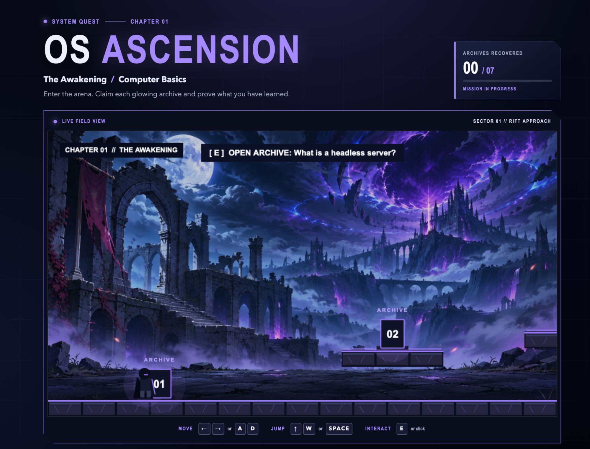
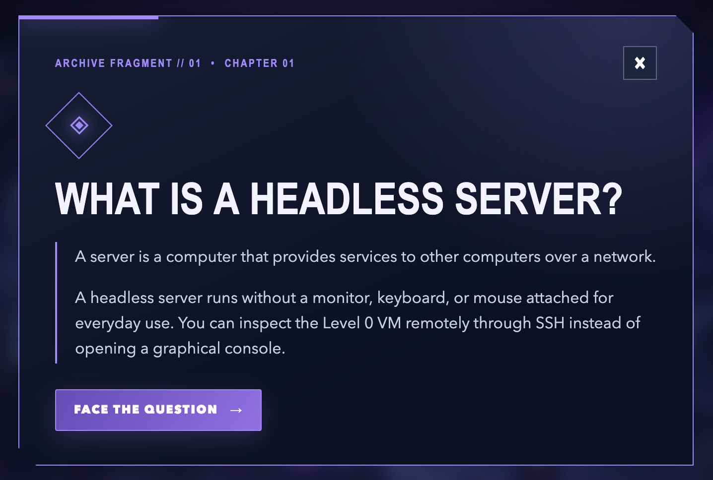
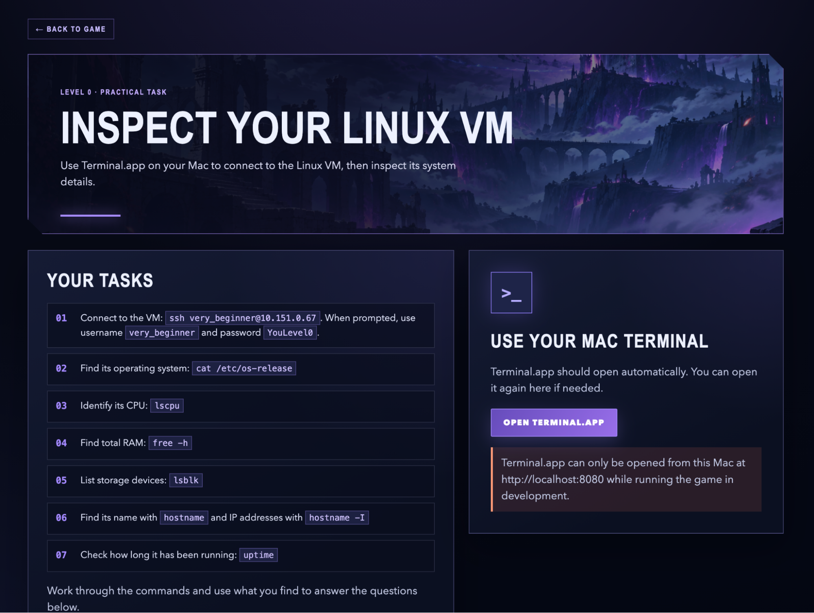
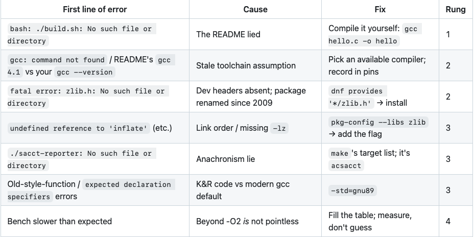

# Hypothesis
The aim of this hackathon was to explore user experience engineering and how it can be used to make learning new tools and technologies more accessible.

A key challenge when introducing users to an unfamiliar concept is catering for different levels of existing knowledge and technical ability. How can we guide someone from having no prior experience to becoming a confident, capable user without overwhelming or discouraging them along the way?

The central idea was to create a learning experience that builds confidence through small, achievable steps, encouraging users to continue exploring a concept rather than becoming frustrated and giving up.

# Approach
To address this challenge, we decided to explore the concept of a self-guided learning ladder.

The ladder was designed around six rungs, numbered 0 to 5. Rung 0 represents a user with no prior knowledge of the concept, while rung 5 represents someone who can confidently use it at an advanced level.

Each rung should introduce new skills that build upon the previous ones, allowing users to gradually develop their understanding and abilities. Importantly, every rung should provide a tangible sense of achievement. Users should be able to complete an activity, see that it has worked and feel encouraged to progress to the next stage.

We were provided with seven qualities that a successful learning ladder should demonstrate, but were given the freedom to interpret and implement these in our own ways:

1. Rung 0 assumes the user is completely new to the concept.

2. there shoud be a win at every single rung with the user having done something that clearly worked.

3. Ensure users don't get stuck by providing self-serve material, a user should be able to rescue themselves without seeking out another person.

4. It should be clear which rung of the ladder you're on and that you've mmoved up the ladder.

5. At the final rung the skills that are needed should build on all the previous levels and should be an actual advanced technique.

6. After someone has gone through the ladder the next user should be able to start from a fresh state.

7. The ladder should be hands on with whatever technologies are being learnt.

The intended completion time for each learning experience was approximately 60–90 minutes. This meant that each team had to balance the depth of the material against the need to keep the experience engaging, achievable and accessible within a relatively short timeframe.

## Team 1's Ladder

Team 1 focused on introducing users to SLURM, a workload manager used to schedule and manage jobs across computing clusters.

The learning ladder took a command-line approach, guiding users through increasingly advanced SLURM functionality. Lessons were delivered directly within the CLI, with the system accepting commands as answers whenever a particular response was expected.

This approach meant that users were learning by interacting with the actual technology rather than working through a separate tutorial.

### Level 1

The first level introduced the fundamental operations required to work with SLURM:

- Submitting jobs to the scheduler.
- Understanding and using basic job flags.
- Cancelling submitted jobs.

The objective was to give users enough knowledge to submit and manage a basic job independently.

### Level 2

Once users understood how to submit jobs, the second level explored how to inspect and understand the cluster environment.

Topics included:

- How to view what is running.
- How to view node information.
- How to find out specific information about running jobs, nodes and partitions.
- How to find out when a job will run based on running times.
- Modules.

This level helped users move beyond simply submitting jobs and develop an understanding of what was happening behind the scenes.

### Level 3

The third level introduced more control over job configuration and execution.

Topics included:

- Sbatch directives: output files and time limits.
- The different types of jobs that can be run.

This allowed users to move towards configuring jobs to suit more specific workloads and requirements.

### Level 4

The fourth level introduced users to more advanced cluster management functionality.

Topics included:

- Exploring accounting (saact).
- General admin controls.

This level aimed to broaden users' understanding of how SLURM operates beyond the perspective of an individual submitting jobs.

### Level 5

The final level explored more advanced features and techniques, building upon the knowledge gained throughout the previous levels.

Topics included:

- Exploring reservations.
- Exploring jobs communicating with each other.
- Showing how to utilise alces-job.

The intention was to expose users to more sophisticated SLURM functionality and demonstrate how the scheduler could be used to support more complex workloads.

Overall, Team 1's approach focused on keeping the learning experience close to the technology itself. By delivering the ladder entirely through the CLI, users could immediately apply what they were learning in a practical environment.

## Team 2's Ladder

Team 2 focused on teaching users how to provision and work with virtual machines.

Rather than using a traditional command-line tutorial, the team opted for a more gamified approach. They combined a quiz-based learning experience with a 2D platformer, creating a more visually engaging way for users to progress through the learning ladder.

The experience involved users navigating a platforming environment and collecting cards containing relevant learning material. These cards introduced the concepts and information needed to complete the practical challenges that followed.

The practical activities required users to apply what they had learnt, with challenges ranging from inspecting the hardware configuration of an existing virtual machine to provisioning a virtual machine from scratch.

Shown below is a selection of screenshots from team 2's ladder.

The original plan was to implement all five levels of the learning ladder. However, due to the limited development time available during the hackathon, only three levels were completed.

Despite this, the team successfully demonstrated an alternative approach to technical learning. By combining gamification with practical exercises, they aimed to make the learning process feel more like progression through a game than working through a conventional tutorial.

The use of collected learning cards also provided a way to introduce information at relevant points, rather than overwhelming users with everything they needed to know at the beginning.

One particularly interesting aspect of this project was the use of the [Phaser framework](https://github.com/phaserjs/phaser) to develop the 2D platformer. This introduced the team to a new technology and demonstrated how game development frameworks could be applied to create more engaging educational experiences.

## Team 3's Ladder

Team 3 took a different approach, focusing on the problems users encounter when following poorly written README files and development instructions.

The objective was to replicate the experience of trying to build, compile and run a project when the accompanying documentation is inaccurate or misleading.

To achieve this, the team deliberately introduced incorrect information into the README. Users were then required to work through the instructions, identify the problems and figure out how to get the program running successfully.

Hints were incorporated into the Markdown documentation to help users identify and overcome the issues without immediately revealing the solutions.

Unlike the other two teams, this learning ladder was not interactive in the traditional sense. Instead, it relied on users independently investigating the problems and applying their existing knowledge to find a solution.

This approach explored a different aspect of user experience engineering: the importance of good documentation and the impact that poor instructions can have on a user's ability to engage with a technology.

By deliberately introducing these frustrations, the team demonstrated how easily an otherwise straightforward development task can become an obstacle when documentation is unclear or incorrect.

# What was learnt

The hackathon provided an opportunity to explore different approaches to user experience engineering, particularly when designing learning experiences for users with varying levels of technical knowledge.

One of the main takeaways was that making a technology accessible involves much more than simply providing a README or a set of instructions. Documentation is important, but it does not always provide enough guidance for someone encountering a concept for the first time.

Team 3 demonstrated how poor documentation can actively hinder a user's progress, while Team 1 explored how embedding guidance directly into the command-line environment can make learning more practical and contextual.

Team 2 took this a step further by exploring how gamification can make technical learning more engaging. The use of Phaser to create a 2D platformer also provided an opportunity to experiment with a new framework and apply it in a context beyond traditional game development.

Across all three projects, several important lessons emerged:

- **Learning should be progressive**. Introducing too much information too early can overwhelm users. Breaking concepts into smaller, achievable steps helps build confidence and encourages continued engagement.

- **Practical experience matters**. Users should have opportunities to apply what they have learnt and see tangible results. Completing a working task is far more rewarding than simply reading about how something works.

- **Guidance should be accessible when needed**. Users should be able to identify what they need to do next and find help when they encounter difficulties, without relying on another person to guide them.

- **Engagement is part of the experience**. Gamification, interactive tutorials and contextual guidance can all provide alternative ways to make technical concepts more approachable.

- **Good documentation is essential, but not always sufficient**. A README may explain how to use a system, but a guided learning experience can provide the additional context and structure needed to help users understand it.