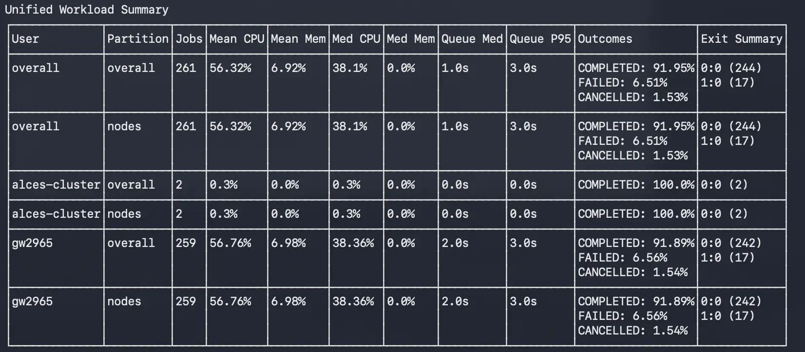
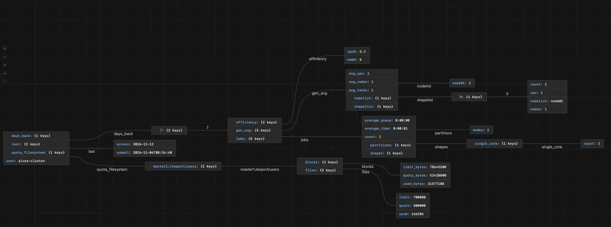
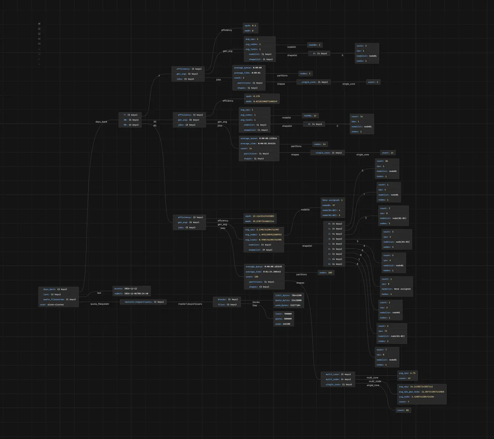
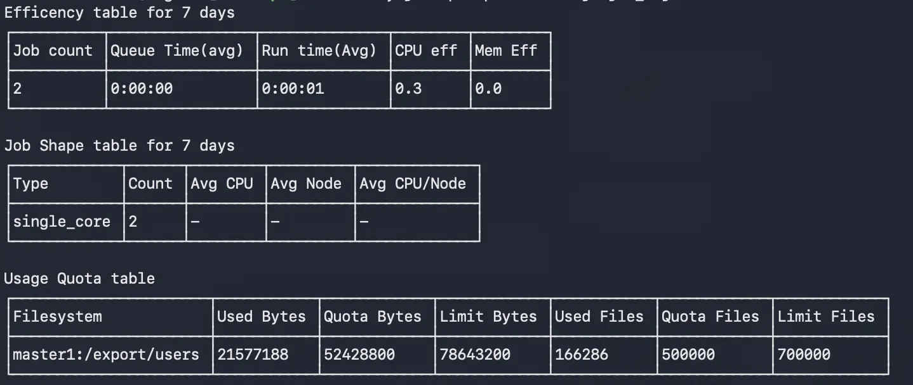
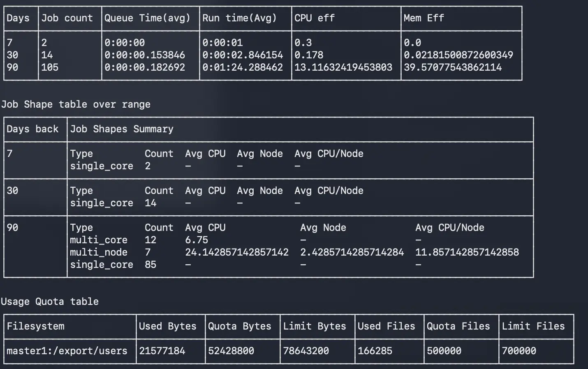

# Hypothesis

The aims of both these projects was to improve the accessiblitly and readability of existing SACCT breakdowns via two methods of access:

- **CLI Tool:** A program on the cluster itself able to print out the general metrics of a cluster in operation.
- **API:** A program to interface with an active cluster using API calls to provide a JSON dump of key metrics on how the cluster is being used by the end operator.

The main reason is because SACCT itself is a tool able to give job by job breakdowns of completed and submitted jobs, however it lacks the in built tools to make general observations of cluster operations work as expected.

Thus the central challenge was defining the structure of how the general use data would be displayed to the end user to make SLURM accounting easier for the end user to understand and so see if there is any specific problem that causes the failure of specific nodes or partitions.

# Approach

The approach taken was to consolidate command line sacct reporting metrics into either a easily processable CSV/tty table format, or a JSON dump format showing the general metrics of jobs and resource usage across the entire cluster regardless of given partition.

Each section is specifically designed for a different user in mind.

For the CLI tool, it is designed for a system operator who wants to understand the current job completion statuses and if a certain partition or user data is more vunerable to a failure state, so that they can use traditional SACCT tools targeted at the known failure states to debug the program.

For the API tool it is designed for flight centre to monitor general system usage via a long distance API call using https processes. It is designed to see where the customer is using the systems to allow monitoring of how well used the cluster is and to adjust support as needed to customer usage.

Both combined can give a clear pitcure of the health of a cluster and how its jobs process.

## CLI Tool

### Key features

- A pretty print table breakdown of every user and partition
- A overall reading feature so as to compare it to the baseline
- Filtering abilities to see what each section is(time, user, job state)
- Information on both used cluster resources and job outcomes
- Ability to export this table into a CSV format

### Usage demonstration

A report of how the CLI tool is used on an actual customer cluster showing the user data of how jobs colate on the CLI over time, showing the mean usage statistics and the final job statuses:

This allows the operator of the cluster to now look into why some of the jobs have failed, knowing that some jobs have failed from a specifific user on a specific cluster.

## API tool

### Key features

- Ability to generate a JSON dump of cluster use metrics
- Ability to see both quota usage of the system and the CPU usage system
- Visualisation of the efficencies of single core, multi core and multi node jobs
- Ability to filer out on time and user specific equiries
- Ability to view changes over time using a json chart

#### CLI assistance features

- Translation of key JSON data into a pretty print table
- Ability to use single CLI tool to call an API from a different machine

### Usage demonstration

By using curl commands on the position, you are able to generate a JSON dump as shown by the screenshot of JSON crack below for both a 7 day fixed time period, and a time pread period.

The usual seven day period:

A timespan on the user:

For those on a management system like rndhub(across clusters), using the CLI tool to call the API into clean dumps as below.

7 Day singlar period:

Timespan CLI output:

# What was learnt

- How to visulaise and colate single point datas into a summary
- How to deploy an API on a cluster
- How to make the user experiance worthwhile and make management easier.

# GitHub Repositories

- [Alces-Sacct-V2](https://github.com/AdamJ2009/Alces-Sacct-V2) – CLI local program for sacct accounting.
- [SACCT_API](https://github.com/AdamJ2009/SACCT_API) – Backend API service for SACCT data with CLI tarball for API.
