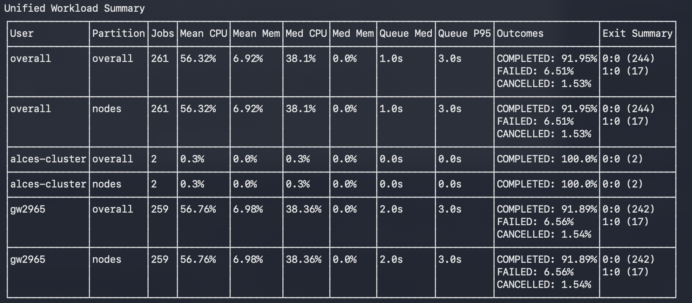
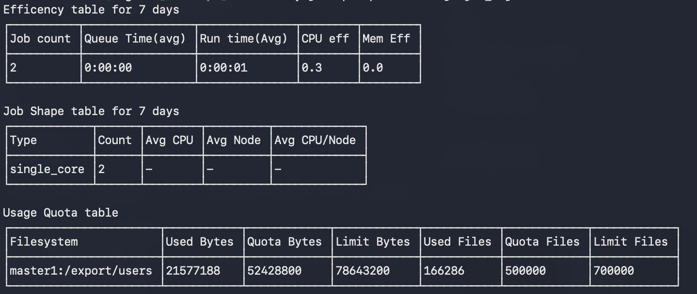
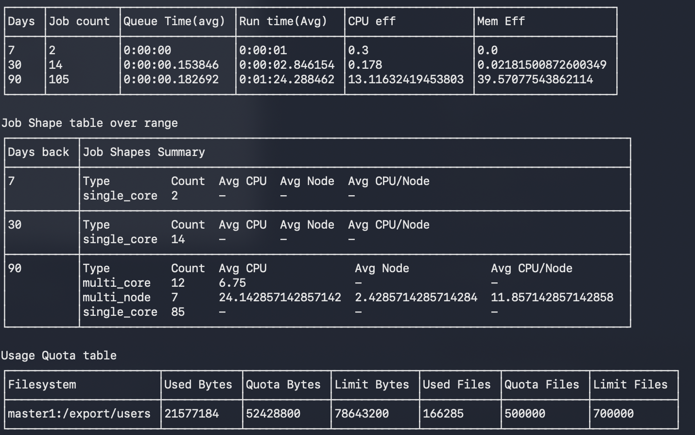
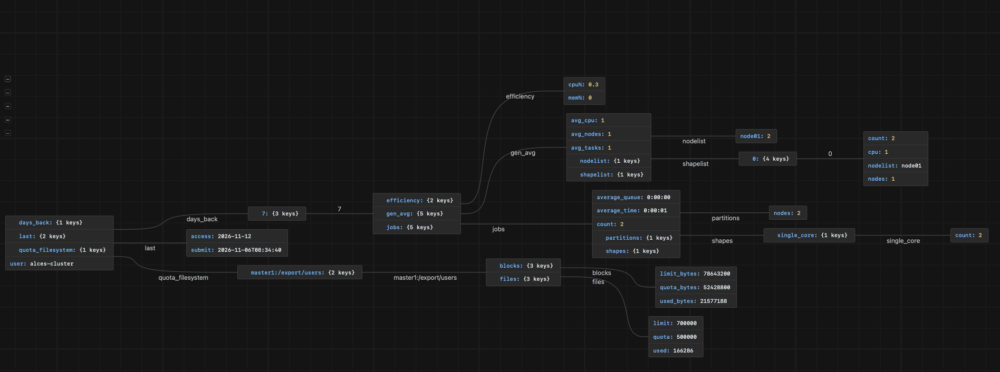
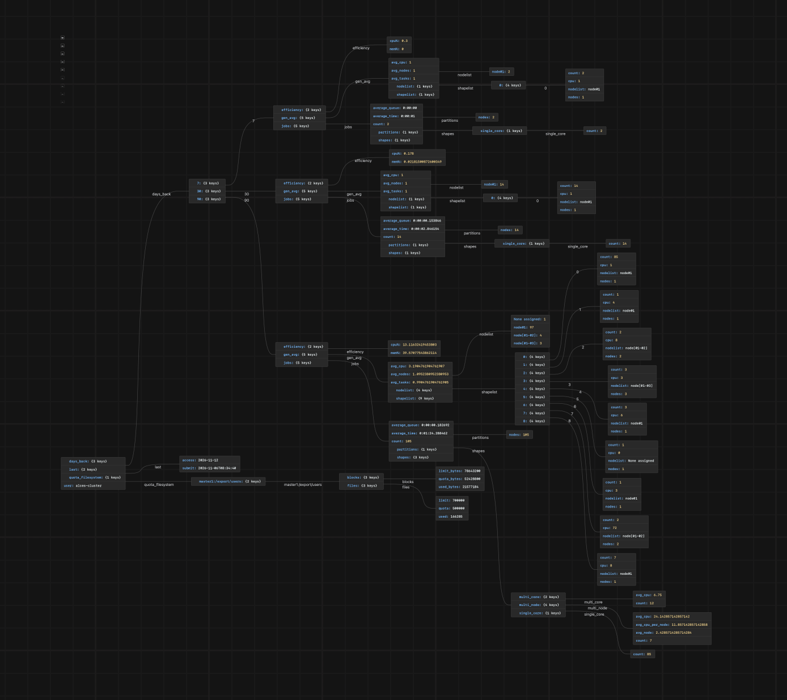

# Hypothesis

The aims of both these projects was to improve the accessiblitly and readability of existing SACCT breakdowns via two methods of access:

- **CLI Tool:** A program on the cluster itself able to print out the general metrics of a cluster in operation.
- **API:** A program to interface with an active cluster using API calls to provide a JSON dump of key metrics on how the cluster is being used by the end operator.

The main reason is because SACCT itself is a tool able to give job by job breakdowns of completed and submitted jobs, however it lacks the in built tools to make general observations of cluster operations work as expected.

Thus the central challenge was defining the structure of how the general use data would be displayed to the end user to make SLURM accounting easier for the end user to understand and so see if there is any specific problem that causes the failure of specific nodes or partitions.

# Approach

TBD

## CLI Tool

TBD

## API tool

TBD

# What was learnt

TBD