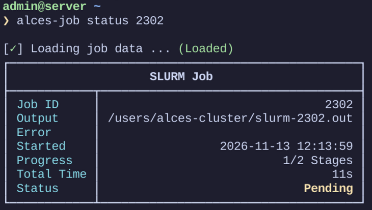
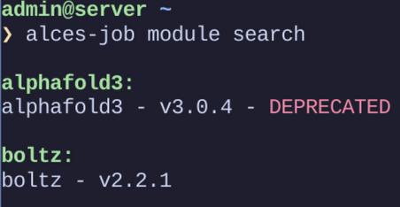

# Installation

Alces Job is written in Ruby and distributed as a gem.

## Installing Ruby

Check what you already have:

```bash
ruby --version
gem --version
```

If Ruby 4 is not installed, use the instructions for your distribution:

:::tabs Debian / Ubuntu | Fedora | RHEL family | openSUSE | Arch | Alpine
:::Debian / Ubuntu

```bash
sudo apt update
sudo apt install -y ruby-full
```

> Debian and Ubuntu install the default Ruby version from their repositories. Ruby 4 will only be installed if your release includes it.

:::

:::Fedora

```bash
sudo dnf install -y ruby
```

> Fedora may provide Ruby 4 in newer releases; if so, this package installs it automatically.

:::

:::RHEL family

Check if Ruby 4 is available as a module (RHEL, AlmaLinux, Rocky Linux, CentOS Stream):

```bash
sudo dnf module list ruby
```

If a Ruby 4 stream exists:

```bash
sudo dnf module reset ruby -y
sudo dnf module enable ruby:4.0 -y
sudo dnf install -y ruby ruby-devel
```

> If no Ruby 4 module is available, your distribution does not currently support Ruby 4 via system packages. Use a version manager instead, as described below.

:::

:::openSUSE

```bash
sudo zypper install -y ruby
```

:::

:::Arch

```bash
sudo pacman -S --noconfirm ruby
```

> Arch typically provides the latest stable Ruby version available at the time of release.

:::

:::Alpine

```bash
sudo apk add ruby
```

:::
:::

### Verify the installation

```bash
ruby --version
gem --version
```

Confirm that the output shows Ruby 4.x.

### If your distribution can't provide Ruby 4

Install Ruby through a version manager such as [mise](https://mise.jdx.dev/getting-started.html).

## Installing the gem

Download the gem file from the [releases page](https://github.com/alces-software/alces-job/releases) and install it:

```bash
gem install alces-job-2.0.3.gem
```

Check that it works:

```bash
alces-job version
```

This prints the installed version and the ASCII banner. A handy next step is `alces-job completion`, which installs shell tab completion so commands and flags complete themselves (see the command reference at the end).

## Installing for every user of a cluster

If you maintain the machine, install the gem as root so system-wide config and templates are available to all users:

```bash
sudo gem install alces-job-2.0.3.gem
```

Installing from source works the same way:

```bash
sudo gem build alces-job.gemspec
sudo gem install alces-job-2.0.3.gem
```

> This installs the gem system-wide, but running the command plain `sudo` will not work because Ruby is in the wrong environment. Either run the tool as the root user directly, preserve the environment with `sudo -E env "PATH=$PATH"`, or point at the binary explicitly, e.g. `sudo /usr/local/bin/alces-job`.

Regular users should never need elevated privileges to generate scripts or use their own templates — this only matters for the site-wide setup described in the configuration section.

:::page-break

# Creating a job script

## Generating a script

`alces-job generate` creates a portable Slurm job script. You can define the core resources (CPU, memory, time), set the job name, and specify the command to run. It can either generate a script for review or submit it straight to Slurm:

```bash
alces-job generate universal \
  --job_name my_job \
  --nodes 1 \
  --ntasks 4 \
  --time 01:00:00 \
  --partition short \
  --mem 8G \
  --command "python run.py" \
  --output output_%j.log \
  --submit
```

## Choosing a job type

Generation comes in five flavours, each backed by a built-in template:

| Type        | For                                         |
| ----------- | ------------------------------------------- |
| `universal` | A generic script using common Slurm options |
| `serial`    | A single-node CPU job                       |
| `mpi`       | A distributed MPI job                       |
| `gpu`       | A GPU-accelerated workload                  |
| `array`     | An array job generation                     |

The flags each type accepts are listed in the command reference; anything not set is simply left out of the final script.

## The interactive wizard

The tool comes with an interactive wizard that walks you through creating a job script step by step. It is recommended for new users, or anyone not experienced with Slurm:

```bash
alces-job -i
```

The wizard asks about the job type, resources, modules and output settings, and builds the options for you — pulling in information about the cluster (partitions, software) when it is available, and falling back to sensible prompts when it is not.


## Previewing and adjusting

A few options change what happens to the script along the way:

- `--dry_run` — previews generation without saving the script.
- `--edit` — opens the generated script in your editor before saving.
- `--prepare` — creates a dedicated working directory and standard output/error paths for the job.
- `--local_scratch` — runs the job from local scratch and copies results back; `--scratch_path` overrides the scratch directory used.

# Templates

Templates are how the tool generates scripts. They use embedded Ruby (ERB) placeholders like `<%= @context.* %>` to dynamically fill in job settings such as job name, array range, partition, memory, modules, working directory, and the command to run.

When you run `alces-job generate universal`, the tool takes the values you pass via flags (like `--job_name`, `--array`, `--command`) and injects them into the template to produce a ready-to-submit script. Conditional blocks such as `<% if @context.mem -%>` mean sections are only included if you provide those options, keeping the final script clean and tailored to your job. Every template is evaluated with `@context`, a struct holding the options passed to the generator (from flags, profiles and site defaults alike).

A minimal template looks like this:

```erb
#!/bin/sh
#SBATCH --job-name=<%= @context.job_name %>
#SBATCH --time=<%= @context.time %>

cd <%= @context.workdir || Dir.pwd %>
<%= @context.command %>
```

You can see examples of all the built-in templates in the [templates folder](https://github.com/alces-software/alces-job/tree/main/templates) of the repository.

## Where templates live

Templates are looked up in three places, in this order of precedence:

1. User templates in `~/.config/alces-job/templates/`
2. Admin templates in `/etc/alces-job/templates/`
3. Built-in templates packaged with the gem

The first match wins, so a user or site template that shares a name with a built-in one overrides it for whoever can see it.

## Listing and inspecting templates

```bash
alces-job template list
```

To show a template's contents:

```bash
alces-job template show --name universal
```

## Using your own template

Save your template to your user template directory, e.g. `~/.config/alces-job/templates/my_slurm_template.erb`, then pass it with the `--template` flag:

```bash
alces-job generate universal \
  --job_name test_job \
  --array 1-10 \
  --time 01:00:00 \
  --mem 4G \
  --command "python run.py" \
  --template my_slurm_template
```

The tool reads the template, replaces the `<%= @context.* %>` placeholders with the values you provided, and outputs the final script — which is submitted immediately if you add `--submit`.

# Profiles

Profiles are saved collections of job settings that let you reuse common Slurm configurations without retyping flags every time. Instead of specifying things like `--nodes`, `--mem` or `--time` for each job, you store them once in a named profile — `fast`, `gpu`, `longrun` — and reuse or edit them as needed. When you run a job with a profile, its stored values are applied automatically, and you can still override them with command-line flags.

### Create a profile

```bash
alces-job profile create \
  --profile_name fast \
  --job_name fastjob \
  --nodes 1 \
  --ntasks 4 \
  --mem 4G \
  --time 01:00:00
```

This saves a profile called `fast` containing those job settings.

### Use or inspect a profile

```bash
alces-job profile show --profile fast
```

This prints the stored configuration so you can verify or reuse it.

### Update a profile

```bash
alces-job profile edit change \
  --profile_name fast \
  --mem 8G \
  --time 02:00:00
```

This updates only the specified fields, leaving everything else unchanged.

### Remove settings from a profile

```bash
alces-job profile edit remove \
  --profile_name fast \
  --mem \
  --time
```

Those flags are deleted from the profile, so future jobs won't inherit them.

### Delete a profile

```bash
alces-job profile delete --profile fast
```

:::page-break

# Working with existing scripts

## Modifying a script

`alces-job modify` changes the directives in an existing job script without regenerating it from scratch — handy when you need to change something on the fly:

```bash
alces-job modify myjob.sbatch --job_name myjob --nodes 2 --time 01:00:00 --command "python main.py" --submit
```

The script is updated in place with the flags you provide; `--output_file` writes the modified script to a new file instead, and `--submit` submits it to Slurm when you're done. The full flag list is in the command reference.

There is also `alces-job modify remove`, which strips selected directives out of a script entirely. Each directive has a boolean flag (e.g. `--mem`, `--partition`), and anything you pass is simply deleted from the script — useful when a script inherited settings it shouldn't have. `--output_file` and `--submit` work here too.

## Checking a script is valid

`alces-job validate` tells you whether a script's values are sensible:

```bash
alces-job validate script myjob.sbatch
```

It runs a built-in validator over the file and reports any problems. Custom templates can be checked the same way by name:

```bash
alces-job validate template my_slurm_template
```

It is also possible to plug in your own validators — they run alongside the built-in one — which is covered under extending the tool.

# Tracking jobs

## Tracking a job while it runs

Creating a job with the `--track` flag allows the tool to follow the progress of the script. It automatically injects the `alces_start_job` helper function, which tells the tool when the script has started. If your script has multiple distinct sections, wrap them with the `alces_start_stage` and `alces_end_stage` helper functions so that progress can be tracked stage by stage — and make sure to set the number of stages in the `ALCES_TOTAL_STAGES` environment variable.

To view the status of a tracked script:

```bash
alces-job job status <jobId>
```

This shows how far the job has progressed and whether it has completed. More detail about the stages is displayed with `--verbose` (or `-v`), and `--live` shows a table that updates in real time.



To get a job you first submitted without tracking under the tool, or simply to wire the helpers up yourself, `alces-job job tracking` prints the locations of the function definitions and the directory where tracking information is stored, so you can source them in your own script.

### Job history

```bash
alces-job job history
```

This shows a list of recent jobs. The number shown can be capped with `--limit` and filtered with `--status`; combined with `--interactive` (or `-i`) it lets you select one of the results and view its full details.

### Where tracking data lives

The directory that tracking information is stored in can be changed through the `tracking.path` key in either the user or admin config file (see the configuration section).

# Modules and cluster information

## Software modules

The tool can query the environment modules available on the system, which keeps the `--module` flags honest when generating a script:

```bash
alces-job module list
```

And to search by name, version or category:

```bash
alces-job module search
```

Both accept `--show_description` (`-d`) to display each module's description, `--show_full_name` (`-f`) to show the full name used for loading, and `--hide_categories` (`-h`) to hide category headings.



## System information

Several commands — the interactive wizard included — use a local cache of information about the cluster (partitions, software and so on). Create it once for the machine:

```bash
alces-job sysinfo init
```

Keep it fresh over time with:

```bash
alces-job sysinfo update --all
```

`--partition` (`-p`) and `--package` (`-k`) refresh just those parts if you don't want everything. On a machine used by a whole site, this cache should be initialised as root — see the configuration section.

:::page-break

# Configuration

## Your own config file

User-level defaults live in a config file created for you by:

```bash
alces-job config init [OPTIONS]
```

Running this as a user creates `~/.config/alces-job/config.yaml`. The flags you pass — `--job_name`, `--mem`, `--time`, `--partition`, `--module`, `--workdir`, `--command`, `--account`, `--output_file`, `--error`, `--mail_user`, `--mail_type`, `--submit`, `--editor` — are stored as your defaults, so future generation needs fewer of them typed out.

Users can also plug in their own script validators here: they are picked up from `~/.config/alces-job/plugins/validators/`.

## Site-wide defaults (admin config)

Whoever maintains the cluster can define defaults for everyone. The admin config is created by running `alces-job config init` as root, which writes `/etc/alces-job/admin-config.yaml`.

The admin config file is a plain YAML map of default CLI options. Typical admin defaults include nodes, array, ntasks, cpus_per_task, gres, dependency, job_name, mem, time, partition, module(s), workdir, command, account, output_file, error, mail_user, mail_type and submit. An example:

```yaml
flags:
   partition:
      default: gpu1
      warn: false
   mem:
      default: 4G
      warn: true
   modules:
      default:
         - Bison/3.8.2-GCCcore-15.2.0
         - GCC/15.2.0
         - GCCcore/15.2.0
      warn: true

module_blacklist:
   - Bison/3.8.2-GCCcore-15.2.0
   - GCC/15.2.0
   - GCCcore/15.2.0
```

The `warn` flags control whether the tool tells the user when a default has been overridden.

### How admin defaults are applied

For the generate commands (`generate universal`, `generate serial`, `generate mpi`, `generate gpu`, `generate array`):

- If `--site_config` is enabled (the default) and the admin defaults file exists, it loads the admin defaults and the user defaults and merges them.
- Those defaults are then merged with the command-line options the user provided.
- User-supplied command-line options take precedence over admin defaults.
- The tool prints a warning when a command-line flag overwrites a value defined by the admin config.

If the admin config file does not exist, generation proceeds using only the command-line options and any profile values.

## Setting things up machine-wide

A few site-level pieces sit alongside the admin config:

- **The gem itself** — install as root as described in the installation section so the CLI, site templates and site config are available to everyone.
- **Site templates** — place ERB templates in `/etc/alces-job/templates/`; they are picked up before the built-in ones (but after a user's own templates). See the templates section for how precedence works.
- **User script validators** — admins can also deploy validators system-wide through `/etc/alces-job/plugins/validators/`; how to write them is in the extending section.
- **System information** — initialise the sysinfo cache once by running `sysinfo init` as root. Users refresh it with `sysinfo update` as described in the modules and cluster information section.

:::page-break

# How it works

This section is for people working on the tool itself.

## Repository layout

- `bin/alces-job` — executable CLI entrypoint script.
- `lib/cli/cli.rb` — registers commands with `dry-cli`.
- `lib/cli/commands/` — command definitions for generate, interactive, profile, config, sysinfo, template, validate, modify, job, module, completion, version.
- `lib/services/` — business logic for script generation, the interactive wizard, config conversion, validation, and system info.
- `lib/services/paths/paths.rb` — `Services::Paths`, the path resolution helper used by the CLI. It determines where user profiles and templates live (the XDG config home, e.g. `~/.config/alces-job/`), and where admin files are expected on the system (under `/etc/alces-job/`, e.g. `/etc/alces-job/admin-config.yaml`).
- `lib/version.rb` — gem version constant.
- `spec/` — RSpec tests covering CLI behaviors, generators, validators, and helpers.
- `templates/` — built-in ERB templates for the supported Slurm job types.
- `.github/workflows/` — GitHub Actions workflows for CI and release automation.
- `alces-job.gemspec` — gem metadata and dependencies.

## Command registration

The executable `bin/alces-job` loads `lib/cli/cli.rb`, which uses `dry-cli` to register a command registry and then requires all command files. Each command in `lib/cli/commands/` is a `Dry::CLI::Command` — for example, `version.rb` registers `version` with the aliases `-v` and `--version`, `interactive.rb` registers `interactive`, and the `generate/` subtree registers commands like `generate universal`.

## The script generation flow

The generator workflow is primarily implemented in `lib/cli/commands/generate/universal.rb` and `lib/services/script_generator/script_generator.rb`. When the user runs a generate command:

1. The CLI command uses `Services::Paths` to locate site and user resources — `#admin_config_path` (typically `/etc/alces-job/admin-config.yaml`), `#system_info_path` (typically `/etc/alces-job/system-info.yaml`), and `#user_profile_path`/`#user_profile_dir` for profiles under the XDG config home (e.g. `~/.config/alces-job/profiles/`).
2. The command optionally merges in the admin config, if the site config feature is enabled and the file is present.
3. The command optionally loads a user profile from the XDG user profile directory.
4. `Services::ScriptGenerator` is created with the final options.
5. The template is loaded from the first of user templates (`~/.config/alces-job/templates/*.erb`), admin templates (`/etc/alces-job/templates/*.erb`), or built-in templates (`templates/*.erb`, packaged with the gem) — the same precedence described in the templates section, selectable through `--template`.
6. The generated script is written to disk, optionally submitted to Slurm using `sbatch`.

## The interactive wizard internals

`lib/services/interactive_wizard.rb` implements interactive mode. It loads cluster metadata from the system info path returned by `Services::Paths#system_info_path` and falls back to prompt-driven configuration if Slurm environment data is unavailable. The wizard uses `TTY::Prompt` for interactive questions, `Terminal::Table` for displaying available job types, and `Pastel` for colored output.

# Extending the tool

## Custom script validators

Admins and users can add their own Slurm script validators, which run alongside the built-in one. Custom validators run at a system-wide level through the admin plugin directory and at a user level through the user plugin directory:

- System-wide: `/etc/alces-job/plugins/validators/`
- Per user: `~/.config/alces-job/plugins/validators/`

To be picked up, a validator must be written in Ruby and follow a few rules:

- The class name must be CamelCase and the file name snake_case, and they must match — `my_cluster_checks.rb` containing `class MyClusterChecks`.
- The class defines `errors` and `warnings` readers and an initialiser that takes the file path and the system info:

```ruby
attr_reader :errors, :warnings

def initialize(file_path, system_info:)
  @file_path = file_path
  @errors = []
  @warnings = []
  @system_info = system_info
end
```

- The class defines a `validate?` method. This should run the validator's checks, add any failed checks to `errors`, add non-blocking messages to `warnings`, and return whether validation passed:

```ruby
def validate?
  lines = File.readlines(@file_path, chomp: true)
  validate_example_rule(lines)
  errors.empty?
end
```

Dropping a file that satisfies all of this into either directory is all that's needed — the next validation run picks it up.

## Adding a new CLI command

To add a new top-level command, create a file under `lib/cli/commands/`, implement a `Dry::CLI::Command`, and register it with the CLI registry. Skeleton example, saved as `my_command.rb`:

```ruby
# frozen_string_literal: true

require 'dry/cli'

module AlcesJob
  module CLI
    module Commands
      class MyCommand < Dry::CLI::Command
        AlcesJob::CLI.register 'my-command', self
        desc 'Short description of my command'

        option :example, type: :string, desc: 'Example option'

        def call(**options)
          # implement behaviour, call services in `lib/services/`
          puts "Running my command with #{options.inspect}"
        end
      end
    end
  end
end
```

Then:

- Add a `require_relative 'commands/my_command'` line in `lib/cli/cli.rb` to match repository style.
- Add unit tests under `spec/` to cover the new command's behaviour.
- Run `bundle exec rubocop` and `bundle exec rspec`.

For a subcommand under an existing namespace (for example under `generate`), place the file in `lib/cli/commands/generate/` and register it with the appropriate name — or rely on the parent files that require subcommands.

# Developing and contributing

## Setup

Install dependencies with Bundler:

```bash
bundle install
```

Use a Ruby version matching the requirement in `alces-job.gemspec`.

## Running the tests and the linter

```bash
bundle exec rspec
bundle exec rubocop
```

## Running the CLI locally

```bash
bundle exec ruby bin/alces-job --help
```

Generate a script as a dry run:

```bash
bundle exec ruby bin/alces-job generate universal --job_name test-job --command "./run.sh" --dry_run
```

## Building the gem locally

```bash
gem build alces-job.gemspec
```

## Continuous integration

Two workflows live in `.github/workflows/`:

- `rspec.yml` runs on pull requests and manual dispatch. Its `lint` job checks out the repository, sets up Ruby, installs dependencies and runs `bundle exec rubocop`; its `test` job (which depends on `lint`) does the same and runs `bundle exec rspec`. Together they make sure code style and tests pass before merging.
- `release.yml` runs when a GitHub release is published. Its `build` job checks out the repository, builds the gem with `gem build alces-job.gemspec` and uploads the resulting `*.gem` file to the release.

## Notes for contributors

- Keep command implementations small and declarative in `lib/cli/commands/`.
- Keep business logic inside `lib/services/`.
- Use the built-in templates in `templates/` as examples for ERB-based script generation — templates should stay idempotent and avoid side effects; the CLI handles file writing and submission.
- Add `template/show` and `template/list` tests if template behaviour needs verification.
- Keep unit tests in `spec/` and run `bundle exec rspec` before opening pull requests.

:::page-break

# Command reference

Every command the tool offers, with its flags. The options most relevant to day-to-day use are explained in the sections above.

:::collapse Job creation

- `alces-job generate universal|serial|mpi|gpu|array` — creates a Slurm job script from a selected template.
   - Common flags:
      - `--job_name`, `-J` — sets the Slurm job name.
      - `--mem` — requests memory such as `4G` or `2000M`.
      - `--time`, `-t` — sets the walltime limit.
      - `--partition`, `-p` — chooses the Slurm partition or queue.
      - `--module`, `-m` — loads one or more environment modules.
      - `--workdir` — runs the job from the specified working directory.
      - `--command` — sets the shell command that the script executes.
      - `--account`, `-A` — charges the job to the specified Slurm account.
      - `--output_file`, `-o` — writes the generated script to a file.
      - `--error`, `-e` — sets the standard error output path.
      - `--mail_user` — sends job notifications to an email address.
      - `--mail_type` — chooses when mail notifications are sent.
      - `--submit` — submits the generated job to Slurm immediately.
      - `--yes` — skips confirmation prompts when submitting.
      - `--profile` — loads defaults from a saved profile.
      - `--site_config` — uses site or admin configuration values.
      - `--dry_run` — previews generation without saving the script.
      - `--track` — injects tracking helpers into the script.
      - `--edit` — opens the generated script in your editor before saving.
      - `--prepare` — creates a dedicated working directory and standard output/error paths.
      - `--local_scratch` — runs the job from local scratch and copies results back.
      - `--scratch_path` — overrides the local scratch directory.
      - `--template` — uses a custom or alternate template.
   - Template-specific flags:
      - `universal`: `--nodes`, `--ntasks`, `--cpus_per_task`, `--gres`, `--array`, `--dependency`
      - `serial`: `--mem`, `--time`, `--partition`, `--module`, `--workdir`, `--command`
      - `mpi`: `--nodes`, `--ntasks`, `--cpus_per_task`
      - `gpu`: `--nodes`, `--ntasks`, `--cpus_per_task`, `--gres`
      - `array`: `--nodes`, `--array`, `--dependency`

- `alces-job interactive` (`-i`, `--interactive`) — launches the guided wizard for selecting a job type, resources, modules, and output settings.

- `alces-job modify <script>` — updates an existing Slurm script in place using the provided flags.
   - `--job_name`, `-J` — changes the job name shown in Slurm.
   - `--nodes`, `-N` — requests a specific number of compute nodes.
   - `--ntasks`, `-n` — sets the total number of tasks.
   - `--cpus_per_task`, `-c` — sets the CPU cores assigned to each task.
   - `--mem` — updates the memory request.
   - `--time`, `-t` — changes the walltime limit.
   - `--partition`, `-p` — selects a new Slurm partition.
   - `--account`, `-A` — changes the Slurm account to charge.
   - `--gres` — requests generic resources such as GPUs.
   - `--output` — writes the script output to a specific file path.
   - `--error`, `-e` — changes the standard error path.
   - `--mail_user` — sets the notification email address.
   - `--mail_type` — chooses when email notifications are sent.
   - `--array` — sets a Slurm array specification.
   - `--dependency` — adds a job dependency rule.
   - `--module`, `-m` — loads additional modules.
   - `--workdir` — changes the working directory used by the job.
   - `--command` — replaces the command executed by the script.
   - `--output_file`, `-o` — writes the modified script to a new file.
   - `--submit` — submits the modified script to Slurm.
   - `--yes` — skips confirmation prompts when submitting.

- `alces-job modify remove <script>` — removes selected Slurm directives from an existing script.
   - `--job_name`, `-J` — removes the job-name directive.
   - `--nodes`, `-N` — removes the nodes directive.
   - `--ntasks`, `-n` — removes the ntasks directive.
   - `--cpus_per_task` — removes the cpus-per-task directive.
   - `--mem` — removes the memory request.
   - `--time`, `-t` — removes the time limit.
   - `--partition`, `-p` — removes the partition directive.
   - `--account`, `-A` — removes the account directive.
   - `--gres` — removes the generic resource directive.
   - `--output` — removes the stdout file directive.
   - `--error`, `-e` — removes the stderr file directive.
   - `--mail_user` — removes the mail-user directive.
   - `--mail_type` — removes the mail-type directive.
   - `--array` — removes the array directive.
   - `--dependency` — removes the dependency directive.
   - `--output_file`, `-o` — writes the result to a new file instead of overwriting the original.
   - `--submit` — submits the modified script after removal.

:::

:::collapse Profiles, templates and validation

- `alces-job profile list` — lists saved user profiles.

- `alces-job profile show --profile <name>` — shows the contents of a saved profile.

- `alces-job profile create --profile_name <name> [flags]` — saves a reusable set of Slurm defaults. Flags are the same as those used for script generation and include job name, resources, modules, workdir, command, array, and dependency options.

- `alces-job profile delete --profile <name>` — deletes a saved profile.

- `alces-job profile edit change --profile_name <name> [flags]` — changes or adds values inside an existing profile. Flags mirror `profile create` and update only the options you provide.

- `alces-job profile edit remove --profile_name <name> [flags]` — removes stored values from an existing profile. Use boolean flags for each field to clear that setting from the profile.

- `alces-job template list` — lists templates from built-in, admin, and user locations.

- `alces-job template show --name <template>` — displays the contents of a named template so you can review or reuse it.

- `alces-job validate script <path>` — validates an existing Slurm script file and reports any problems.

- `alces-job validate template <name>` — validates a custom template by name.

:::

:::collapse Monitoring, modules and system info

- `alces-job job status <jobId> [flags]` — gets the status of a tracked job.
   - `--verbose`, `-v` — shows detailed stage information.
   - `--live` — refreshes the status display in real time.

- `alces-job job history [flags]` — shows a history of tracked jobs.
   - `--status` — filters by job status (`running` or `completed`).
   - `--limit` — limits how many jobs are shown.
   - `--interactive`, `-i` — lets you select a job and view its full details.

- `alces-job job tracking [flags]` — prints the paths needed to manually source the tracking helper functions.
   - `--pretty`, `-p` — formats the output in a more readable way.

- `alces-job module list` — lists available modules on the system.
   - `--show_description`, `-d` — displays each module description.
   - `--show_full_name`, `-f` — shows the full module name used for loading.
   - `--hide_categories`, `-h` — hides category headings in the output.

- `alces-job module search` — searches available modules by name, version, or category.
   - `--module_name`, `-n` — filters by the module name.
   - `--version`, `-v` — filters by module version.
   - `--category`, `-c` — filters by module category.
   - `--show_description`, `-d` — displays each module description.
   - `--show_full_name`, `-f` — shows the full module name used for loading.
   - `--hide_categories`, `-h` — hides category headings in the output.

- `alces-job sysinfo init` — creates a local cache of system information used by other commands.

- `alces-job sysinfo update` — refreshes the stored system information.
   - `--partition`, `-p` — updates partition information.
   - `--package`, `-k` — updates package information.
   - `--all`, `-a` — updates all available information.

:::

:::collapse Setup and housekeeping

- `alces-job completion` — installs shell tab completion for `alces-job` so commands and flags can be completed interactively.

- `alces-job version` (`-v`, `--version`) — prints the installed version and the ASCII banner.

- `alces-job config init` — generates an initial configuration file for user or admin defaults.
   - `--job_name`, `-J` — stores a default Slurm job name.
   - `--mem` — stores a default memory requirement.
   - `--time`, `-t` — stores a default walltime limit.
   - `--partition`, `-p` — stores a default partition.
   - `--module`, `-m` — stores default modules.
   - `--workdir` — stores a default working directory.
   - `--command` — stores a default command to run.
   - `--account`, `-A` — stores a default Slurm account.
   - `--output_file`, `-o` — stores a default output script filename.
   - `--error`, `-e` — stores a default error file path.
   - `--mail_user` — stores a default notification email.
   - `--mail_type` — stores a default mail notification type.
   - `--submit` — stores the default submit behavior.
   - `--editor` — stores a default editor for manual script editing.

:::

## Links

[github](https://github.com/alces-software/alces-job)
