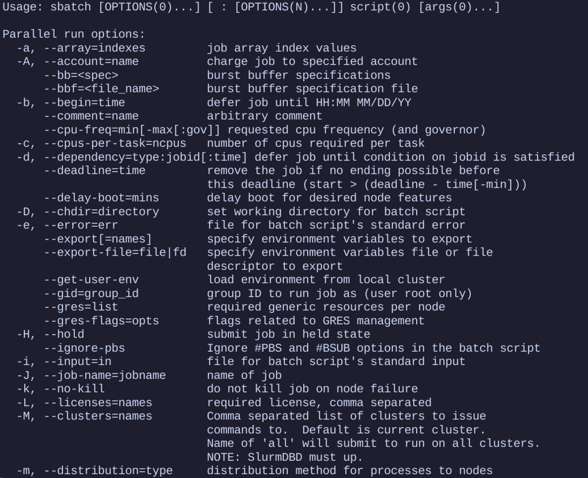

# Alces Job

Alces Job is a CLI tool built in Ruby designed to help users that are new to Slurm or HPCs create high quality job scripts that use good practices.

Generating a script is only part of the tool. It can also modify and validate scripts that already exist, reuse saved settings through profiles, and track jobs while they run. Site administrators can layer their own defaults and templates on top, so every user of a cluster starts from sensible values.

## Why it's needed

A lot of the time, when researchers or students are given access to an HPC for the first time, they have no idea what to do.
They are presented with a console, some documentation, and are expected to figure it out.
Usage of an HPC differs greatly to using a personal computer or laptop, and interacting with a scheduler can be daunting when looking at the hundreds of options that Slurm offers you.
Jobs can be submitted with the incorrect number of resources, to the wrong partition, or with too little or too much time.

Alces Job aims to help guide users through creating a job, by exposing the main directives that Slurm uses and, through its interactive wizard, explaining the usage of each one. Or it can get out of the way entirely and just produce the script. Advanced features like job tracking or creating shared project directories are there to be used, not waded through.
The output is a syntactically valid job script that can be run without worry of if the partition is spelled correctly, or if the time has been formatted in a way that Slurm understands.

## What it does

The core of the tool is `alces-job generate`. You pick a job type — serial, MPI, GPU, array, or a universal catch-all — pass the options you care about, such as job name, time, memory, partition, modules and the command to run, and it fills a matching template to produce a ready-to-submit sbatch script. Anything you don't set is simply left out of the final script.

Anyone new to Slurm can skip the flags entirely: `alces-job -i` opens an interactive wizard that walks through choosing a job type and resources step by step, drawing on gathered information about the cluster's partitions and software where it can.

Around generation sit the supporting features. `alces-job modify` and `modify remove` edit the directives of existing scripts on the fly, `validate` checks that a script's values are sensible, profiles save reusable sets of defaults for later jobs, and `--track` injects helper functions into a script so its progress — down to individual stages — can be followed live with `alces-job job status`.

## How it's used

Alces Job can be installed either locally or globally via ruby gems.
It can then be run with `alces-job <command>` such as `alces-job generate array` or `alces-job -i`.

Because everything is template-driven, clusters can shape what users get out of it: admins drop site-wide templates and defaults into `/etc/alces-job/`, users add their own templates and profiles under `~/.config/alces-job/`, and the tool resolves what it finds in that order. The result is that a first-time user runs one command and gets a script that already follows the site's conventions.
