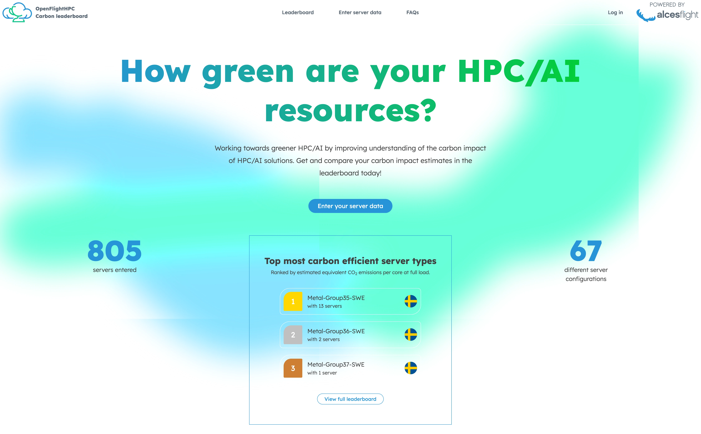
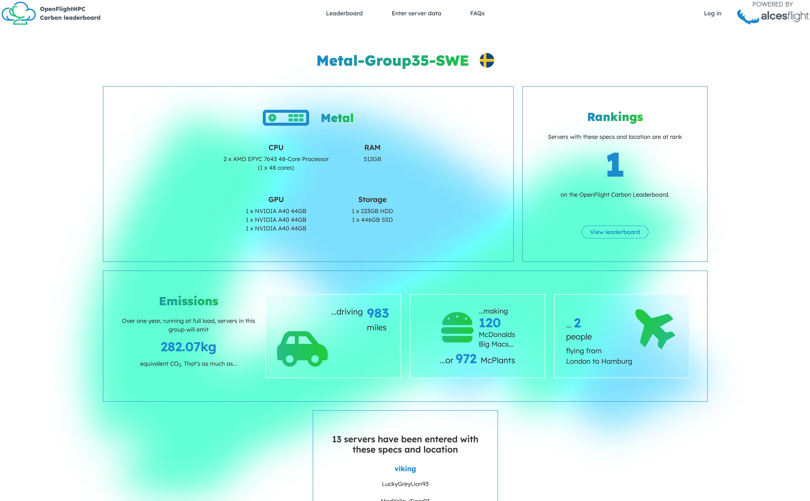

# Hypothesis

The goal of this project was to collect and compare the estimated carbon impact of both physical and virtual servers.

The initiative aims to provide a simple methodology for estimating and comparing the carbon impact of different server configurations, presented through a leaderboard with a light competitive element. By collecting data across different resource types and levels of utilisation, the project aims to improve understanding of the environmental impact of computing resources under varying workloads.

# Approach

The project uses a leaderboard to display and compare the estimated carbon impact of participating servers. Alongside each entry, users can view information about the server's specifications, helping to provide context for the reported estimates.

### Carbon Data

To collect the required data, we developed a [helper script](https://github.com/openflighthpc/carbon-leaderboard/tree/main/carbon-client). This script gathers anonymous information about the server and allows users to provide additional details that may affect the carbon impact estimates, such as the server's location. The collected information is then submitted to the leaderboard.

The project uses the [Boavizta API](https://doc.api.boavizta.org/) to estimate the carbon impact of server hardware based on its specifications and available environmental data.

The primary metric used is **Global Warming Potential (GWP)**, which expresses the estimated carbon impact in grams of CO₂ equivalent per hour (gCO₂eq/hr).

The leaderboard currently focuses on the estimated impact of operating the hardware at runtime. It does not include the carbon impact associated with manufacturing the hardware.

### How do we estimate virtual devices?

Estimating the carbon impact of virtual machines is more complicated than estimating physical servers, as it requires information about the underlying hardware hosting the virtual resources.

Estimation for virtual devices is still in early estimation and will improve over time, but some initial support for identifying the hardware behind AWS instances has been implemented. This allows more informed estimates to be produced for supported AWS resources.

For other platforms, the underlying hardware may be unknown or bespoke, as is often the case with OpenStack. This makes it more difficult to produce reliable estimates.

One issue identified during testing was that OpenStack estimates could be significantly higher than expected. By default, OpenStack may provide limited information about the CPU topology of a virtual machine. As a result, each virtual CPU core can be interpreted as a separate physical CPU, artificially inflating the estimated carbon impact.

Defining the CPU topology correctly within OpenStack resolves this issue by providing more accurate information about the physical resources backing the virtual machine.

### Are the values accurate?

Carbon impact calculations depend on several factors, including:

- Manufacturer's reports on hardware
- Cleanliness of power to a country
- Available information on the reported hardware

As a result, the values displayed by the leaderboard should be treated as estimates rather than exact measurements. They are calculated using the best available information through the Boavizta service, which provides a transparent methodology for its calculations. Further details about this methodology are available on the [Boavizta website](https://doc.api.boavizta.org/).

There are also several factors that the current leaderboard does not account for:

- The cleanliness of the power source to the data-center housing the servers
- impact of the manufacture of the hardware
- Intiatives taken to offset carbon

These limitations mean that the leaderboard provides a useful basis for comparison, but its values should not be interpreted as a complete measure of a server's overall environmental footprint.

# What was learnt

This project provided experience in collecting hardware information, integrating external APIs and using real-world data to produce environmental impact estimates. We gained a better understanding of the challenges involved in comparing physical and virtual resources, particularly the difficulty of identifying the underlying hardware used by virtual machines.

We also learnt that carbon impact estimates depend heavily on the quality and availability of the input data. Issues such as missing CPU topology information can significantly affect the results, highlighting the importance of understanding the hardware being measured.

Overall, we learnt how to build a system that turns server specifications into comparable carbon impact estimates, while recognising the limitations and assumptions involved in environmental calculations. The project also demonstrated how a leaderboard can make technical data more accessible and encourage users to consider the environmental impact of their computing resources.

[github](https://github.com/openflighthpc/carbon-leaderboard)
