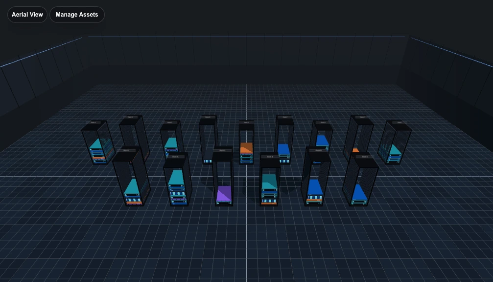
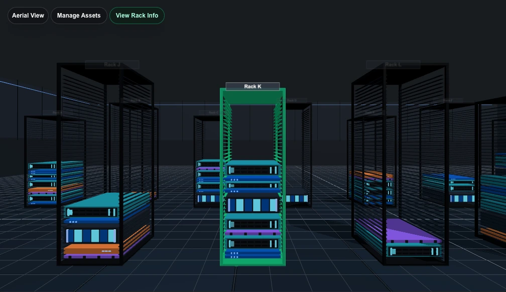
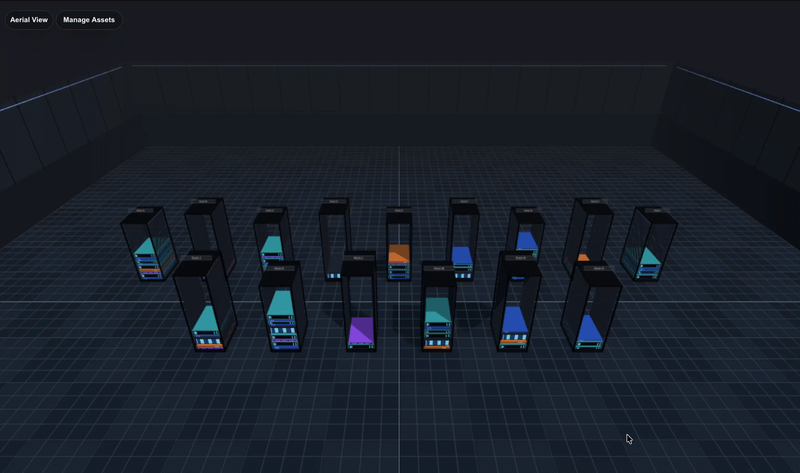

# Hypothesis

The goal of this project was to explore alternative methods of visualising HPC clusters, moving away from traditional dashboards and offering users a more accessible, intuitive and engaging experience.

The initiative aimed to investigate whether interactive 3D visualisations could provide a more effective way for users to understand the structure and status of their cluster. By representing computing resources visually, the project sought to make the otherwise mundane process of monitoring and checking clusters more engaging.

# Approach

We developed interactive 3D visualisations of clusters in the browser using TypeScript and Three.js.

API calls were made to a backend that provided information about the cluster. This information was then processed by the frontend and used to construct a 3D representation of the cluster and its computing resources.

Three.js allowed us to create an interactive environment in which users could explore their cluster from different perspectives, providing an alternative to presenting cluster information through conventional tables, charts and dashboards.

Rather than replacing traditional monitoring tools entirely, the project explored how 3D visualisations could complement existing approaches and provide users with a more visually intuitive understanding of their computing infrastructure.

# What was learnt

This project demonstrated that cluster visualisation does not have to follow the conventional dashboard format. Interactive 3D environments offer an alternative way of presenting cluster information, allowing users to develop a more intuitive understanding of their computing infrastructure.

We learnt that reconsidering how information is presented, rather than simply what information is presented, has the potential to improve the user experience. By moving away from traditional tables and charts, users may find it easier to explore, understand and engage with their clusters.

Overall, the project highlighted the potential for more creative approaches to visualising HPC infrastructure, making the otherwise mundane process of monitoring and checking clusters more accessible, intuitive and enjoyable.

