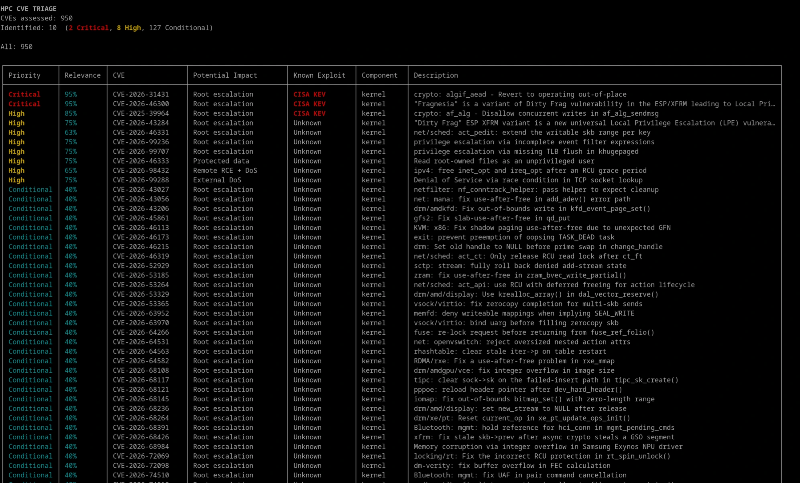

## Engineer's Write-up

Performed R&D into developing a custom CVE scanning tool focused on vulnerabilities relevant to HPC environments, rather than traditional scanners that can produce large numbers of findings that aren't necessarily relevant.

The main aims were:

- Agentless/remote - no additional software required on cluster nodes.
- Identify CVEs particularly relevant to HPC systems, such as privilege escalation and unauthorised access.
- Reduce the amount of manual work required to review CVEs.

AI was used to help develop a python script, this pulled data from several sources including Rocky Linux, Red Hat and CISA resources to prioritise vulnerabilities that warrant further investigation. AI also allowed rapid/iterative development, adding in additional CVE sources and refining the logic used to identify and prioritise relevant vulnerabilities in a much shorter timeframe.

The resulting script provides a way of identifying and filtering potentially relevant CVEs, helping narrow down which vulnerabilities require further manual investigation.

