# Hypothesis

The goal for this project was to assemble and create a collection of tools for HPC environment accessibility and management.

The Flight Environment is a comprehensive suite of tools designed to make HPC environments more accessible to end-users and easier for administrators to manage. The tools work independently but become more powerful when used together, each addressing specific areas of HPC environment usage.

# Approach

It consists of three main components:

- **Flight User Suite:** CLI tools for end-users to streamline common workflow tasks like launching desktop sessions, managing software ecosystems, and handling object storage.
- **Flight Web Suite:** A web front-end providing browser-based access to terminals, desktops, and files on HPC systems.
- **Flight Admin Tools:** CLI tools for administrators to handle cluster configuration, system inventory, and configuration management

### Flight User Suite

The Flight User Suite provides self-service tools for HPC end-users:

- **Runway:** A self-contained Ruby environment and entrypoint for accessing other Flight tools
- **Starter:** Profile scripts for integrating the user suite into the shell environment
- **Desktop:** Launch VNC-ready virtual desktops with various environments (GNOME, xterm, KDE, etc.)
- **Env:** Access and manage various software managers for HPC applications
- **Silo:** Object-based storage management for files and software
- **Job:** Create job scripts from templates, launch jobs, and monitor activity

### Flight Web Suite

The Flight Web Suite provides web-based access to HPC environments:

- **WWW:** Self-contained web-server for Web Suite applications
- **Login:** User authentication integrated with system auth
- **Console:** Web based terminal for CLI access
- **Desktop:** Create and manage remote desktop sessions
- **File Manager:** Upload and download files in the user environment
- **Job:** Create and manage job scripts and execution

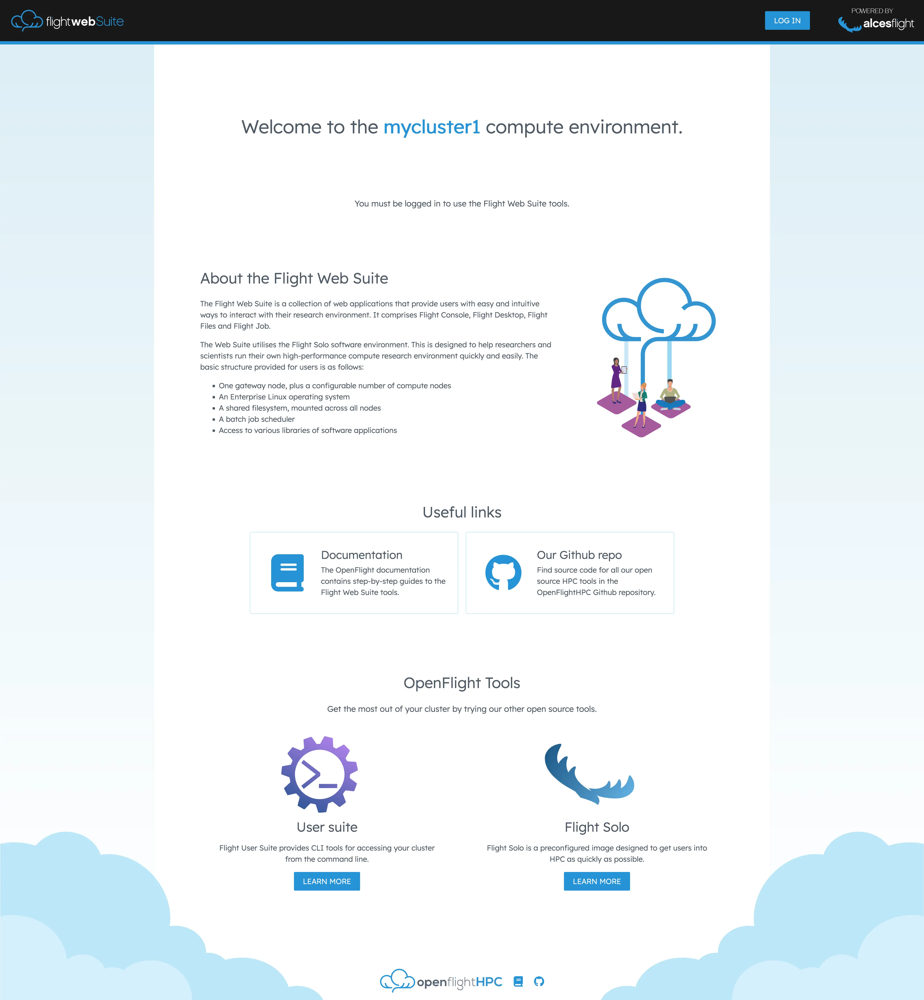
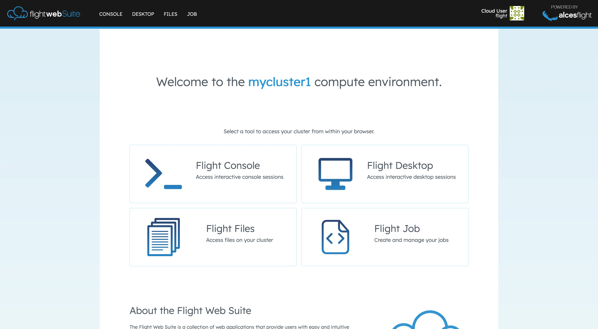
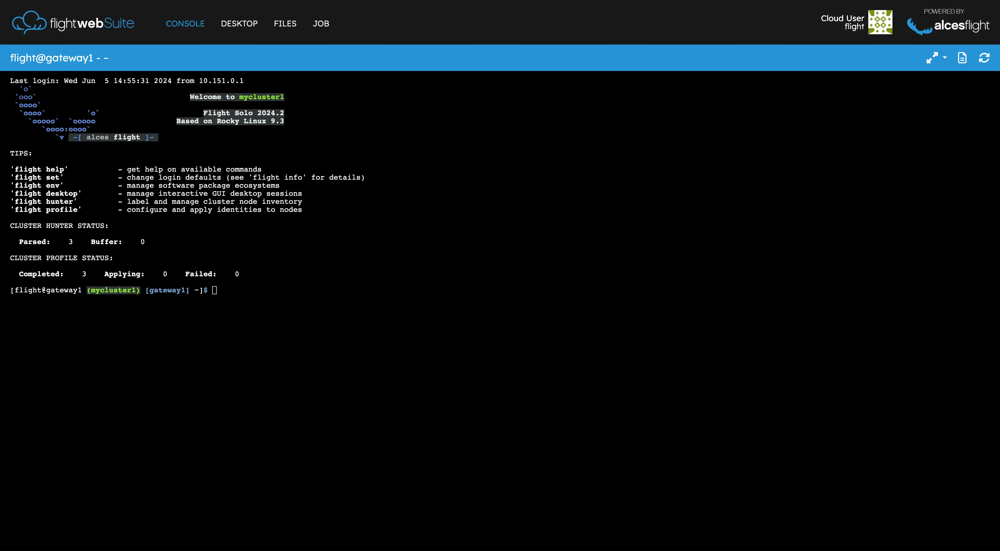
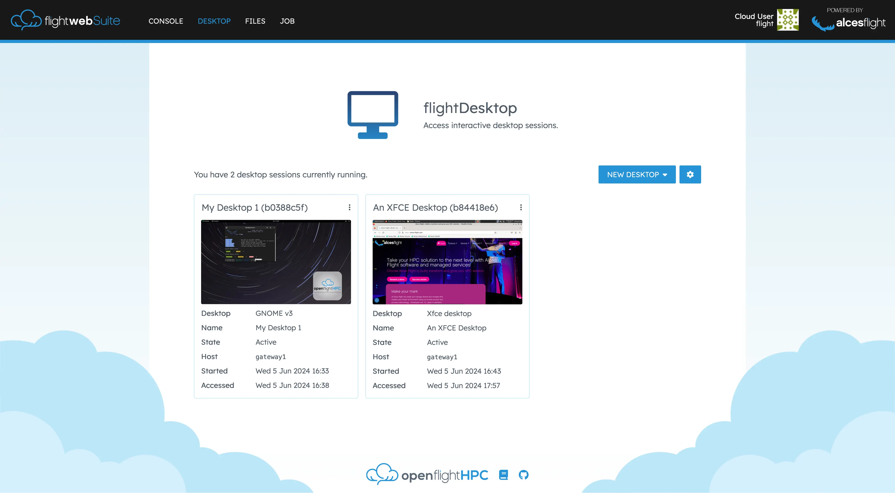
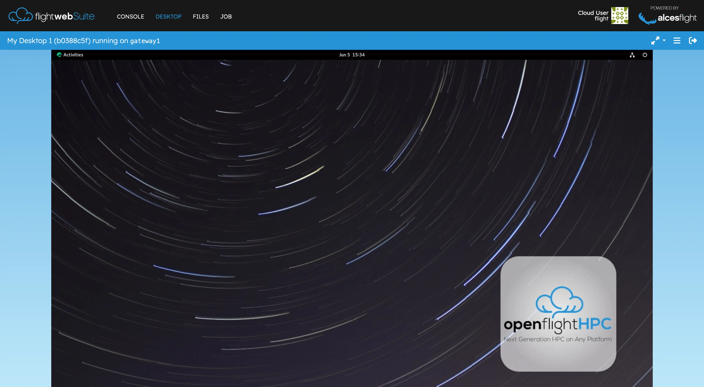
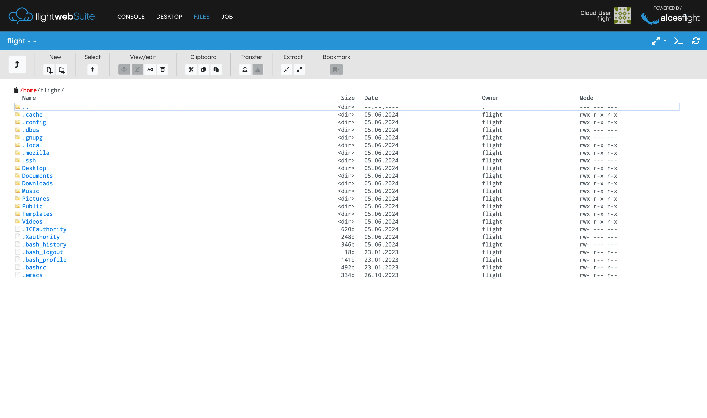

### Flight Admin Tools

Administarator-focused tools for cluster management:

- **Gather:** Collect and store system information.
- **Hunter:** Send system information anad manage host inventory over the network.
- **Profile:** Apply configuration identities to hosts in a HPC environment.
- **PDSH:** OpenFlight's build of PDSH for parallel shell execution.

### Outcomes

- Enabled slef-service HPC access for end-users.
- Streamlined desktop,job, and storage management.
- Integrated admin tools for cluster configuration.

# Documentation

:::collapse Flight Environment Basics

### Activate the Flight environment

The Flight User Suite sits unobtrusively on the research environment with the `flight` command serving as an entrypoint to the various system commands.

This provides some quick tips to activating the system and finding out more about the flight system (`flight info`).

To load the system, simply run `flight start` (which, when first run, will generate some login keys for allowing passwordless login to compute nodes)

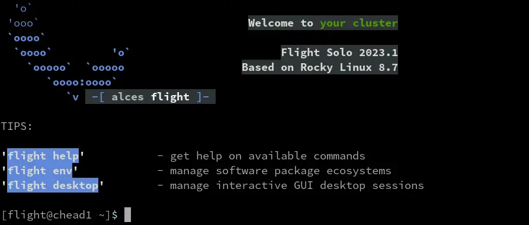

The flight system can be set to automatically start on login for the user by running `flight set always on`

### Flight HowTo

The Flight User Suite comes with built-in guides to assist with usage of the research environment from setting up the flight environment to using the queue system.

#### Showing Available Guides

To show the available guides, list them with:

```bash
[flight@chead1 (mycluster1) ~]$ flight howto ls
┌───────┬──────────────────────────────────┐
│ Index │ Name                             │
├───────┼──────────────────────────────────┤
│ 1     │ Get Started                      │
│ 2     │ Work With The Flight Environment │
│ 3     │ Use Flight User Suite            │
│ 4     │ Run Jobs                         │
│ 5     │ Use A Scheduler                  │
│ 6     │ Flight Desktop                   │
│ 7     │ Flight Env                       │
│ 8     │ Flight Job                       │
│ 9     │ Flight Login Api                 │
└───────┴──────────────────────────────────┘
```

#### Viewing a Guide

A guide can be viewed by requesting either the index or name of the desired guide. When viewing a guide, the content will open inside a `less` session.

To view the get started guide by name:

```bash
flight howto show 'Get Started'
```

To view the get started guide by index:

```bash
flight howto show 1
```

When finished with the guide, simply escape the `less` session with `q`. Alternatively, the optional argument `--no-pager` will prevent any sort of view manager, instead the contents of the guide will be output straight to the terminal.

:::

### Flight Admin Tools

:::collapse Flight Gather

### Flight Gather

Flight Gather collects system information into a processable YAML format.

Data collected by Flight Gather:

- BIOS Version
- Serial Number
- Total RAM
- CPU info (sockets, cores, IDs, models)
- Network info (interfaces, MAC addresses, speed)
- Disk info (name, size)
- GPU info (name, slot)
- Platform

Further to the above, the user can provide groups (in a similar vein to genders files) to add further categorisation to the data. This is useful when collating the data from many systems.

#### Using Flight Gather

There are a few basic usages to flight gather:

- Collect system information

```bash
flight gather collect
```

- View the system information

```bash
flight gather show
```

- Modify groups assigned to the data

```bash
flight gather modify --primary MyPrimaryGroupName
```

To find further information on the tool and command options see the help page for the tool `flight gather --help`, the same can be done for sub-commands (e.g. `flight gather collect --help`)

:::

:::collapse Flight Hunter

Flight hunter is a host inventory tool used find and connect to nodes in a compute cluster. It is predominantly used while setting up a cluster.

Flight hunter's namesake feature is the ability to discover nodes on the local network by hunting. It can also send information between nodes, and can send on startup to a designated server node.

#### Hunt

Hunting can be started with the command `flight hunter hunt`. e.g.

```bash
[flight@chead1 (mycluster1) [login1] ~]$ flight hunter hunt
Hunter running on port 8888 - Ctrl+C to stop
```

There are several options that change how `hunt` works:

- `--allow-existing` - Duplicate entries will replace existing ones rather than being rejected.
- `--port <port>` - Overrides the default port to accept on.
- `--include-self` - Sends itself to hunter.
- `--auth <auth>` - Defines a password to use as an authentication key, only incoming senders with the correct auth will be accepted.
- `--auto-parse <regex>` - Automatically parses nodes matching this regex when they are added.

Hunter also has the ability to automatically apply a profile identity to nodes as soon as they are parsed. This is called `auto-apply` - it is not a command line option, it must be configured through hunter config files.

> All the above options can be set in the Flight Hunter config file located within `etc/config.yml` in the installation directory (if installed through the package this will be at `/opt/flight/opt/hunter/etc/config.yml`).

#### Send

Sending inventory information to a hunter server can be done with the command `flight hunter send`. A message will be displayed on a successful transmission.

```bash
[flight@chead1 ~]$ flight hunter send --server 10.10.0.1
Successful transmission
```

- `--port <port number>` - Overrides the default port to send to.
- `--server <ip address>` - Overrides the default server name, useful if the default is not set.
- `--auth <auth>` - Defines a password to use as an authentication key.
- `--broadcast` - Makes send broadcast to all addresses on the default subnet.
- `--broadcast-address <subnet>` - Overrides the default subnet to send to, use if the default subnet was not configured.
- `--groups <group1,group2,group3...>` - Specifies the groups that this node should be in.
- `--label <label>` - Defines a label to use when parsing this node.
- `--prefix <prefix>` - Defines a prefix, which will be numbered, and used as a label.
- `--command <command>` - Runs the given console command and sends the output as the payload of the send.
- `--retry-interval <interval>` - The number of seconds to wait before attempting to send again

> All the above options can be set in the Flight Hunter config file located within `etc/config.yml` in the installation directory (if installed through the package this will be at `/opt/flight/opt/hunter/etc/config.yml`).

#### Parse

One of hunter's main features is the ability to parse discovered nodes to prepare them for use with other flight tools. A benefit of the parsing feature is applying "labels" to discovered hosts; in ephemeral systems the hostnames may not be ideally formed or of a memorable length so labels make it easier to identify hosts.

> There must be some discovered nodes in the hunter buffer, otherwise there is nothing to parse.

The `parse` command will generate a list, for example:

```bash
[flight@login-node.novalocal ~]$ flight hunter parse
Select nodes: (Scroll for more nodes)
‣ ⬡ login-node.novalocal - 127.0.0.1
  ⬡ compute-node-1.novalocal - 10.151.15.194
  ⬡ compute-node-2.novalocal - 10.151.15.238
```

To parse, select a node from the list with space, and you will be taken to the label editor.

```bash
Choose label: login-node.novalocal
```

Here, you can edit the label like plain text.

```bash
Choose label: login1
```

> You can clear the current node name by pressing down in the label editor.

When done editing, press enter to save. The modified node label will appear next to the ip address and original node label.

```bash
Select nodes: login-node.novalocal - 127.0.0.1 (login1) (Scroll for more nodes)
‣ ⬢ login-node.novalocal - 127.0.0.1 (login1)
  ⬡ compute-node-1.novalocal - 10.151.15.194
  ⬡ compute-node-2.novalocal - 10.151.15.238
```

From this point, you can either hit the enter key to finish parsing and process the selected nodes, or continue changing node labels. Either way, you can return to this list by running `flight hunter parse` again.

> **Do you have many hosts in the buffer to pass at once?**
>
> If the hostnames of these are acceptable or labels/prefixes have been set then the `--auto` option will allow for bulk parsing of the buffer.

##### Parse options

There are some additional options that can be used with parse:

- `--prefix <prefix>` - Defines a prefix, which will be numbered, and used as a label.
- `--start <number>` - Defines the start value for the numbering of prefixes.
- `--auto` - Automatically parses everything in the buffer list.
- `--allow-existing` - Duplicate entries will replace existing ones rather than being rejected.
- `--skip-used-index` - If there is already a node with a particular label, then entering a different node with the same label will increase the index to the next available one instead of throwing an error.
- `--dry-run` - Print the generated node labels without actually parsing any nodes.
- `--default-label` - Set what the default label for a node should be if no label/prefix has been provided (either in the node presets or on the parse CLI). This can be one of `short` (use the short hostname of the node), `long` (use the FQDN of the node) and `blank` (do not generate any label).

> All the above options can be set in the Flight Hunter config file located within `etc/config.yml` in the installation directory (if installed through the package this will be at `/opt/flight/opt/hunter/etc/config.yml`).

#### Other Hunter Commands

##### `autorun`

This command automatically runs either `hunt` or `send` based on its configuration.

> This is used by the hunter service to launch hunter with the correct settings and isn't intended for use by end-users

##### `dump-buffer`

Drops all nodes in the buffer list.

##### `list`

Shows all nodes in the parsed list of nodes, and has several additional options:

- `--plain` - Displays in a plain format.
- `--by-group` - Displays by group.
- `--buffer` - Shows the buffer list instead.

##### `modify-groups <node>`

Allows for adding or removing of groups to/from a node.

- `--add <groups>` - Adds a group or comma separated list of groups.
- `--remove <groups>` - Removes a group or comma separated list of groups.
- `--buffer` - Modifies groups in the buffer list instead.
- `--regex` - The nodename is parsed as regex instead, and group changes are made to all nodes that match.

> You can select multiple nodes at once by writing a comma separated list, or with square bracket expansion (like genders syntax). For example, `remove node[01-02] compute` would remove `node01` and `node02`.

##### `modify-label <old> <new>`

Changes the label of a node from its current one to a new one.

##### `remove-node <label>`

Removes a node from the parsed list.

- `--buffer` - Remove from the buffer list, and use the node id instead.
- `--name` - Specify the node by regex matching the hostname instead.

> You can select multiple nodes at once by writing a comma separated list, or with square bracket expansion (like genders syntax). For example, `remove node[01-02] compute` would remove `node01` and `node02`.

##### `rename-group <group> <new name>`

Renames a group, keeping all the nodes it contains.

- `--buffer` - Uses the buffer list instead.

##### `show <label>`

Shows the details of a node, identifying it by label.

- `--buffer` - View a node in the buffer list instead, identifying it by id.
- `--plain` - Print in a plain format, more easily machine readable.

:::

:::collapse Flight Profile

Flight profile is a tool that manages the profiles of cluster nodes. In this context, a profile is a cluster type (e.g. SLURM, Kubernetes, Jupyter Lab), and the different types of nodes are identities. For example, a profile might be `slurm multinode`, and the identities would be `login` and `compute`. This page covers the sub-commands of `flight profile`, which are run in the format `flight profile <sub-command> --<option>`.

#### Using Flight Profile

Generally speaking, the process of utilising Flight Profile is to:

- Prepare the type you wish to use
- Run through the configure prompt to customise the type
- Apply identities from within the profile to hosts

> The type you wish to use will need to be prepared on all nodes that are to be included in the cluster, this is because the preparation process installs the required dependencies for the cluster type for the current system only.

The various commands of Flight Profile are described in further detail below.

#### `configure`

When `flight profile configure` is run, the user will be guided through a series of questions that need to be answered to properly configure the cluster.

- `--reset-type` - After a cluster type has been chosen, it will be locked in when `configure` is run in the future. This argument allows the user to reset and select a different cluster type.
- `--show` - Shows the answers for the current configuration.
- `--accept-defaults` - When using `--answers`, take the default values for any answers not given.
- `--answers` - Pass json text as the answers instead of using the menu. This could be done either by pasting text or passing the contents of a file (e.g. `flight profile configure --answers "$(cat /path/file.json)"`). Below are some examples of what the json could look like:

```json title="Web Access"
{
   "cluster_type": "openflight-web-access",
   "default_username": "flight",
   "default_password": "0penfl1ght",
   "access_host": "51.104.217.61"
}
```

```json title="Slurm Standalone"
{
   "cluster_type": "openflight-slurm-standalone",
   "cluster_name": "my-cluster",
   "default_username": "flight",
   "default_password": "0penfl1ght",
   "access_host": "51.104.217.61"
}
```

```json title="Slurm Multinode"
{
   "cluster_type": "openflight-slurm-multinode",
   "cluster_name": "my-cluster",
   "ipa_use": "false",
   "default_username": "flight",
   "default_password": "0penfl1ght",
   "access_host": "51.104.217.61",
   "compute_ip_range": "10.10.0.0/16",
   "nfs_server": "login1",
   "configure_rack_view": "true"
}
```

```json title="Kubernetes Multinode"
{
   "cluster_type": "openflight-kubernetes-multinode",
   "cluster_name": "my-cluster",
   "default_username": "flight",
   "default_password": "0penfl1ght",
   "access_host": "51.104.217.61",
   "compute_ip_range": "10.10.0.0/16",
   "pod_ip_range": "192.168.0.0/16",
   "nfs_server": "login1"
}
```

```json title="Jupyter"
{
   "cluster_type": "openflight-jupyter-standalone",
   "cluster_name": "my-cluster",
   "default_username": "flight",
   "default_password": "0penfl1ght",
   "access_host": "51.104.217.61"
}
```

An example of using `answers` to configure a slurm multinode cluster would be:

```bash
flight profile configure --answers '{"cluster_type": "openflight-slurm-standalone", "cluster_name": "my-cluster", "default_username": "flight", "default_password": "0penfl1ght", "access_host": "51.104.217.61"}'
```

> The OpenFlight Cluster Types provided along with Flight Profile attempt to determine sensible defaults which will aid in providing the correct information for configuring the cluster.

#### `apply <node,node2...> <identity>`

Applies an identity to one or more nodes. e.g. `flight profile apply node01,node02` or `flight profile apply node01`. If an identity's dependencies are not met then the application of the identity to the node will become queued until requirements are satisfied.

- `--force` - Overwrite the identity of a node that has already been applied to.
- `--remove-on-shutdown` - Adds a systemd hook to the node which will trigger removal from the cluster on shutdown if the node's identity supports removal.
- `--wait` - Don't background the process of application.
- `--groups` - Select nodes to apply to based on hunter groups.
- `--detect-identity` - Attempt to automatically determine the identity to apply based on the hunter groups of the node. If any group matches that of the available identities for the current cluster type, it will be applied.
- `--dry-run` - Show which identities would be applied to which nodes without actually performing apply process.

> You can select multiple nodes at once by writing a comma separated list, or with square bracket expansion (like genders syntax). For example, `apply node[01-02] compute` would apply `compute` to `node01` and `node02`.

#### `avail`

Lists the available cluster types.

#### `clean <node>`

Removes the data for one or more nodes that failed application or removal from appearing in the list of profile accessible nodes. This means the node will show as `available`.

#### `dequeue <node>`

Removes a node from the apply queue.

#### `identities <type>`

Shows a list of all available identities for a cluster type. If there is no given cluster type, identities will be shown for the currently configured cluster type.

#### `list`

Displays the identity and status of every node available to profile. e.g.

```bash
[flight@chead1 (mycluster1) [login1] ~]$ flight profile list
┌────────┬──────────┬───────────┐
│ Node   │ Identity │ Status    │
├────────┼──────────┼───────────┤
│ login1 │ login    │ complete  │
│ node02 │ compute  │ failed    │
│ node01 │          │ available │
└────────┴──────────┴───────────┘
```

#### `prepare <type>`

Prepares a cluster type, completing dependencies. If no cluster type is specified then the currently configured one is used.

> The type you wish to use will need to be prepared on all nodes that are to be included in the cluster, this is because the preparation process installs the required dependencies for the cluster type for the current system only.

#### `remove <node,node...>`

Removes the identity of a node, so that it no longer works as part of the cluster.

- `--remove-hunter-entry` - Also remove it from the hunter list.
- `--force` - Bypass restrictions on using `remove` on a node.
- `--wait` - Don't background the process of removal.

> `remove` is limited to only some identities, so not all identities can be removed.
>
> You can select multiple nodes at once by writing a comma separated list, or with square bracket expansion (like genders syntax). For example, `remove node[01-02] compute` would remove `node01` and `node02`.

#### `view <node>`

Shows the setup/removal progress of a node and its current status.

- `--raw` - Shows the entire ansible log output.
- `--watch` - View the process "live", regularly updates the output on the screen to show current status.

#### Auto-apply

Profile can automatically apply an identity to a node with the auto-apply configuration. This is done by configuring `flight hunter hunt` to automatically apply identities whenever a node is parsed with `auto-parse`.

> You must have already configured flight profile with the `configure` command or else auto-applying will not work.

##### Setup Auto-apply

1. Open the file `/opt/flight/opt/hunter/etc/config.yml`

> You will need to have root user permissions to edit this config file.

2. Add these lines:

```yaml
auto_apply:
   <regex>: <identity>
```

- You can add extra lines of `<regex>: <identity>` to catch more identities. e.g.

```yaml
auto_apply:
   cnode: compute
   chead: login
```

3. Restart the hunter service with `flight service restart hunter`.

- Alternatively, you can stop the hunter service with `flight service stop hunter` and then run `flight hunter hunt`.

#### Auto-remove

Profile can automatically remove nodes when they are shutdown, additionally it can remove them from the hunter inventory when they are successfully removed. This setup, coupled with auto-apply, can create a cluster that dynamically grows and shrinks with an auto-scaling group on various cloud platforms.

##### Setup Auto-remove

1. Open the file `/opt/flight/opt/hunter/etc/config.yml`

> You will need to have root user permissions to edit this config file.

2. Add the following lines:

```yaml
remove_on_shutdown: true
remove_hunter_entry: true
```

Now when a node has an identity applied to it then the service to automatically trigger removal on shutdown will be added to it. Further to this, when the node is successfully removed then the corresponding hunter entry will also be removed.

:::

### Flight User Suite

:::collapse Flight Desktop

Flight Desktop enables systems to launch graphical desktop sessions to support users who want to run interactive applications across the research environment. The system can support a number of different sessions simultaneously, and allow multiple remote participants to connect to the same session to support training and collaborative activities. This section of the documentation describes how to setup and use this tool.

#### Preparing a Desktop Type

##### View Available Types

Your research environment supports many types of graphical session designed to provide interactive applications directly to users. To view the available types of session, use the command `flight desktop avail`:

```bash
[flight@chead1 (mycluster1) ~]$ flight desktop avail
┌───────┬──────────────────────────────────────────────────┬────────────┐
│ Name  │ Summary                                          │ State      │
├───────┼──────────────────────────────────────────────────┼────────────┤
│ gnome │ GNOME v3, a free and open-source desktop         │ Unverified │
│       │ environment for Unix-like operating systems.     │            │
│       │                                                  │            │
│       │  > https://www.gnome.org/                        │            │
│       │                                                  │            │
│ kde   │ KDE Plasma Desktop (KDE 4). Plasma is KDE's      │ Unverified │
│       │ desktop environment. Simple by default, powerful │            │
│       │ when needed.                                     │            │
│       │                                                  │            │
│       │  > https://kde.org/                              │            │
│       │                                                  │            │
│ xfce  │ Xfce is a lightweight desktop environment        │ Unverified │
│       │ for UNIX-like operating systems. It aims to be   │            │
│       │ fast and low on system resources, while still    │            │
│       │ being visually appealing and user friendly.      │            │
│       │                                                  │            │
│       │  > https://xfce.org/                             │            │
│       │                                                  │            │
└───────┴──────────────────────────────────────────────────┴────────────┘
```

Application types that are `unverified` need to be prepared before they can be started.

##### Preparing a Type

To prepare a new session type, use the command `flight desktop prepare <type>` (preparing will automatically install any required application and support files; if these dependencies have been installed manually then a desktop session can be checked for verification with `flight desktop verify <type>`). Once enabled, users can start a new session using the command `flight desktop start <type>`.

> The `prepare` command is only available to the `root` user as it requires installation of packages.
>
> Preparing a new session type only enables it for the machine that you run the command from, any other nodes will need to have the type enabled too.

##### Using sudo to prepare

Since only the root user can use `prepare`, you also cannot use `sudo` to run `prepare`.

Instead the user must become the root user and enable the Flight system, then run `prepare`.

#### Launch a Desktop Session

Users can launch a new session by using the `flight desktop start gnome` command. After launching the desktop, a message will be printed with connection details to access the new session:

```bash
Starting a 'gnome' desktop session:

   > ✅ Starting session

A 'gnome' desktop session has been started.

== Session details ==
      Name:
  Identity: 4549eae1-6f8b-4983-8057-99b378afcdd3
      Type: gnome
   Host IP: 51.104.217.61
  Hostname: chead1
      Port: 5901
   Display: :1
  Password: mkO3Zxjl
  Geometry: 1024x768

This desktop session is not directly accessible from outside of your
cluster as it is running on a machine that only provides internal
cluster access.  In order to access your desktop session you will need
to perform port forwarding using 'ssh'.

Refer to 'flight desktop show 4549eae1' for more details.

If prompted, you should supply the following password: mkO3Zxjl
```

Users need a VNC client to connect to the graphical desktop session.

Users with Mac clients can use the URL provided in the command output to connect to the session; e.g. from the above example, simply enter `51.104.217.61:5901` into the Safari address bar.

Linux and Windows users should enter the IP address and port number shown into their VNC client in the format `IP:port`. For example - for the output above, Linux and Windows client users would enter `51.104.217.61:5901` into their VNC client:

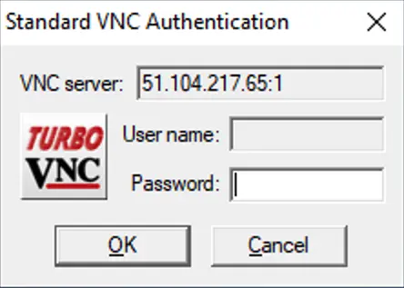

A one-time randomized password is automatically generated by the flight system when a new session is started. Linux and Windows users may be prompted to enter this password when they connect to the desktop session.

Once connected to the graphical desktop, users can use the session as they would a local Linux machine:

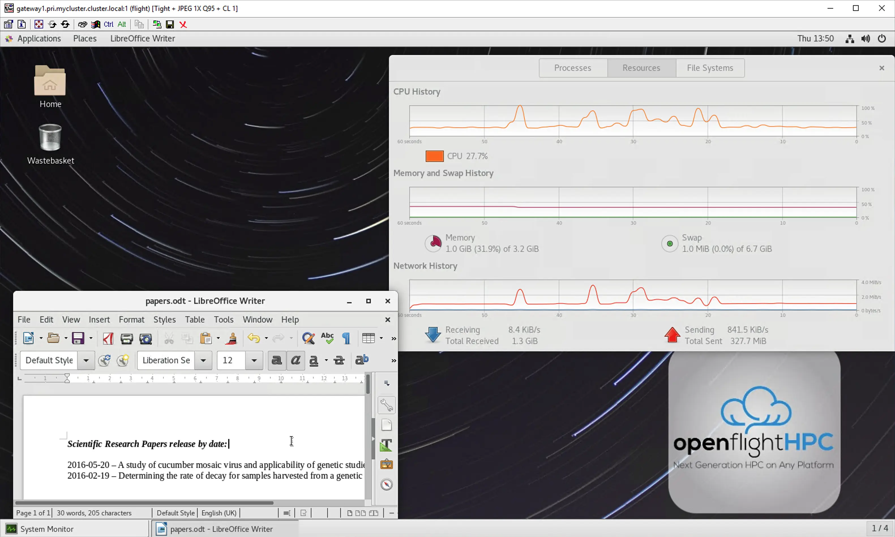

#### Port Forwarding a Desktop Session

Depending on your connection to the HPC you may see this message when starting a desktop session:

```bash
This desktop session is not directly accessible from outside of your
cluster as it is running on a machine that only provides internal
cluster access.  In order to access your desktop session you will need
to perform port forwarding using 'ssh'.
```

For example in the following:

```bash
[flight@chead1 (mycluster1) ~]$ flight desktop start gnome
Starting a 'gnome' desktop session:

   > ✅ Starting session

A 'gnome' desktop session has been started.

== Session details ==
      Name:
  Identity: dd8acf76-1494-4c88-adb1-a8bbd405d965
      Type: gnome
   Host IP: 20.68.202.163
  Hostname: chead1
      Port: 5903
   Display: :3
  Password: WB3gUQMW
  Geometry: 1024x768

This desktop session is not directly accessible from outside of your
cluster as it is running on a machine that only provides internal
cluster access.  In order to access your desktop session you will need
to perform port forwarding using 'ssh'.

Refer to 'flight desktop show dd8acf76' for more details.

If prompted, you should supply the following password: WB3gUQMW
```

By running the command `flight desktop show <name>` we can see more information:

```bash
[flight@chead1 (mycluster1) ~]$ flight desktop show dd8acf76

== Session details ==
      Name:
  Identity: dd8acf76-1494-4c88-adb1-a8bbd405d965
      Type: gnome
   Host IP: 20.68.202.163
  Hostname: chead1
      Port: 5903
   Display: :3
  Password: WB3gUQMW
  Geometry: 1024x768

This desktop session is not directly accessible from outside of your
cluster as it is running on a machine that only provides internal
cluster access.  In order to access your desktop session you will need
to perform port forwarding using 'ssh':

  ssh -L 5903:20.68.202.163:5903 flight@

Once the ssh connection has been established, depending on your
client, you can connect to the session using one of:

  localhost:5903
  localhost:3

If, when connecting, you receive a warning as follows, try again with
a different port number, e.g. 5904, 5905 etc.:

  channel_setup_fwd_listener_tcpip: cannot listen to port: 5903

If prompted, you should supply the following password: WB3gUQMW
```

##### Windows

On Windows, the desktop environment can still be connected like so:

1. Begin your environment as demonstrated on the previous page.
1. Note down the IP address, port number and password.
1. Open PuTTY.
1. Load one of your saved sessions or save a new session with your log in details.

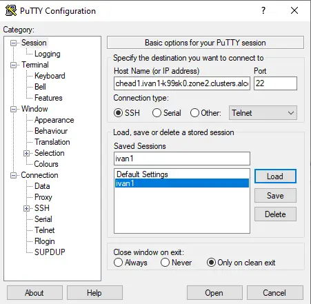

1. Find the "Category:" section on the left of the window.
1. Scroll down to "Connection" and expand it.
1. Scroll down to "SSH" and expand it.
1. Click on the "Tunnels" page.

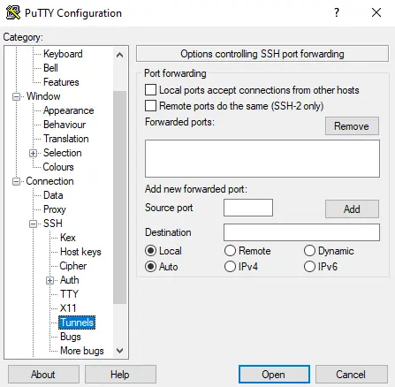

1. Input the source port (a local port) and destination which is `IP address:port number` of the desktop environment that was started.

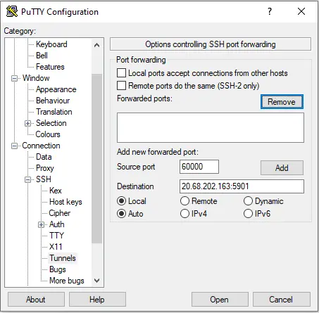

1. After inputting the information, click "Add" and the details will move to a box above.

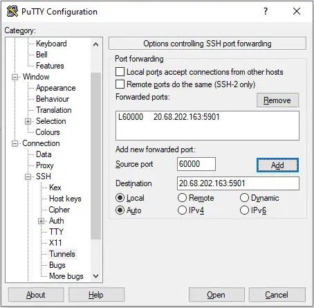

1. Scroll back to the top of the "Category:" section, and click on "Session".

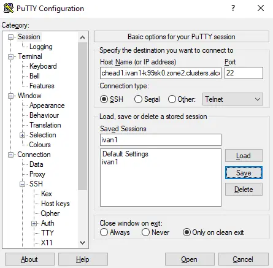

1. Save the session and then click open to run the command line interface and log in.
1. Open your VNC client, and type `localhost:XXXXX` where `XXXX` is the source port number you entered earlier.

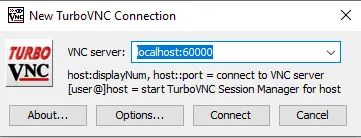

1. Click "Connect", and if prompted enter the password you noted down.

##### Linux/Mac

The steps for connecting with Linux/Mac are outlined in the output of the `flight desktop show` command above.

#### Resizing a Desktop Session

When launching a graphical desktop session using the `flight desktop` utility, a session resolution can be specified using the `--geometry <size>` option. For example, to launch a `gnome` desktop session with a resolution of 1920x1080 pixels, use the command:

```bash
flight desktop start --geometry 1920x1080 gnome
```

By default, your graphical desktop session will launch with a compatibility resolution of 1024x768. For example, to change the default resolution to 1920x1080 pixels, use the command:

```bash
flight desktop set geometry 1920x1080
```

Users can resize the desktop to fit their screens using the command `flight desktop resize <session id> <resolution>`. For example:

```bash
flight desktop resize 4549eae1 1920x1080
```

Your graphical desktop session will automatically resize to the new resolution requested. Use your local VNC client application to adjust the compression ratio, colour depth and frame-rate settings in order to achieve the best user-experience for the desktop session.

#### Viewing and Terminating Sessions

Users can view a list of the currently running sessions by using the command `flight desktop list`:

```bash
[flight@chead1 (mycluster1) ~]$ flight desktop list
┌──────┬──────────┬───────┬───────────┬───────────────┬────────────────┬──────────┬────────┐
│ Name │ Identity │ Type  │ Host name │ IP address    │ Display (Port) │ Password │ State  │
├──────┼──────────┼───────┼───────────┼───────────────┼────────────────┼──────────┼────────┤
│      │ 4549eae1 │ gnome │ chead1    │ 20.68.202.163 │ :1 (5901)      │ mkO3Zxjl │ Active │
│      │ 52e44bdd │ gnome │ chead1    │ 20.68.202.163 │ :3 (5903)      │ 5eAlaST0 │ Active │
│      │ abbbe30b │ gnome │ chead1    │ 20.68.202.163 │ :2 (5902)      │ XLH7bV30 │ Active │
└──────┴──────────┴───────┴───────────┴───────────────┴────────────────┴──────────┴────────┘
```

To display connection information for an existing session, use the command `flight desktop show <session-ID>`. This command allows users to review the IP-address, port number and one-time password settings for an existing session.

```bash
[flight@chead1 (mycluster1) ~]$ flight desktop show 4549eae1

== Session details ==
      Name:
  Identity: 4549eae1-6f8b-4983-8057-99b378afcdd3
      Type: gnome
   Host IP: 20.68.202.163
  Hostname: chead1
      Port: 5901
   Display: :1
  Password: mkO3Zxjl
  Geometry: 1024x768

This desktop session is not directly accessible from outside of your
cluster as it is running on a machine that only provides internal
cluster access.  In order to access your desktop session you will need
to perform port forwarding using 'ssh':

  ssh -L 5901:20.68.202.163:5901 flight@

Once the ssh connection has been established, depending on your
client, you can connect to the session using one of:

  localhost:5901
  localhost:1

If, when connecting, you receive a warning as follows, try again with
a different port number, e.g. 5902, 5903 etc.:

  channel_setup_fwd_listener_tcpip: cannot listen to port: 5901

If prompted, you should supply the following password: mkO3Zxjl
```

Users can terminate a running session by ending their graphical application (e.g. by logging out of a Gnome session, or exiting a terminal session), or by using the `flight desktop kill <session-ID>` command. A terminated session will be immediately stopped, disconnecting any users:

```bash
flight desktop kill 4549eae1
```

#### Securing your Desktop Session

As the VNC protocol does not natively provide support for security protocols such as SSL, you may wish to take steps to secure access to your VNC sessions.

Several third party tools exist to help you secure your VNC connections. One option is [ssvnc](http://ssvnc.sourceforge.net/).

Alternatively, you could use an SSH tunnel to access your session. Refer to online guides for setup instructions.

:::

:::collapse Flight Env

The breadth of application of HPC environments can be intimidating. There are many different users and workflows for every application.

This section aims to provide some suitable examples to demonstrate the ease of establishing consistent workflows and the flexibility provided by the flight tools in assisting with workflow creation.

Traditionally, administrators handle a lot of workflow creation. From manually compiling applications all the way through to assisting users launching their workflows. With this in mind, these documents should be able to assist both admins and users to establish their own customised solutions with minimal disruption.

#### Flight Env Command Usage

##### Viewing Available Ecosystems

Various [package-ecosystems](https://openflighthpc.org/lab/FENV/docs/flight-env/#ecosystems) are available for managing software on your research environment. These can be viewed by using the `env` subcommand:

```bash
flight env avail
```

##### Creating a Local Ecosystem

A local ecosystem is only available to the user that creates it. All of the packages and libraries are installed to the users home directory.

To install a package ecosystem, use the create command as follows (replacing easybuild with your desired package ecosystem):

```bash
flight env create easybuild
```

Once a package ecosystem has been installed, it needs to be activated for the session to be able to manage software with it:

```bash
[flight@chead1 (mycluster1) ~]$ flight env activate easybuild
<easybuild> [flight@chead1 (mycluster1) ~]$
```

> Your preferred software ecosystem can be set to automatically activate for your user within the flight system by running `flight env set-default easybuild`, replacing easybuild with your chosen software ecosystem.

##### Creating a Global Ecosystem

A global ecosystem is available to all users on the system. All of the packages and libraries are installed to a shared storage directory. The global directories can be configured in `/opt/flight/opt/env/etc/config.yml` with the `global_depot_path:` and `global_build_cache_path` keys.

> The user requires suitable write permissions to the configured global depot paths in order to be able to create a global ecosystem.

To install a global package ecosystem, use the create command with the global option flag:

```bash
flight env create -g easybuild
```

Once the global ecosystem has been installed, it needs to be activated for the session to be able to monitor software with it:

```bash
[root@chead1 (mycluster1) ~]$ flight env activate easybuild@global
<easybuild@global> [flight@chead1 (mycluster1) ~]$
```

##### Custom Ecosystem Names

When installing an ecosystem, a custom alias can be added by appending `@mycustomname` to the end of creation command. For example, to create a local gridware installation with the alias `test`:

```bash
flight env create easybuild@test
```

To activate this environment, the alias will need to be specified in the activation command:

```bash
[flight@chead1 (mycluster1) ~]$ flight env activate easybuild@test
<easybuild@test> [flight@chead1 (mycluster1) ~]$
```

#### Ecosystems

The Flight Env command provides streamlined installation of many popular software management ecosystems. These can be seen below along with the features they provide.

|                        | Conda | Easybuild | Modules | Singularity | Spack |
| ---------------------- | :---: | :-------: | :-----: | :---------: | :---: |
| Dependency Management  |  ✅   |    ✅     |   ❌    |     ✅      |  ✅   |
| Compilation            |  ✅   |    ✅     |   ❌    |     ❌      |  ✅   |
| Preconfigured Binaries |  ❌   |    ✅     |   ❌    |     ✅      |   ◆   |
| Multiple Versions      |   ◆   |    ✅     |   ✅    |     ✅      |  ✅   |

More information on the features:

- **Dependency Management** - The ecosystem automatically resolves and installs dependencies.
- **Compilation** - The ecosystem builds software from source for optimised functionality on the system (Note: these sorts of installations will take a long time).
- **Preconfigured Binaries** - The ecosystem provides binaries of the available software for quicker installation to get applications installed quickly.
- **Multiple Versions** - The ecosystem allows for installation of multiple versions of software which can be toggled between.

◆ is for partial support. Technically these features are supported in certain use cases and with additional work. This is not considered full support as multiple versions may require undocumented or uncommon use-cases of the tool.

##### Conda Usage Example

Conda is an open source package management system and environment management system that runs on Windows, macOS and Linux. Conda quickly installs, runs and updates packages and their dependencies. Conda easily creates, saves, loads and switches between environments on your local computer. It was created for Python programs, but it can package and distribute software for any language.

###### Creating and Using Ecosystem

Flight Env provides quick setup methods to create a conda software ecosystem.

To install and use conda:

- Activate the flight system.
- Create the conda installation for the user:

```bash
[flight@chead1 ~]$ flight env create conda
Creating environment conda@default
   > ✅ Verifying prerequisites
   > ✅ Fetching prerequisite (miniconda)
   > ✅ Creating environment (conda@default)
Environment conda@default has been created
```

- Activate the conda ecosystem:

```bash
[flight@chead1 ~]$ flight env activate conda
(base) <conda> [flight@chead1 ~]$
```

- Check that conda can be run:

```bash
(base) <conda> [flight@chead1 ~]$ conda --version
conda 4.7.10
```

###### Installing and Running Perl

An example workflow using perl is demonstrated below.

- View available versions:

```bash
(base) <conda> [flight@chead1 ~]$ conda search perl
Loading channels: done
# Name                       Version           Build  Channel
perl                          5.26.0      hae598fd_0  pkgs/main
perl                          5.26.2      h14c3975_0  pkgs/main
```

- Install specific version:

```bash
(base) <conda> [flight@chead1 ~]$ conda install perl=5.26.2
Collecting package metadata (current_repodata.json): done
Solving environment: done

## Package Plan ##

  environment location: /home/flight/.local/share/flight/env/conda+default

  added / updated specs:
    - perl=5.26.2

The following packages will be downloaded:

    package                    |            build
    ---------------------------|-----------------
    ca-certificates-2019.5.15  |                1         134 KB
    certifi-2019.6.16          |           py37_1         156 KB
    conda-4.7.11               |           py37_0         3.0 MB
    perl-5.26.2                |       h14c3975_0        10.5 MB
    ------------------------------------------------------------
                                           Total:        13.7 MB

The following NEW packages will be INSTALLED:

  perl               pkgs/main/linux-64::perl-5.26.2-h14c3975_0

The following packages will be UPDATED:

  ca-certificates                               2019.5.15-0 --> 2019.5.15-1
  certifi                                  2019.6.16-py37_0 --> 2019.6.16-py37_1
  conda                                       4.7.10-py37_0 --> 4.7.11-py37_0

Proceed ([y]/n)? y

Downloading and Extracting Packages
conda-4.7.11         | 3.0 MB    | ############################################################################################ | 100%
certifi-2019.6.16    | 156 KB    | ############################################################################################ | 100%
perl-5.26.2          | 10.5 MB   | ############################################################################################ | 100%
ca-certificates-2019 | 134 KB    | ############################################################################################ | 100%
Preparing transaction: done
Verifying transaction: done
    Executing transaction: done
```

- Check installation location:

```bash
(base) <conda> [flight@chead1 ~]$ which perl
~/.local/share/flight/env/conda+default/bin/perl
```

- Install perl library (this may prompt for initial `cpan` configuration, once configuration is complete then the library will be installed):

```bash
(base) <conda> [flight@chead1 ~]$ cpan File::Slurp
Loading internal null logger. Install Log::Log4perl for logging messages
Reading '/home/flight/.cpan/Metadata'
  Database was generated on Mon, 09 Sep 2019 15:17:03 GMT
Running install for module 'File::Slurp'
<-- snip -->
```

- Check installation worked:

```bash
(base) <conda> [flight@chead1 ~]$ cpan File::Slurp
Loading internal null logger. Install Log::Log4perl for logging messages
Reading '/home/flight/.cpan/Metadata'
  Database was generated on Mon, 09 Sep 2019 15:17:03 GMT
File::Slurp is up to date (9999.27).
```

##### Easybuild Usage Example

EasyBuild is a software build and installation framework that allows you to manage (scientific) software on High Performance Computing (HPC) systems in an efficient way.

###### Creating and Using Ecosystem

Flight Env provides quick setup methods to create an easybuild software ecosystem.

To install and use easybuild:

- Activate the flight system.
- Create the easybuild installation for the user:

```bash
[flight@chead1 ~]$ flight env create easybuild
Creating environment easybuild@default
   > ✅ Verifying prerequisites
   > ✅ Fetching prerequisite (lua)
   > ✅ Extracting prerequisite (lua)
   > ✅ Building prerequisite (lua)
   > ✅ Installing prerequisite (lua)
   > ✅ Fetching prerequisite (tcl)
   > ✅ Extracting prerequisite (tcl)
   > ✅ Building prerequisite (tcl)
   > ✅ Installing prerequisite (tcl)
   > ✅ Fetching prerequisite (lmod)
   > ✅ Extracting prerequisite (lmod)
   > ✅ Configuring prerequisite (lmod)
   > ✅ Installing prerequisite (lmod)
   > ✅ Fetching prerequisite (easybuild)
   > ✅ Bootstrapping EasyBuild environment (easybuild@default)
Environment easybuild@default has been created
```

- Activate the easybuild ecosystem:

```bash
[flight@chead1 ~]$ flight env activate easybuild
<easybuild> [flight@chead1 ~]$
```

- Check that easybuild can be run:

```bash
<easybuild> [flight@chead1 ~]$ module load EasyBuild
<easybuild> [flight@chead1 ~]$ eb --version
This is EasyBuild 3.9.4 (framework: 3.9.4, easyblocks: 3.9.4) on host chead1.pri.basic.cluster.local.
```

###### Installing and Running Perl

An example workflow using perl is demonstrated below.

- View available versions:

```bash
<easybuild> [flight@chead1 ~]$ eb -S perl
CFGS1=/home/flight/.local/share/flight/env/easybuild+default/software/EasyBuild/3.9.4/lib/python2.7/site-packages/easybuild_easyconfigs-3.9.4-py2.7.egg/easybuild/easyconfigs
 * $CFGS1/a/annovar/annovar-2016Feb01-foss-2016a-Perl-5.22.1.eb
 * $CFGS1/b/Bio-DB-HTS/Bio-DB-HTS-2.11-foss-2017b-Perl-5.26.0.eb
 * $CFGS1/b/Bio-DB-HTS/Bio-DB-HTS-2.11-foss-2018b-Perl-5.28.0.eb
 * $CFGS1/b/Bio-DB-HTS/Bio-DB-HTS-2.11-intel-2017b-Perl-5.26.0.eb
<-- snip -->
 * $CFGS1/p/Perl/Perl-5.26.1-GCCcore-6.4.0.eb
 * $CFGS1/p/Perl/Perl-5.26.1-foss-2018a-bare.eb
 * $CFGS1/p/Perl/Perl-5.26.1-foss-2018a.eb
 * $CFGS1/p/Perl/Perl-5.28.0-GCCcore-7.3.0.eb
 * $CFGS1/p/Perl/Perl-5.28.1-GCCcore-8.2.0.eb
<-- snip -->
 * $CFGS1/y/YAML-Syck/YAML-Syck-1.27-goolf-1.4.10-Perl-5.16.3.eb
 * $CFGS1/y/YAML-Syck/YAML-Syck-1.27-ictce-5.3.0-Perl-5.16.3.eb

Note: 9 matching archived easyconfig(s) found, use --consider-archived-easyconfigs to see them
```

- Install specific version:

```bash
<easybuild> [flight@chead1 ~]$ eb Perl-5.28.1-GCCcore-8.2.0.eb --robot
== temporary log file in case of crash /tmp/eb-MdohD2/easybuild-J6tjhZ.log
== resolving dependencies ...
== processing EasyBuild easyconfig /home/flight/.local/share/flight/env/easybuild+default/software/EasyBuild/3.9.4/lib/python2.7/site-packages/easybuild_easyconfigs-3.9.4-py2.7.egg/easybuild/easyconfigs/m/M4/M4-1.4.18.eb
== building and installing M4/1.4.18...
== fetching files...
== creating build dir, resetting environment...
== unpacking...
== patching...
== preparing...
== configuring...
== building...
<-- snip -->
```

- Check installation location:

```bash
<easybuild> [flight@chead1 ~]$ which perl
```

- Install perl library (this may prompt for initial `cpan` configuration, once configuration is complete then the library will be installed):

```bash
<easybuild> [flight@chead1 ~]$ cpan File::Slurp
Loading internal null logger. Install Log::Log4perl for logging messages
Reading '/home/flight/.cpan/Metadata'
  Database was generated on Mon, 09 Sep 2019 15:47:03 GMT
Running install for module 'File::Slurp'
<-- snip -->
```

- Check installation worked:

```bash
<easybuild> [flight@chead1 ~]$ cpan File::Slurp
Loading internal null logger. Install Log::Log4perl for logging messages
Reading '/home/flight/.cpan/Metadata'
  Database was generated on Mon, 09 Sep 2019 15:47:03 GMT
File::Slurp is up to date (9999.27).
```

##### Modules Usage Example

Modules provides simple environment management. Tools and software to be used with modules will be compiled or installed outside of the modules environment.

###### Creating and Using Ecosystem

Flight Env provides quick setup methods to create a modules software ecosystem.

To install and use modules:

- Activate the flight system.
- Create the modules installation for the user:

```bash
[flight@chead1 ~]$ flight env create modules
Creating environment modules@default
   > ✅ Verifying prerequisites
   > ✅ Fetching prerequisite (modules)
   > ✅ Extracting prerequisite (modules)
   > ✅ Building prerequisite (modules)
   > ✅ Installing prerequisite (modules)
   > ✅ Creating environment (modules@default)
Environment modules@default has been created
```

- Activate the modules ecosystem:

```bash
[flight@chead1 ~]$ flight env activate modules
<modules> [flight@chead1 ~]$
```

- Check that modules can be run:

```bash
<modules> [flight@chead1 ~]$ module --version
Modules Release 4.3.0 (2019-07-26)
```

###### Installing Software - General Overview

Unlike the other [package ecosystems](https://openflighthpc.org/lab/FENV/docs/flight-env/#ecosystems), Modules provides the ecosystem management tool but not any package management tools. Therefore, with the Modules ecosystem, you are free to compile and install software in a Module compatible manner.

Module files can be installed to `~/.local/share/flight/env/modules+default/modulefiles` (for local Modules ecosystems) or to `/opt/apps/flight/env/modules+global/modulefiles` (for global modules ecosystems).

> If the Modules ecosystem has been installed with a [custom ecosystem name](https://openflighthpc.org/lab/FENV/docs/flight-env/#custom-ecosystem-names) then the path will not be `modules+default`/`modules+global` but instead `modules+mycustomname`.

For more information on building software for Modules, see the [modulefile reference](https://modules.readthedocs.io/en/latest/modulefile.html) and build documentation for the chosen software.

###### Installing and Running Perl

**Compile Perl from Source**

- Download perl 5.30.1 source:

```bash
<modules> [flight@chead1 ~]$ wget https://www.cpan.org/src/5.0/perl-5.30.1.tar.gz
```

- Decompress the source files:

```bash
<modules> [flight@chead1 ~]$ tar -xzf perl-5.30.1.tar.gz
```

- Configure the software to install to a localperl directory:

```bash
<modules> [flight@chead1 ~]$ cd perl-5.30.1
<modules> [flight@chead1 ~]$ ./Configure -des -Dprefix=$HOME/localperl
```

- Compile and install perl:

```bash
<modules> [flight@chead1 ~]$ make
<modules> [flight@chead1 ~]$ make install
```

**Create Modulefile and Test**

- Create the perl modulefile:

```bash
<modules> [flight@chead1 ~]$ cat << EOF > ~/.local/share/flight/env/modules+default/modulefiles/perl-5.30.1
#%Module1.0
proc ModulesHelp { } {
global dotversion

puts stderr "\tPerl 5.30.1"
}

module-whatis "Perl 5.30.1"
conflict perl
prepend-path PATH ~/localperl/bin
prepend-path LD_LIBRARY_PATH ~/localperl/lib
prepend-path LIBRARY_PATH ~/localperl/lib
prepend-path MANPATH ~/localperl/man
EOF
```

- Check install location:

```bash
<modules> [flight@chead1 ~]$ module load perl-5.30.1
<modules> [flight@chead1 ~]$ which perl
~/localperl/bin/perl
```

- Install perl library (this may prompt for initial `cpan` configuration, once configuration is complete then the library will be installed):

```bash
<modules> [flight@chead1 ~]$ cpan File::Slurp
Loading internal logger. Log::Log4perl recommended for better logging
Reading '/home/flight/.cpan/Metadata'
  Database was generated on Wed, 11 Mar 2020 15:29:03 GMT
<-- snip -->
Appending installation info to /home/flight/localperl/lib/5.30.1/x86_64-linux/perllocal.pod
  CAPOEIRAB/File-Slurp-9999.30.tar.gz
  /usr/bin/make install  -- OK
```

- Check installation worked:

```bash
<modules> [flight@chead1 ~]$ cpan File::Slurp
Loading internal logger. Log::Log4perl recommended for better logging
Reading '/home/flight/.cpan/Metadata'
  Database was generated on Wed, 11 Mar 2020 15:29:03 GMT
File::Slurp is up to date (9
```

##### Singularity Usage Example

Singularity is high-performance container technology specifically designed to enhance Enterprise Performance Computing by building containers that support HPC, analytics, artificial intelligence, machine learning, and deep learning to provide "intelligence anywhere".

###### Creating and Using Ecosystem

Flight Env provides quick setup methods to create a singularity software ecosystem.

To install and use singularity:

> If installing singularity for a user then there are a number of restrictions and additional steps to consider in configuring the environment. See the `Personal Environment` section of `flight env info singularity`.

- Activate the flight system.
- Create the singularity installation for the user:

```bash
[flight@chead1 ~]$ flight env create singularity
Creating environment singularity@default
   > ✅ Verifying prerequisites
   > ✅ Fetching prerequisite (squashfs)
   > ✅ Extracting prerequisite (squashfs)
   > ✅ Building prerequisite (squashfs)
   > ✅ Installing prerequisite (squashfs)
   > ✅ Fetching prerequisite (go)
   > ✅ Extracting prerequisite (go)
   > ✅ Fetching prerequisite (singularity)
   > ✅ Extracting prerequisite (singularity)
   > ✅ Building prerequisite (singularity)
   > ✅ Installing prerequisite (singularity)
   > ✅ Creating environment (singularity@default)
Environment singularity@default has been created
```

- Activate the singularity ecosystem:

```bash
[flight@chead1 ~]$ flight env activate singularity
<singularity> [flight@chead1 ~]$
```

- Check that singularity can be run:

```bash
<singularity> [flight@chead1 ~]$ singularity --version
singularity version 3.2.1
```

###### Installing and Running Perl

An example workflow using perl is demonstrated below.

> The perl container is built from a docker container which can be searched for in the [docker hub](https://hub.docker.com/). To search the singularity container library, use `singularity search SEARCHTERM`.

- Install specific version:

```bash
<singularity> [flight@chead1 ~]$ singularity build --sandbox perl_5.30.simg docker://perl:5.30
INFO:    Starting build...
Getting image source signatures
Copying blob sha256:4ae16bd4778367b46064f39554128dd2fda2803a5747fddeff74059f353391c9
 48.05 MiB / 48.05 MiB [====================================================] 0s
Copying blob sha256:bbab4ec87ac4f89eaabdf68dddbd1dd930e3ad43bded38d761b89abf9389a893
 7.44 MiB / 7.44 MiB [======================================================] 0s
<-- snip -->
Writing manifest to image destination
Storing signatures
INFO:    Creating sandbox directory...
INFO:    Build complete: perl_5.30.simg
```

- Check installation location:

```bash
<singularity> [flight@chead1 ~]$ singularity exec perl_5.30.simg which perl
/usr/local/bin/perl
```

- Install perl library (this may prompt for initial `cpan` configuration, once configuration is complete then the library will be installed):

```bash
<singularity> [flight@chead1 ~]$ singularity exec -w perl_5.30.simg cpan File::Slurp
INFO:    Convert SIF file to sandbox...
perl: warning: Setting locale failed.
perl: warning: Please check that your locale settings:
    LANGUAGE = (unset),
    LC_ALL = (unset),
    LC_CTYPE = "en_GB.UTF-8",
    LANG = "en_GB.UTF-8"
    are supported and installed on your system.
perl: warning: Falling back to the standard locale ("C").
Loading internal null logger. Install Log::Log4perl for logging messages
Reading '/home/flight/.cpan/Metadata'
  Database was generated on Wed, 11 Sep 2019 13:29:02 GMT
Running install for module 'File::Slurp'
<-- snip -->
```

- Check installation worked:

```bash
<singularity> [flight@chead1 ~]$ singularity exec perl_5.30.simg cpan File::Slurp
perl: warning: Setting locale failed.
perl: warning: Please check that your locale settings:
    LANGUAGE = (unset),
    LC_ALL = (unset),
    LC_CTYPE = "en_GB.UTF-8",
    LANG = "en_GB.UTF-8"
    are supported and installed on your system.
perl: warning: Falling back to the standard locale ("C").
Loading internal logger. Log::Log4perl recommended for better logging
Reading '/home/flight/.cpan/Metadata'
  Database was generated on Wed, 11 Sep 2019 13:29:02 GMT
File::Slurp is up to date (9999.27).
```

##### Spack Usage Example

Spack is a package manager for supercomputers, Linux, and macOS. It makes installing scientific software easy. With Spack, you can build a package with multiple versions, configurations, platforms, and compilers, and all of these builds can coexist on the same machine.

###### Creating and Using Ecosystem

Flight Env provides quick setup methods to create a spack software ecosystem.

To install and use spack:

- Activate the flight system.
- Create the spack installation for the user:

```bash
[flight@chead1 ~]$ flight env create spack
Creating environment spack@default
   > ✅ Verifying prerequisites
   > ✅ Fetching prerequisite (spack)
   > ✅ Extracting Spack hierarchy (spack@default)
   > ✅ Bootstrapping Spack environment (spack@default)
Environment spack@default has been created
```

- Activate the spack ecosystem:

```bash
[flight@chead1 ~]$ flight env activate spack
<spack> [flight@chead1 ~]$
```

- Check that spack can be run:

```bash
<spack> [flight@chead1 ~]$ spack --version
spack 0.12.1
```

###### Installing and Running Perl

An example workflow using perl is demonstrated below.

- View available versions:

```bash
<spack> [flight@chead1 ~]$ spack list perl
==> 148 packages.
perl                          perl-extutils-pkgconfig     perl-math-cdf                    perl-sub-uplevel
perl-algorithm-diff           perl-file-copy-recursive    perl-math-cephes                 perl-svg
perl-app-cmd                  perl-file-listing           perl-math-matrixreal             perl-swissknife
perl-array-utils              perl-file-pushd             perl-module-build                perl-task-weaken
perl-b-hooks-endofscope       perl-file-sharedir-install  perl-module-implementation       perl-term-readkey
<-- snip -->

<spack> [flight@chead1 ~]$ spack info perl
Package:   perl

Description:
    Perl 5 is a highly capable, feature-rich programming language with over
    27 years of development.

Homepage: http://www.perl.org

Tags:
    None

Preferred version:
    5.26.2     http://www.cpan.org/src/5.0/perl-5.26.2.tar.gz

Safe versions:
    5.28.0     http://www.cpan.org/src/5.0/perl-5.28.0.tar.gz
    5.26.2     http://www.cpan.org/src/5.0/perl-5.26.2.tar.gz
```

- Install specific version:

```bash
<spack> [flight@chead1 ~]$ spack install perl@5.26.2
==> Installing pkgconf
==> Searching for binary cache of pkgconf
==> Warning: No Spack mirrors are currently configured
==> No binary for pkgconf found: installing from source
==> Fetching http://distfiles.alpinelinux.org/distfiles/pkgconf-1.4.2.tar.xz
<-- snip -->
==> Successfully installed perl
  Fetch: 0.83s.  Build: 2m 31.21s.  Total: 2m 32.04s.
[+] /home/flight/.local/share/flight/env/spack+default/opt/spack/linux-centos7-x86_64/gcc-4.8.5/perl-5.26.2-wavwojlef7lshvx2awf4zze2lrx5l7l4
```

- Check installation location:

```bash
<spack> [flight@chead1 ~]$ module load perl-5.26.2-gcc-4.8.5-wavwojl
<spack> [flight@chead1 ~]$ which perl
~/.local/share/flight/env/spack+default/opt/spack/linux-centos7-x86_64/gcc-4.8.5/perl-5.26.2-wavwojlef7lshvx2awf4zze2lrx5l7l4/bin/perl
```

- Install perl library (this may prompt for initial `cpan` configuration, once configuration is complete then the library will be installed):

```bash
<spack> [flight@chead1 ~]$ cpan File::Slurp
Loading internal null logger. Install Log::Log4perl for logging messages
Reading '/home/flight/.cpan/Metadata'
  Database was generated on Wed, 11 Sep 2019 14:41:02 GMT
Running install for module 'File::Slurp'
<-- snip -->
```

- Check installation worked:

```bash
<spack> [flight@chead1 ~]$ cpan File::Slurp
Loading internal null logger. Install Log::Log4perl for logging messages
Reading '/home/flight/.cpan/Metadata'
  Database was generated on Wed, 11 Sep 2019 14:41:02 GMT
File::Slurp is up to date (9999.27).
```

:::

:::collapse Flight Silo

Flight Silo allows users to connect to "silos" - cloud storage systems designed primarily to distribute software and projects, with more general file storage also available. Silo comes installed as part of the User Suite included with Flight Solo.

This section details the various commands used to manage silos, files and software.

#### Setting up Platforms

Use `flight silo type avail` to list all available platform types and their current state. e.g.

```bash
[flight@chead1 ~]$ flight silo type avail
┌───────────┬───────────────────────────────┬──────────┐
│ Name      │ Description                   │ Prepared │
├───────────┼───────────────────────────────┼──────────┤
│ aws       │ Amazon Simple Storage Service │ true     │
│ openstack │ Openstack Swift Storage       │ true     │
└───────────┴───────────────────────────────┴──────────┘
```

Types are not prepared by default. To prepare a type you must become the root user, and then do `flight silo type prepare <type>`. e.g.

```bash
[root@chead1 ~]# flight silo type prepare aws
Preparing...
Type aws prepared for use
```

Types are the backend providers of storage, and each type can hold multiple silos. Silos are used to hold software and files. To find out more about these see the relevant page in this section, or use the command `flight silo help` to view available commands and command syntax.

#### Managing Silos

A silo is a storage space that is the same regardless of platform used. Even though a silo may appear as a directory in your cloud storage, it is highly recommended that a silo should **only** be managed by the command line tool.

##### OpenFlight Silo

The Flight Silo tool comes with the `openflight` silo, this is a read-only silo that provides some example files & software. So long as the [AWS platform](#setting-up-platforms) is prepared then the `openflight` repository can be interacted with to pull files and software.

##### Viewing Silos

To see the available silos on the system use the command `flight silo repo list`.

```bash
[flight@chead1 ~]$ flight silo repo list
┌────────────┬───────────────────────────────────┬──────────┬─────────┬────────────┐
│ Name       │ Description                       │ Platform │ Public? │ ID         │
├────────────┼───────────────────────────────────┼──────────┼─────────┼────────────┤
│ mysilo1    │                                   │ aws      │ false   │ ABCDE123   │
│ openflight │ Openflight software and resources │ aws      │ true    │ OPENFLIGHT │
└────────────┴───────────────────────────────────┴──────────┴─────────┴────────────┘
```

> Silos that are defined locally and no longer exist upstream will be marked in yellow. This can occur when a silo has been deleted from a different system.

##### Creating and Adding Silos

You can add an already existing silo with the command `flight silo repo add`. All questions asked will be the same as for creation, except that the answers will be used to find an existing silo.

To create a silo use the command `flight silo repo create`. This will take you through a series of questions:

- Provider type - Which provider the silo should be created on.
- Silo name - What the name of the silo should be.

After this point, any further questions depend on the chosen platform.

**AWS**

- Region - The region the silo should be created in.
- Access key ID - The ID for a valid aws access key.
- Secret access key - The secret key for a valid aws access key.

More information about AWS access keys can be found [in the AWS documentation](https://docs.aws.amazon.com/powershell/latest/userguide/pstools-appendix-sign-up.html).

**OpenStack**

- Endpoint URL - The URL of the OpenStack Swift Storage service to store this silo.
- Access key ID - The ID for a valid access key generated by OpenStack EC2-like credentials.
- Secret access key - The secret key for the above access key.

##### Removing and Deleting Silos

If you no longer wish to have access to a silo on your machine, you can run the command `flight silo repo remove <name>`. This means that in order to access the silo again you would need to use the `add` command.

A silo can be deleted with `flight silo repo delete <name>`. Unlike the `remove` command, the silo could not be re-added later as it is fully deleted upstream along with all of its contents.

##### Setting a Default Silo

If a default silo has been set, then commands that require a silo to be specified in the argument will use the default instead. Set a default with the command `flight silo set-default` e.g.

```bash
[flight@chead1 ~]$ flight silo set-default openflight
Default silo set to: openflight
```

##### Editing Silo Information

When a silo is created it is named and the description is left blank. Both the name and description can be modified using the `flight silo repo edit` command. For example:

```bash
[flight@chead1 ~]$ flight silo repo edit mysilo1
Silo name: myfilesilo1
Silo description: This is my silo for sharing files between ephemeral cloud systems!
Updating silo details...
Silo details updated
```

> Any other systems that have a silo added locally will detect upstream changes and will require `flight silo repo refresh` to be run to ensure names and descriptions are synchronised with the upstream silo.

#### Managing Files

Silo provides simple file management, this allows users to save and restore their files.

**`file list <silo>:<directory>`**

List the files in the given silo and directory. If no silo is specified then the default will be used. If no directory is given then the top-level of the silo file storage will be shown.

**Example 1**

```bash
[flight@chead1 ~]$ flight silo file list openflight:/openfoam
cavity-example.sh  motorBike.tar.gz  OpenFOAM-v2212.tar.gz
```

**`file push <source> <silo>:<destination>`**

Upload a file to a silo. If no silo is specified then the default will be used.

- `--recursive` - Uploads a whole directory and all of its contents. You must specify a directory rather than a file.
- `--make-parent` - Create parent directories if they don't exist.

**Example 1**

```bash
[flight@chead1 ~]$ flight silo file push example.sh
Local file '/home/flight/example.sh' copied to remote '/example.sh'
```

**Example 2**

```bash
[flight@chead1 ~]$ flight silo file push dir/subdir/example.sh --make-parent
Local file '/home/flight/example.sh' copied to remote '/dir/subdir/example.sh'
```

**`file pull <silo>:<destination> <local destination>`**

Pull a file or directory from a silo. If no silo is specified then the default will be used. If no local destination is specified then the current working directory will be used.

- `--recursive` - Pulls a whole directory and all of its contents.

**Example 1**

```bash
[flight@chead1 ~]$ flight silo file pull openflight:/kubernetes/pod-launch-test.yaml
Pulling 'openflight:/kubernetes/pod-launch-test.yaml' into '/home/flight'...
File(s) downloaded to /home/flight
```

**Example 2**

```bash
[flight@aztest1 ~]$ flight silo file pull --recursive openflight:/openfoam/ openfoam-download-example
Pulling 'openflight:/openfoam/' into 'openfoam-download-example'...
File(s) downloaded to openfoam-download-example
```

**`file delete <silo>:<destination>`**

Delete a file in a silo. If no silo is specified then the default will be used.

- `--recursive` - Deletes a whole directory and all of its contents. You must specify a directory rather than a file.

**Example 1**

```bash
[flight@chead1 ~]$ flight silo file delete example.sh
Deleting remote file 'example.sh'...
Deleted remote file 'example.sh'
```

#### Managing Software

Software in the context of Flight Silo is software binaries that can be compiled in advance, and then kept in a silo so that they can be accessed from any number of HPC environments without needing to be recompiled. This provides users a method to manage and share their own software.

This section describes several commands associated with software which are run in the format `flight silo <command> --<option>`.

**`software delete <name> <version>`**

Delete a software binary from the default silo.

- `--repo <silo>` - Instead of using the default silo, specify which one to delete from.

**Example 1**

```bash
[flight@chead1 ~]$ flight silo software delete exampl 0.0
Deleting software 'exampl' version '0.0'...
Deleted software 'exampl' version '0.0'.
```

**`software pull <name> <version>`**

Download and extract a software binary from the default silo.

- `--repo <silo>` - Instead of using the default silo, specify which one to pull from.
- `--dir <path>` - Install software within `<path>` instead of the standard location. The order in which the destination path is decided is based on the following (in priority order):

1. The value of the environment variable `flight_SILO_software_dir`
1. The `--dir` argument
1. The value of `software_dir` in `~/.config/flight/silo/config.yml`
1. The value of `software_dir` in `/opt/flight/opt/silo/config.yml` (this path may differ if a non-standard installation location has been chosen or if the source code has been cloned elsewhere)

- `--overwrite` - Overwrite local software if it exists.

**Example 1**

```bash
[flight@chead1 ~]$ flight silo software pull exampl 0.0
Downloading software 'exampl' version '0.0'...
Extracting software to '/home/flight/.local/share/flight/silo/software'...
Extracted software 'exampl' version '0.0 to '/home/flight/.local/share/flight/silo/software'...
```

**`software push <file> <name> <version>`**

Upload a software binary to the default silo.

- `--repo <silo>` - Instead of using the default silo, specify which one to push to.
- `--force` - Overwrite existing software in the silo if it exists.

**Example 1**

```bash
[flight@chead1 ~]$ flight silo software push exampl.tar.gz exampl 0.0
Uploading software 'exampl' version '0.0'...
Uploaded software 'exampl' version '0.0'.
```

**`software search <name>`**

List the software binaries in the default silo. If no name is given, then all software will be displayed.

- `--repo <silo>` - Instead of using the default silo, specify which one to search on.

**Example 1 - With Search Term (Shows Versions)**

```bash
[flight@chead1 ~]$ flight silo software search exampl
┌────────┬─────────┬────────┐
│ Name   │ Version │ Size   │
├────────┼─────────┼────────┤
│ exampl │ 0.0     │ 500 MB │
└────────┴─────────┴────────┘
```

**Example 2 - With No Search Term**

```bash
[flight@chead1 ~]$ flight silo software search
Showing latest 5 versions...
┌────────┬─────────┐
│ Name   │ Version │
├────────┼─────────┤
│ exampl │ 0.0     │
└────────┴─────────┘
```

#### Managing Migrations

Migrations provide a method for replicating [Silo software](#managing-software) installations on new clusters. This supports quicker time-to-science by reducing the admin work required to create duplicate environments in ephemeral cloud situations.

Every [software pull](#managing-software) made by the user will be recorded in an "archive". This will detail what software version was installed from what silos and to which directories it was installed.

**`migration view`**

Show the state of the current migration archives and any others available to the system.

- `--archive <archive>` - Specify the archive to view instead of the currently enabled one.

**Example 1**

```bash
[flight@gateway1 ~]$ flight silo migration view

Archives:
┌──────────┬─────────┬───────────┐
│ Archive  │ Status  │ Host Silo │
├──────────┼─────────┼───────────┤
│ wooldbfe │ enabled │ Undefined │
└──────────┴─────────┴───────────┘

Enabled archive details:
┌──────────┬──────────┬─────────┬───────────────────────┬──────────┬────────────┐
│ Type     │ Name     │ Version │ Path                  │ Absolute │ Silo Name  │
├──────────┼──────────┼─────────┼───────────────────────┼──────────┼────────────┤
│ software │ OpenFOAM │ 22.12   │ ~/apps/OpenFOAM/22.12 │ false    │ openflight │
└──────────┴──────────┴─────────┴───────────────────────┴──────────┴────────────┘
```

> Software install destinations within home directories are portable between different users as they are not marked as "absolute" paths so, when migrating, will be installed into the home directory of whichever user is applying the migration.

**`migration apply`**

Apply a migration archive to the current system. This will attempt to install the software within the archive to the recorded destinations.

- `--archive <archive>` - Specify the archive ID to view instead of the currently enabled one.
- `--ignore-missing-item` - Don't fail the apply if a silo, software package or version of a software package within the archive are not present.
- `--overwrite` - Overwrite software locally if it already exists at the installation location.

**Example 1**

```bash
[flight@gateway1 ~]$ flight silo migration apply --archive qsaoxvxj
Validating Archive 'qsaoxvxj'...
Migration for archive 'qsaoxvxj' started...

Migrating software my-software 1.0.0...
'my-software' '1.0.0' successfully migrated

Migrating software my-software 2.0.0...
'my-software' '2.0.0' successfully migrated

Migration All Done √
```

**`migration continue`**

Resume monitoring of `software pull` actions.

**Example 1**

```bash
[flight@gateway1 ~]$ flight silo migration continue
Migration Monitoring Enabled √
```

**`migration pause`**

Pause monitoring of `software pull` actions. After running this command any software installed with Silo will not be added to the currently enabled archive.

**Example 1**

```bash
[flight@gateway1 ~]$ flight silo migration pause
Migration Monitoring Disabled √
```

**`migration pull <archive>`**

Retrieve updated archive details from a silo.

**Example 1**

```bash
[flight@gateway1 ~]$ flight silo migration pull mysilo1
Obtaining silo migration archives...
Done √
```

**`migration push`**

Update remote silos with latest local archive information. Archives are pushed to their "Host Silo", those without "Host Silos" are uploaded to the default silo.

- `--repo <silo>` - Specify a silo other than the default to store the local-only archives in.

**Example 1**

```bash
[flight@gateway1 ~]$ flight silo migration push --repo mysilo1
Updating migration archives for Silo mysilo1...
All Done √
```

**`migration remove software <name> <version>`**

Remove a software item from the current archive.

- `--archive <archive>` - Remove from the specified archive instead of the current one.
- `--all` - Remove the software version from all archives.

**Example 1**

```bash
[flight@gateway1 ~]$ flight silo migration remove software OpenFOAM 22.12
Software 'OpenFOAM 22.12' migration record has been removed from archive 'wooldbfe'
```

**`migration switch`**

Change from the currently enabled archive to a new, empty archive.

- `--archive <archive>` - Instead of creating a new one, enable the specified archive.

**Example 1**

```bash
[flight@gateway1 ~]$ flight silo migration switch
Enabled archive has been switched to 'debkxnfs'.
```

:::
