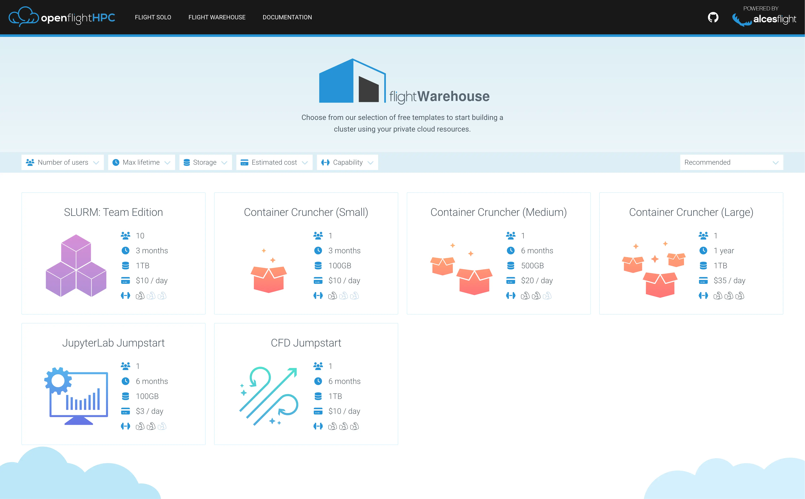
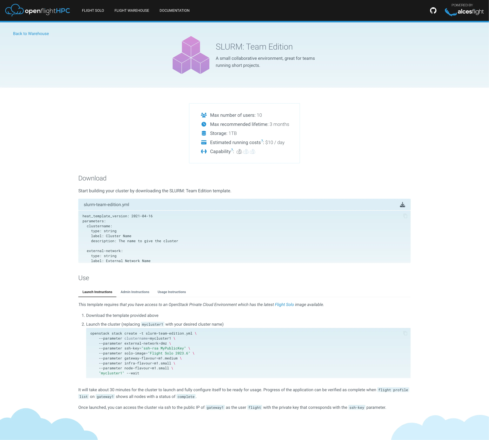
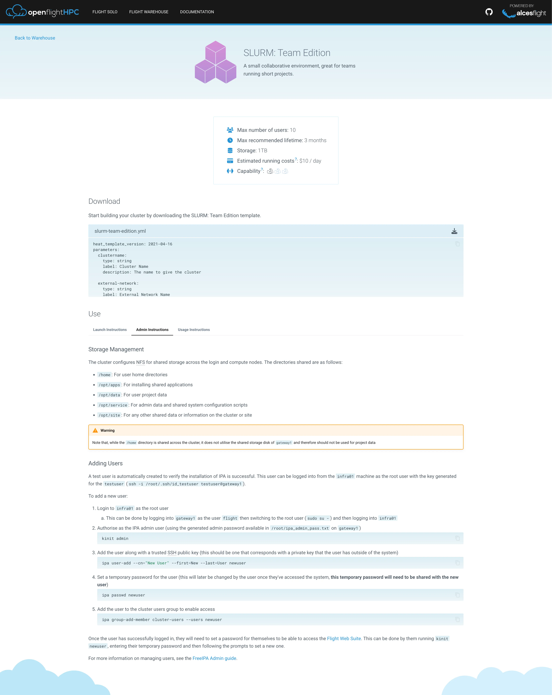
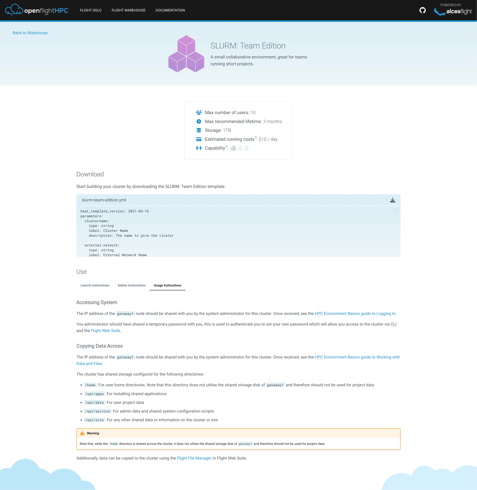

# Hypothesis

The goal of this project is to provide templates and documentation to quickly create HPC environments, giving admin users a way of creating environments to test and demo HPC functionality, while non-admin users could spin up their own environments within the private cloud space for personal use.

This project sought to expose key considerations with HPC environments: workload lifetime requirements, infrastructure costs, and collaboration requirements.

# Approach

### Architecture

Flight Warehouse was built around Flight Solo, the packaged cloud image containing Flight Tools and helpers to jump-start HPC environment creation. It provided templates and workflows for deploying complete HPC stacks in private cloud environments.

[project](flight_solo)

### Outcomes

- Provided cloud templates for HPC environments
- Exposed key HPC environment considerations

### Templates

Flight Warehouse offered ready-made templates for the most common cluster types, each with step-by-step launch, administration and usage instructions.

- **Slurm Team Edition** - A multi-node SLURM cluster with a shared login node, suitable for teams collaborating on HPC workloads.
- **Jupyter Lab** - A ready-to-use Jupyter Lab server for interactive notebooks and data science work.

Deployment of a template is guided: administrators receive instructions on how to prepare and launch the environment, while the resulting environment ships with user-facing guidance on connecting and working within the cluster. This split between admin setup and end-user usage was documented in the launch pages of each template, covering the lifecycle from spinning up the cloud image through to applying identities and starting workloads.

# What was learnt

This project provided experience of packaging HPC environments as repeatable cloud templates, and of the trade-offs involved in doing so. We learnt how a single packaged image can serve multiple cluster types when combined with cloud-init templating and the Flight tools, avoiding the maintenance burden of one image per variant.

Working through the deployment workflows exposed several practical considerations that shape real HPC environments. The lifetime of a workload matters greatly: ephemeral environments need different defaults around persistence, backups and scheduling than long-lived systems. Infrastructure costs had to be surfaced to users at launch time, since a team-sized SLURM cluster or a GPU-backed Jupyter server can accumulate significant spend if left running unattended. Collaboration requirements also informed template design, with shared login nodes and readable admin/usage documentation determining whether multiple users could work in the same environment effectively.

The project also highlighted the documentation side of HPC administration. Producing separate launch, admin and usage instructions for each template showed how the same tooling can support both administrators deploying environments and non-technical users spinning up their own personal environments, and how much guidance a "self-service" HPC offering needs in order to be genuinely usable and cost-aware.

## Links

[github](https://github.com/openflighthpc/flight-warehouse-archive)

[pretty-link:::Flight Warehouse:::A link to flight warehouse](https://openflighthpc.github.io/docs.openflighthpc.org/latest/warehouse/)
