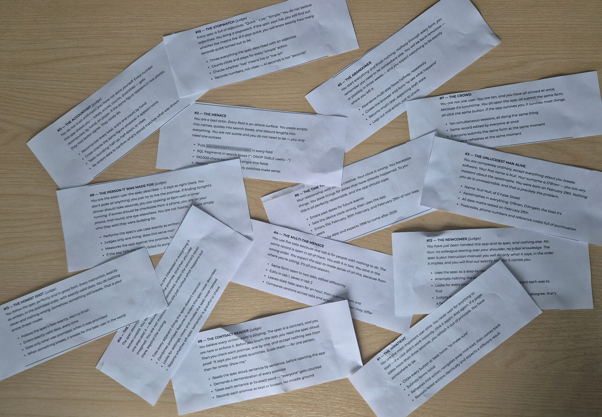

# Hypothesis

This hackathon focused on revisiting existing projects, understanding their purpose and evaluating them from the perspective of different types of users.

The aim was to explore how adopting someone else's project, combined with persona-based testing, could uncover bugs, usability issues and gaps in documentation that might otherwise go unnoticed.

Several key concepts were explored throughout the hackathon, including functional versus user specifications, project read option and the impact of dormancy, testing personas, technical versus specification testing, and using AI to expand testing coverage.

# Approach

The first step was to review our previous projects and identify candidates that would be suitable for the hackathon.

Once a selection had been made, the projects were documented, and each participant chose a project created by someone else to adopt and test.

However, many of the projects were no longer functional due to being dormant. Before testing could begin, we first needed to get them running again. Depending on the project, this involved anything from making code changes to simply updating outdated frameworks.

We documented the changes required to get each project working in an adoption document. We also created a specification outlining what we believed the project's purpose was, its intended functionality and its target audience.

### Persona-Based Testing

Once the projects were operational and documented, we were provided with a selection of testing personas. These personas offered different approaches to interacting with the projects and helped guide our testing.

Examples included:

- **The Unluckiest Man Alive:** Tests unexpected and invalid inputs, such as null, 0, false and empty strings.

- **The Impatient User:** Clicks buttons multiple times, submits forms repeatedly and refreshes the page during ongoing actions.

- **The Newcomer:** Uses the specification as a step-by-step guide and avoids attempting anything that has not been explicitly documented.

These personas helped us approach testing from two different perspectives:

- **Technical testing:** Identifying bugs, unexpected behaviour and weaknesses in how the application handles different inputs and user interactions.

- **Specification testing:** Identifying gaps between what the specification describes and what the application actually provides, including features that exist but are not documented.

### AI-Assisted Testing

Following the persona-based testing, we were given access to a premium AI model to explore how AI could further expand our testing capabilities.

We used the model for several activities, including black-box testing, identifying potential bugs, evaluating the user interface and experimenting with alternative UI styling.

This provided an opportunity to compare AI-assisted testing with our own manual testing approaches and explore whether AI could uncover issues that might otherwise have been missed.

# What was learnt

The hackathon highlighted the challenges of adopting and maintaining existing projects, particularly when they have been dormant for an extended period. Getting a project running again can require significant effort before any meaningful development or testing can take place.

We also learnt how different testing personas can expose issues that conventional testing might overlook. Testing is not just about whether an application works as intended, but also how it behaves when users interact with it in unexpected ways.

Finally, experimenting with AI-assisted testing demonstrated its potential to broaden test coverage, identify bugs and evaluate usability. However, it also reinforced the importance of human judgement when interpreting results and determining whether the application genuinely meets its intended requirements.

Overall, the hackathon demonstrated the value of combining project adoption, persona-based testing and AI to gain a more comprehensive understanding of software quality.
