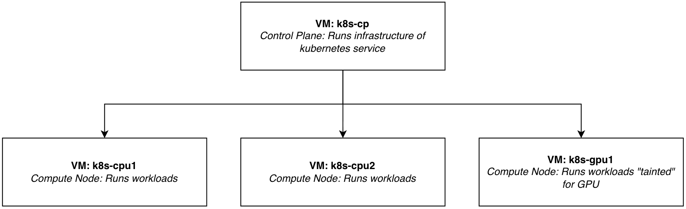

# Hypothesis
This hackathon focused on exploring Kubernetes, developing a better understanding of its capabilities and investigating how container orchestration and scaling could improve workload management and task throughput.

The hackathon had two primary objectives:
1. Investigate whether Kubernetes could be used to manage and execute workloads in a way similar to a traditional High-Performance Computing (HPC) environment.
2. Gain practical experience with Kubernetes concepts, architecture and scaling capabilities.

# Approach
We initially began by using Kubernetes in Docker (Kind) to create a small cluster for experimentation.

The initial setup consisted of a Redis queue, several worker pods, and Grafana and Prometheus for monitoring and visualising the system.

However, we felt this approach abstracted too much from the intended use case. As a result, during the second half of the day, we moved towards a more realistic implementation using virtual machines to host the Kubernetes environment.

### System Architecture

The following architecture was implemented:

The initial implementation focused on allowing users to submit jobs without any additional scheduling logic. This provided a foundation for exploring how Kubernetes could manage and execute workloads.

### Running HPC-Style Workloads

A FastQC job was successfully executed using multiple containers.

The workload was split across separate containers, with one responsible for initialising and preparing the data. This could involve downloading external resources, copying files or formatting and preparing inputs. A second container then executed the actual job.

This approach demonstrated how Kubernetes could coordinate multiple containers as part of a single workload, allowing preparation and execution stages to be separated.

### Job Submission and Scaling

We also explored using Kubernetes to replicate aspects of an HPC job queue.

A Python-based frontend was developed to provide a visual interface for submitting jobs, allowing users to interact with the system without needing to submit workloads directly through Kubernetes commands.

Throughout development, we gained practical experience with several Kubernetes concepts, including:

- **Pods:** The fundamental units used to run containerised workloads.
- **Deployments:** Used to manage and maintain replicated application instances.
- **Services:** Used to provide network access and communication between components.
- **StatefulSets:** Explored for managing workloads that require stable identities and persistent state.
- **Horizontal Pod Autoscaler (HPA):** Used to automatically adjust the number of pod replicas based on resource utilisation or other metrics.
- **KEDA:** Explored as an alternative scaling mechanism, allowing workloads to scale based on external event sources, such as queue length.

# What was learnt

The hackathon provided valuable hands-on experience with Kubernetes and demonstrated how it could be applied to workloads traditionally associated with HPC environments.

One of the main takeaways was understanding how Kubernetes manages containerised applications through concepts such as pods, deployments and services. We also explored how workloads can be scaled dynamically using HPA and KEDA, potentially improving resource utilisation and overall task throughput.

We also learnt the importance of choosing an appropriate architecture when replicating an existing system. Moving from a simple local cluster to a virtual machine-based environment helped bring the implementation closer to the intended HPC use case.

Ultimately, the hackathon demonstrated how Kubernetes could be used to manage, execute and scale containerised workloads, while providing an opportunity to explore how its orchestration capabilities could complement traditional HPC workflows.