# Hypothesis
This hackathon focused on exploring how traditional command-line interfaces (CLI) could be transformed into more interactive, visually engaging experiences using [Opentui](https://opentui.com). 

Participants were given the freedom to define their own individual goals. They could either focus on building a small but complete application or explore a particular feature of the OpenTUI framework. The overarching objective was to experiment with a new technology and learn something new.

OpenTUI also introduced the use of the Bun package manager, which made setting up and running applications relatively straightforward.
# Approach

Rather than concentrating on exploring individual framework features, everyone opted to build a small but complete project. This allowed us to experiment with OpenTUI in practical scenarios and explore the different types of applications that could be built within a terminal environment.

Several projects were developed, each demonstrating different capabilities of the framework.

### Clicker Game

One of the projects developed was a penguin-themed clicker game built entirely within OpenTUI.

The game incorporated several familiar clicker mechanics, including:

- Click detection to generate fish.
- Multipliers to increase resource generation.
- Events and upgrades.
- Buildings that provide passive resource generation.
- Statistics displaying lifetime progress.

The project demonstrated how OpenTUI could be used to create an interactive game with multiple screens, gameplay mechanics and persistent progression.

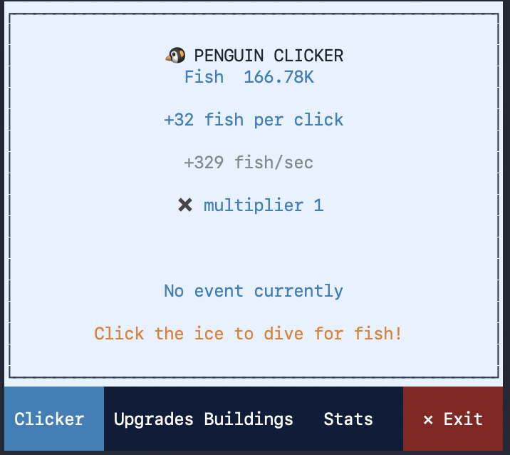
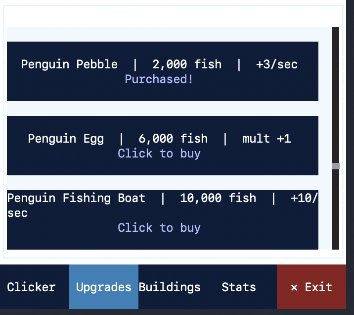
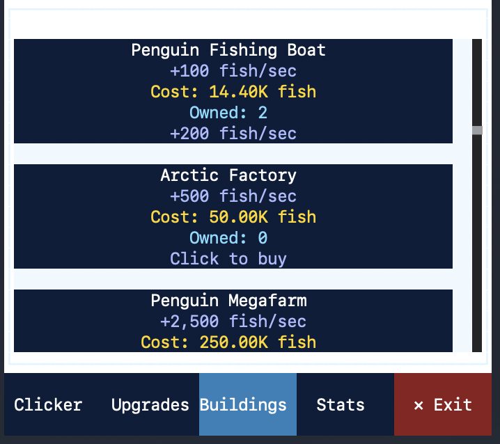
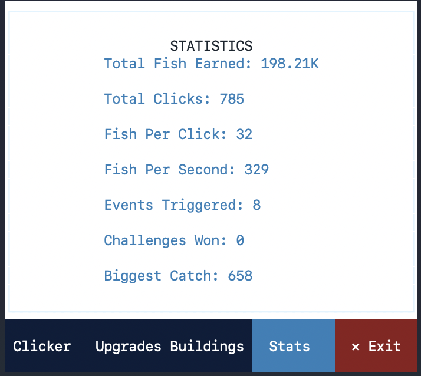

### Visual Representation of TAC

OpenTUI was also used to create a graphical interface for an existing tool,[TAC](https://www.npmjs.com/package/@acegoal07/tac).

The project utilised the React variant of OpenTUI to build an interactive interface, with an additional layer developed between the application and the Docker API. This allowed users to manage clusters and their associated files through a visual interface rather than relying entirely on traditional CLI commands.

The interface included functionality for creating and deleting clusters, as well as viewing information about existing clusters.

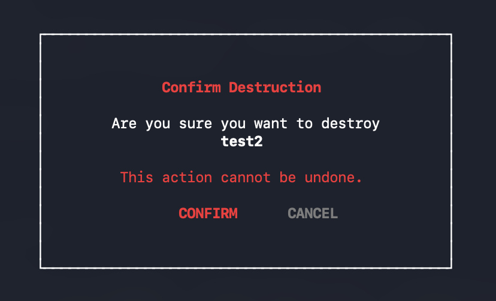
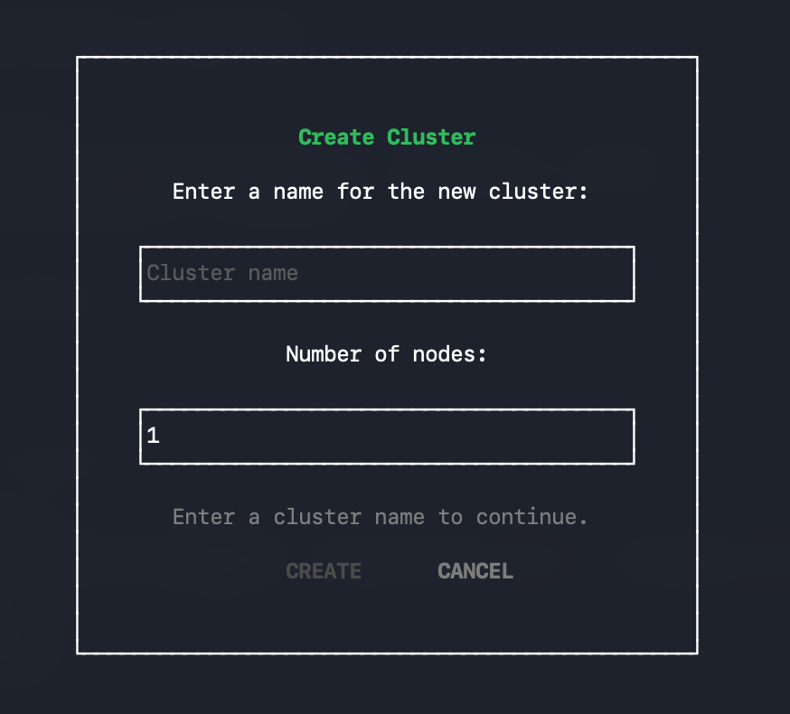
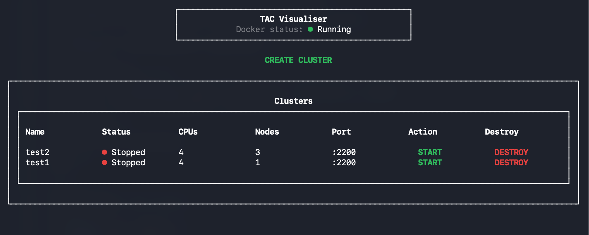

This project demonstrated how OpenTUI could be used to improve the usability of existing command-line tools without needing to replace their underlying functionality.

### Solar System Visualiser

This project combined OpenTUI with the [Three.js framework](https://threejs.org) to create a 3D visualisation of the Solar System directly within the terminal.

Users could explore the different planets by navigating the camera, zooming in and out, and moving between celestial bodies.

The project explored OpenTUI's graphical capabilities beyond traditional terminal text, demonstrating how 3D visualisations could be incorporated into a terminal-based application.

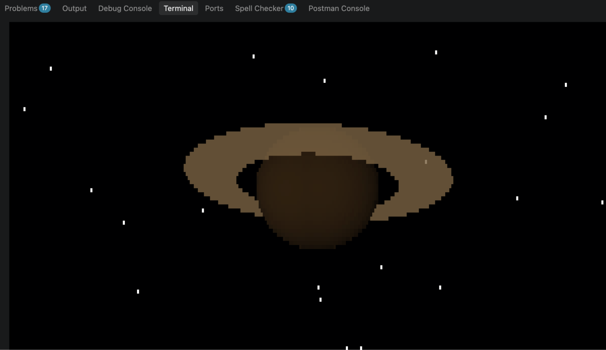
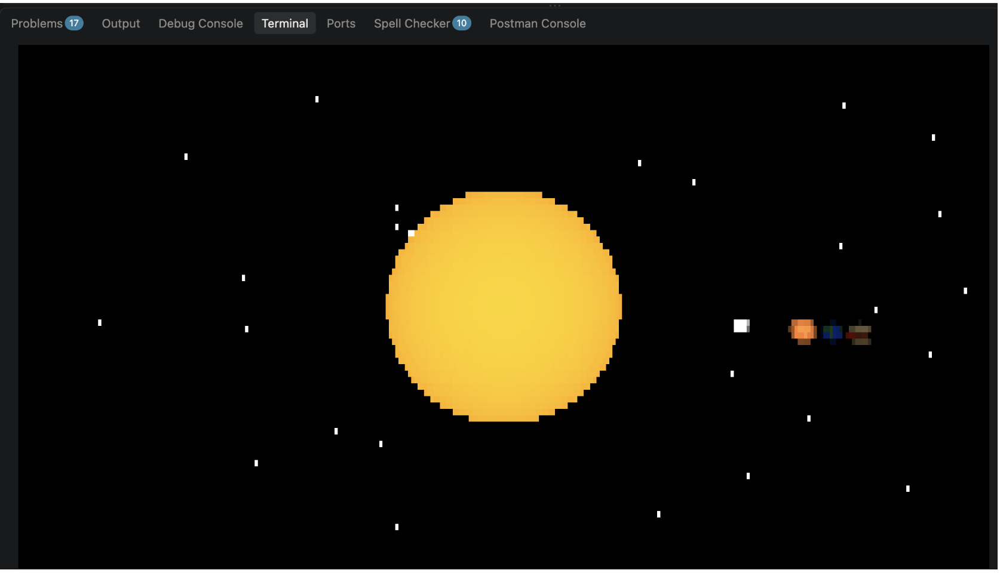
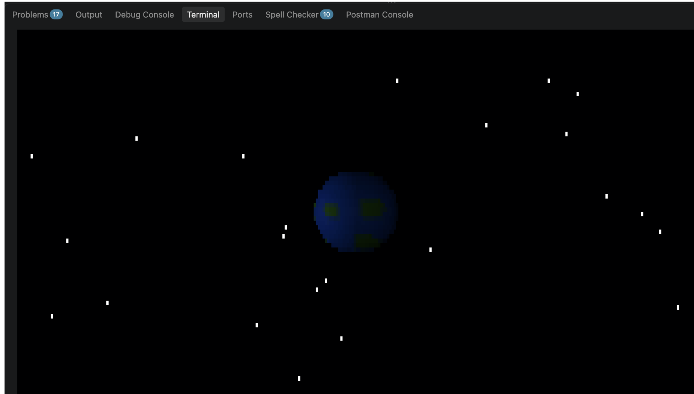
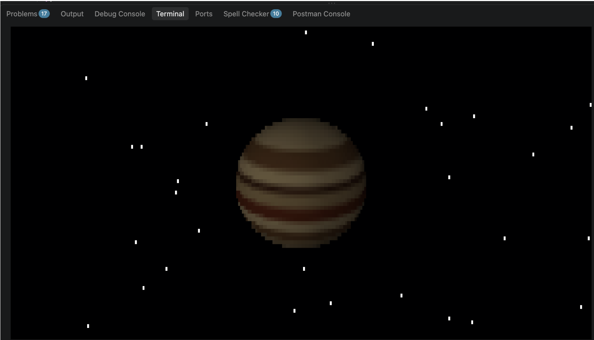

### 1v1 Shooter

Another project explored OpenTUI's capabilities through the development of an arcade-style two-player shooter based around the theme of a gentleman's duel.

The game begins with a coin toss to determine which player shoots first. Players then take turns firing at one another, with the opposing player attempting to dodge incoming bullets by jumping.

The first player to successfully hit their opponent three times wins the duel.

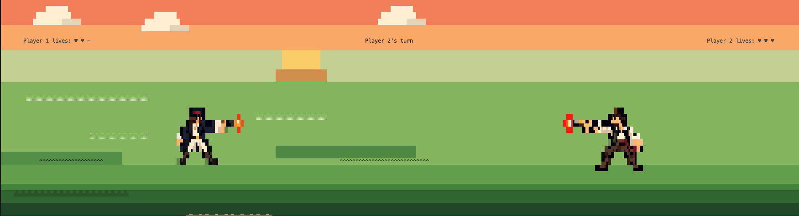

This project demonstrated how OpenTUI could support interactive gameplay, player input and real-time game logic.

### Minesweeper

OpenTUI was used to recreate the classic game Minesweeper within the terminal.

A dedicated cell object was implemented, with each cell maintaining different states and properties, such as whether it had been flagged or revealed.

Users could uncover cells, place flags and interact with the surrounding grid. The game also implemented the familiar Minesweeper mechanic where neighbouring cells are automatically revealed when a cell has a danger score of zero.

This project provided an opportunity to explore how OpenTUI could handle grid-based interfaces, interactive elements and game state management.

### Album artwork renderer, browser & previewer

This project explored OpenTUI's multimedia capabilities, particularly its ability to render images within the terminal using Unicode blocks and support audio streaming.

The[Deezer API](https://developers.deezer.com/api) was integrated to retrieve album artwork and provide track previews.

During the first half of the day, development focused on creating a functional interface capable of displaying multiple albums.

During the second half of the day, further functionality was introduced, including an audio waveform visualisation and 3D elements. These additions transformed the album carousel into a floating, more visually dynamic interface.

This project demonstrated that terminal interfaces do not necessarily need to be restricted to text and basic formatting, and can instead incorporate multimedia elements and more sophisticated visual experiences.

# What was learnt

The hackathon provided an opportunity to explore OpenTUI and its capabilities as a framework for building interactive terminal applications.

One of the main takeaways was how much more can be achieved within a terminal environment than traditional command-line interfaces might initially suggest. Through OpenTUI, we were able to experiment with graphical interfaces, games, 3D visualisations and multimedia applications, all while remaining within the terminal.

We also explored how OpenTUI could be used alongside other technologies, including React, Three.js and external APIs such as Deezer. This demonstrated the flexibility of the framework and how existing tools and technologies could be combined to create more sophisticated applications.

Another important takeaway was the value of having freedom to experiment. Rather than working towards a single predefined outcome, everyone was able to pursue an idea that interested them, resulting in a diverse range of projects and approaches.

Ultimately, the hackathon demonstrated that the CLI does not have to be limited to text-based interaction. With frameworks such as OpenTUI, it is possible to build rich, interactive experiences that retain the convenience of terminal-based applications while introducing many of the benefits traditionally associated with graphical user interfaces.