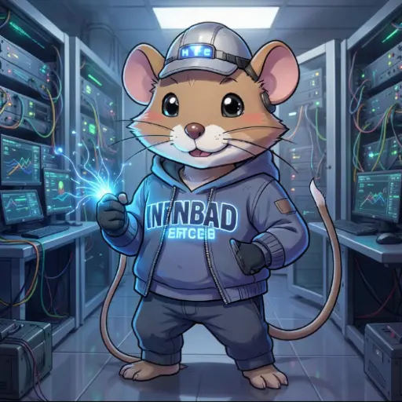
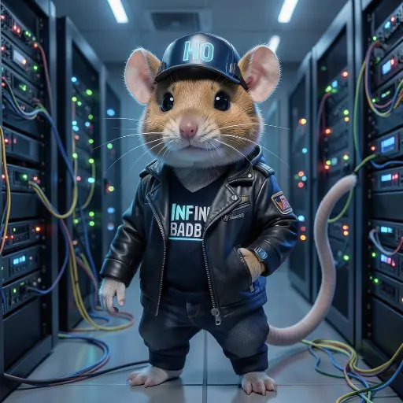
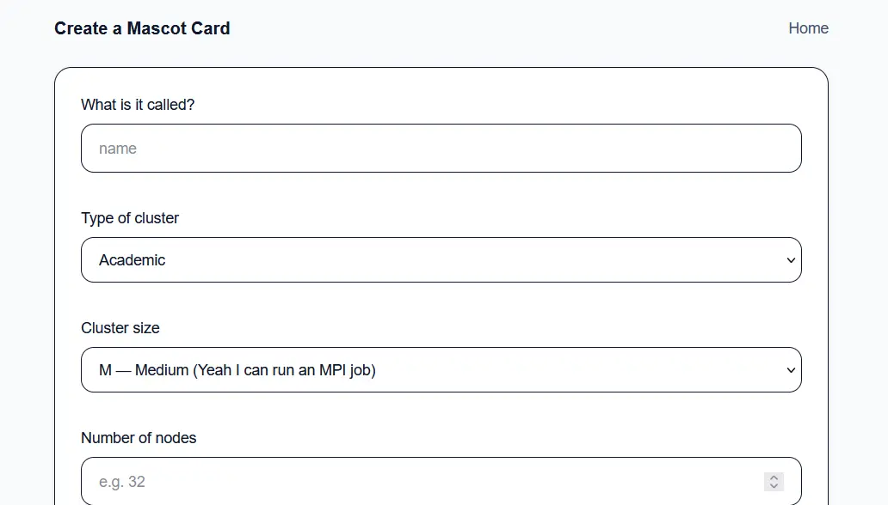
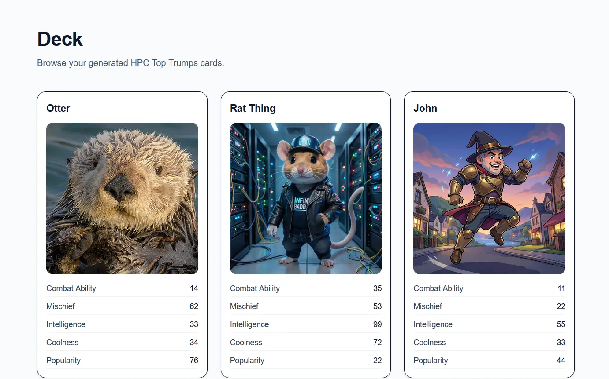
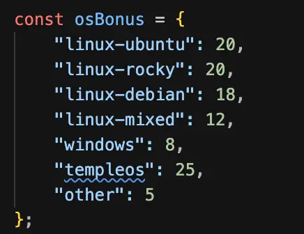
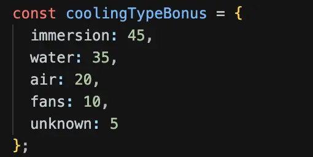
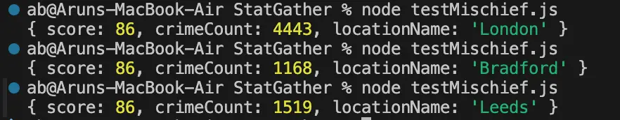
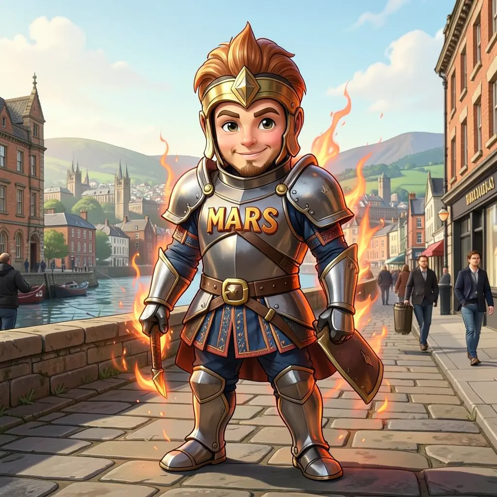
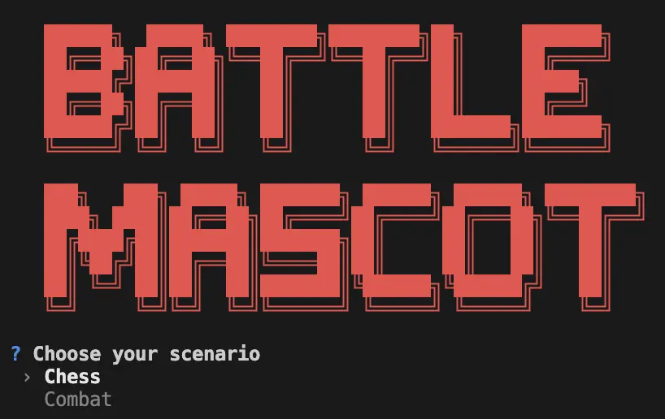
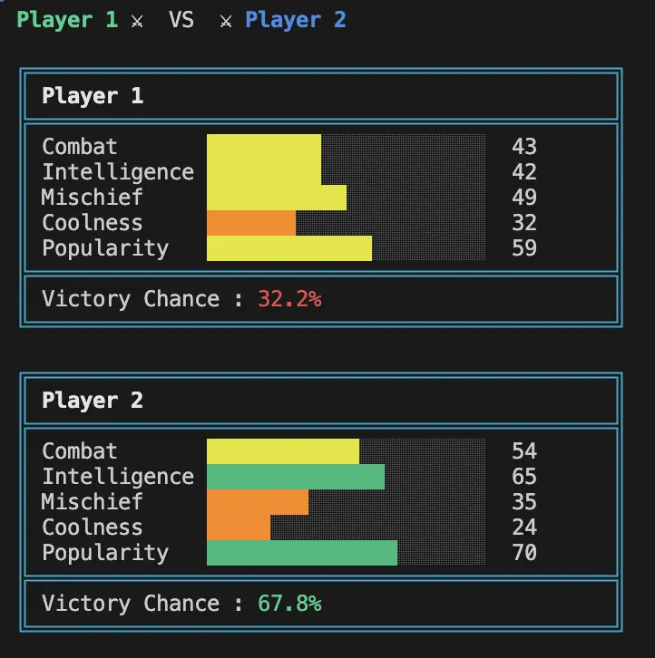

# Hypothesis

The goal of this hackathon was to explore how the characteristics and attributes of High Performance Computing (HPC) environments could be used to generate unique mascots using generative AI. Each mascot would represent an HPC cluster through its appearance and individual statistics, with the aim of making technical cluster information more engaging and accessible.

# Approach

The team split into smaller projects, with each member or group focusing on a different component of the overall system. These components were designed to integrate with one another to create a complete mascot generation and gaming experience.

### Image Generation Server

Initially, we experimented with [Ollama's image generation models](https://ollama.com/blog/image-generation). Although these models ran successfully locally, they presented challenges when it came to scalability and hosting.

We then experimented with running a smaller image generation model, approximately 6GB in size, on CPU-only hardware behind a lightweight web server. This server accepted user inputs and returned a generated image. Despite running without GPU acceleration, the model was able to generate an image in approximately one minute.

Initially, the server struggled to handle multiple clients simultaneously. After addressing these issues, it was able to generate multiple images successfully.

The following images compare the results produced by the original Ollama model and the smaller 6GB model.

### UI for Image Generation Server

To make the image generation process more accessible, a user interface was developed rather than requiring users to interact directly with the server. This frontend was built using Next.js.

A form was created to collect the attributes required to generate each mascot, allowing users to provide information about their HPC environment and use it as input for image generation.

The website was also extended to display the generated mascots alongside their individual statistics. This allowed users to compare mascots and see how different HPC environments influenced their characteristics, creating a Top Trumps-style experience.

### Stats Generation

One team member focused on developing the statistics system for the mascots. Each mascot was assigned five attributes:

- **Combat Ability**
- **Coolness**
- **Intelligence**
- **Popularity**
- **Mischief**

These statistics were calculated using information about the HPC cluster and its surrounding environment. For example, bonuses could be awarded based on the cluster's operating system, cooling system or number of compute nodes.

The mischief statistic was based on the crime rate of the area in which the cluster was located. To obtain this information, we integrated the [Data police UK API](https://data.police.uk/docs/).

However, we encountered difficulties working with the API, meaning that not all the data and features we had originally hoped to incorporate could be implemented.

### Image generation experimentation

A key requirement was finding a way to pass user-provided information into an AI model to generate mascot images that reflected the characteristics of each HPC environment.

We initially experimented with the [pollinations.ai API](http://pollinations.ai), using a prompt template to generate images based on user selections. This approach allowed different inputs to be passed to the model, but the results were often too similar to one another. The model also struggled to process longer prompts, limiting how much information could influence the generated images.

Following this experimentation, we moved towards hosting our own image generation model through the image generation server. This allowed the website to make API requests directly to the model and gave us greater control over the generation process. The resulting images were more reflective of the prompts and the specific HPC environments being represented.

### Mascot Battling Game

To make the generated mascots more engaging, we also developed a command-line battling game that integrated with the mascot API.

The game allowed users to select two mascots to compete against one another. Their statistics were then used to calculate the probability of each mascot winning.

Different battle scenarios were introduced, with each scenario assigning different weights to the five statistics. This meant that a mascot's chances of winning depended on the scenario selected, rather than simply having the highest overall stats.

Once the probabilities had been calculated, the game displayed the likelihood of each mascot winning and used these values to determine the winner.

# What was learnt

This hackathon provided experience in developing an end-to-end application by combining several independently developed components. We learnt how to host an image generation model behind an API, including the challenges of running models using CPU-only hardware, handling multiple simultaneous requests and balancing image quality against performance.

We also gained experience integrating a Next.js frontend with backend services, using external APIs to retrieve data and translating real-world information into game statistics. Experimenting with different image generation models highlighted the importance of model selection, prompt design and testing generated results against the intended use case.

Finally, developing the battling game demonstrated how data generated from real HPC environments could be transformed into engaging interactive features.

Overall, we learnt how to bring together generative AI, web development, API integration, data processing and gamification into one connected system. The hackathon also highlighted the importance of defining clear integration points between independently developed components and allowing time to address compatibility and API limitations.
