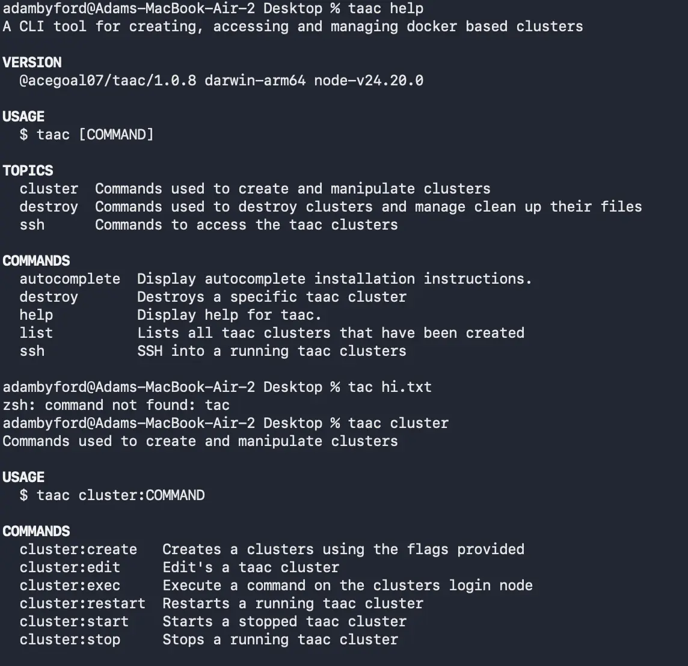
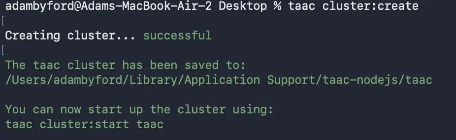
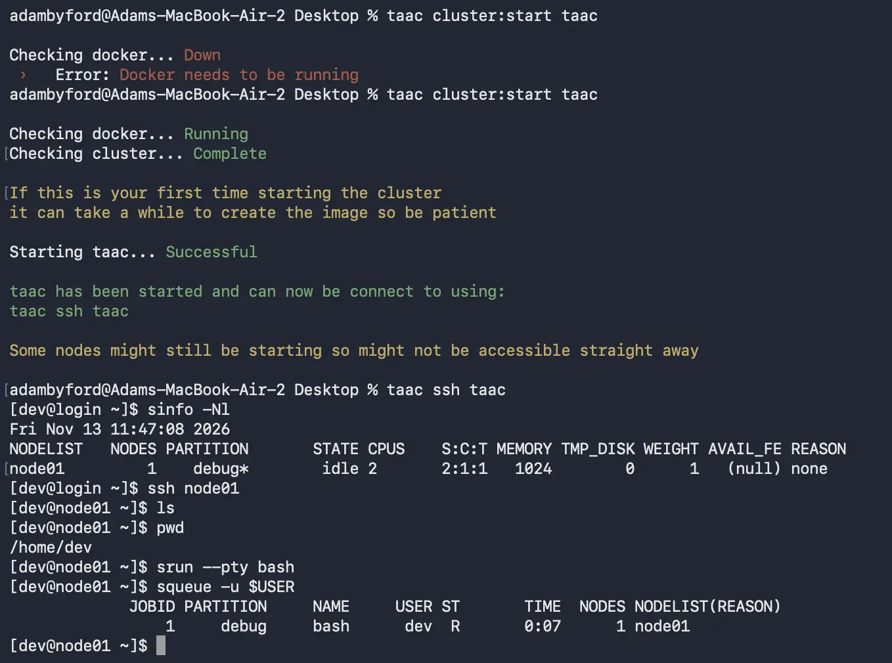
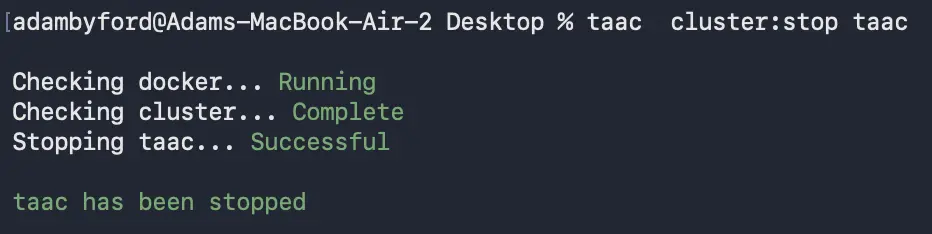

# Hypothesis

The goal behind this project was to create a CLI tool that allows user to create test clusters using docker, offering the ability to customise, manage and access the created clusters from within the CLI.

taac (Technically Almost A Cluster) provides a way for users to spin up throwaway HPC-style clusters on any machine with Docker and Node.js, without needing dedicated infrastructure. It is intended for testing tooling, demonstrating workflows and learning how clusters behave, with the full lifecycle: creation, customisation, access and teardown. Handled by a single CLI.

# Approach

### Building Clusters with Docker

taac uses the Docker API to build clusters out of containers, treating each container as a node in the cluster. A cluster is provisioned from prebuilt images (Rocky Linux 9.3 based, with a Slurm image used for scheduler workloads), so creating an environment becomes a matter of describing it rather than manually assembling one machine at a time.

Cluster creation is driven by options passed to the CLI, giving control over the shape of the environment from the start:

```bash
taac cluster:create --name=mycluster --nodes=4 --cpus=2 --memory=4g
```

- `--name=<cluster_name>` Name the cluster for later access.
- `--nodes=<number>` Set how many nodes the cluster contains.
- `--cpus=<limit>` / `--memory=<limit>` Constrain the resources each node can use.
- `--port=<port>` Choose the port the cluster is exposed on.
- `--database` Include a database within the cluster.
- `--module=<manager>` Pick the module manager to use (`lmod` or `em`).
- `--packages=<list>` Install extra packages into the cluster.
- `--commands=<list>` Run extra commands during setup (before packages install).

Because the cluster is recreated from these settings, the same command always produces the same shape of environment, which makes it usable as a repeatable test fixture.





### Managing Clusters

Once created, clusters are managed entirely through the CLI. Environments can be paused and resumed, their configuration edited after the fact, and commands executed inside them without opening an interactive session:

- `taac list` Show all available clusters.
- `taac cluster:start` / `taac cluster:stop` / `taac cluster:restart <name>` Control a cluster's lifecycle.
- `taac cluster:edit <name>` Change nodes, resources, port, modules, packages and commands of an existing cluster.
- `taac cluster:exec <name> <command>` Run a command inside the cluster.

When a cluster is no longer needed it can be destroyed individually or all at once with `taac destroy:all`. Passing `--preserve` keeps the cluster definition file so the identical environment can be recreated later.





### Accessing Clusters

taac exposes the created clusters as real, reachable environments. `taac ssh <name>` opens an SSH session onto the cluster, while `taac ssh:info <name>` prints the connection details for tools that want to handle access themselves. This keeps the workflow the same whether a user is poking around a one-node sandbox or working across a multi-node setup.

# What was learnt

Building taac was an exercise in treating infrastructure as a disposable, declarative resource. Driving Docker through its API showed how far containers can be pushed towards behaving like cluster nodes: wiring up multiple containers as peers, exposing them through a single port, and reproducing enough of a real cluster's surface (SSH access, schedulers, module managers) for meaningful testing without any dedicated hardware.

The project also demonstrated the value of describing environments rather than hand-assembling them. Because a cluster's shape is captured in its creation options and preserved in a definition file, environments become repeatable, the same inputs produce the same cluster, edited configurations apply cleanly, and `--preserve` means even a destroyed environment can be brought back identically.

Finally, taac highlighted what a good CLI lifecycle looks like. Covering creation, customisation, execution, access and teardown inside one tool removed the usual scatter of docker commands, config files and SSH incantations, and showed how a small CLI wrapper can make disposable infrastructure feel as approachable as any other developer tool.

## Links

(github)[https://github.com/acegoal07/taac]

[pretty-link:::taac npm page:::A link to the taac npm page](https://www.npmjs.com/package/@acegoal07/taac)
