# Week 1

## VVIZ Scripts

From the scope I chose to work on and continue to refine the core VVIZ scripts that the API relies upon, one of the concerns brought up during the week was that jobs were being scheduled on the vviz’s on slurm instead of the compute nodes themselves which is an inaccurate representation of how the system works.

Much of my week was spent solving issues with the core scripts which revealed themselves during usage, one of these was a major flaw in the fstab file in the virtual machines which caused the machines to start up again without an ip address which caused a major failure as it was unable to connect to the shared nfs drive and wasn’t able to ssh to the other nodes making them inaccessible and causing the job to fail.

I was able to add some features to the VVIZ scripts during the week with the addition of the newNode.sh script, this allowed for new viz node slots to be easily added with the files being edited programmatically as well as the viz nodes being configured with slurm and connecting to the nfs mount programmatically.
Furthermore the ability to delete viz node slots was added to the newNode.sh script.
Finally I created a setup script for the VVIZ core scripts however it has not been tested yet.

I have learnt more about programmatically changing existing files using bash, as the newNode.sh script is reliant upon this particularly for changing the amount of licenses in the slurm.conf file as this number needs to go up and down as viz node slots are added and removed.
I also learnt about and solved the issues with vviz that emerged as more people used it, namely the issues with how fstab was set up as well as issues with the vviz scripts themselves.

This coming week I will be continuing to work on the vviz core scripts, I plan on actually killing the virtual machines and then reconfiguring them instead of the stop, reconfigure and then start system we currently have.
Actually killing them will result in all files on the virtual machine being lost once the user's vviz session is up matching the intended behaviour.
Furthermore I also plan to integrate a seasoning option into the core scripts allowing users to ask for specific “seasonings” which would result in the vviz coming with requested software on start.
Finally I plan on implementing an absolute endtime for vviz jobs so instead of saying I want the job to last x hours you can specify I want the job to end at x time.

Below is the successful output of the newNode.sh script adding a slot for viz7:

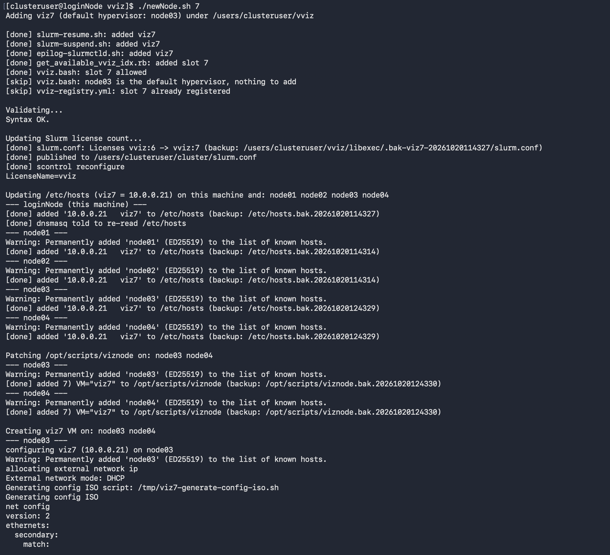
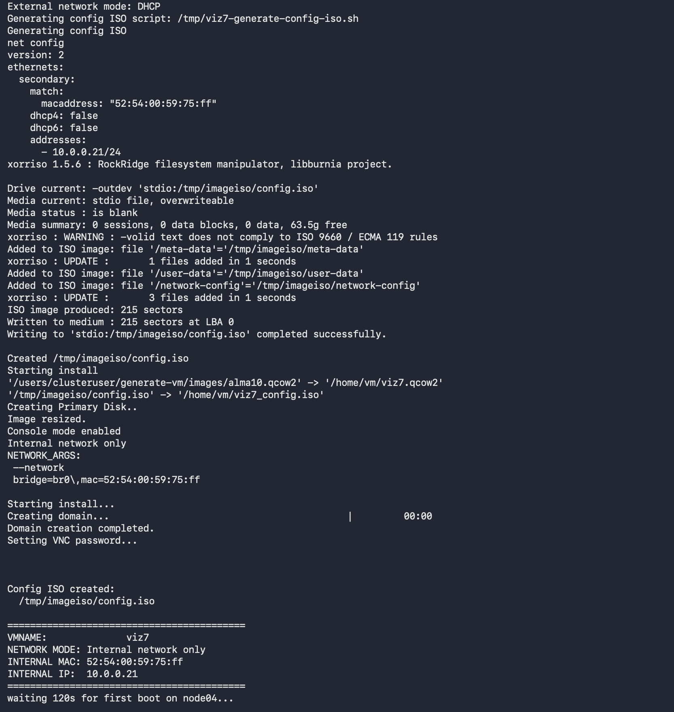
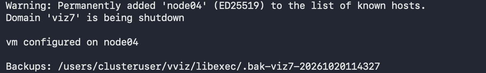

## API

We set out to make an api that could interact with slurm in order to determine what vizes were running on a cluster.
The idea was a proof of concept for an api that could sit on the login node, in order to run slurm commands to manage what vizes were running.

We used the hono template that we already had, and found that it was possible to directly run slurm commands via node, and output the data as json.
We did find that you had to be very restrictive with what commands can be run, as an RCE exploit could be very dangerous on a web interface attached to a HPC.

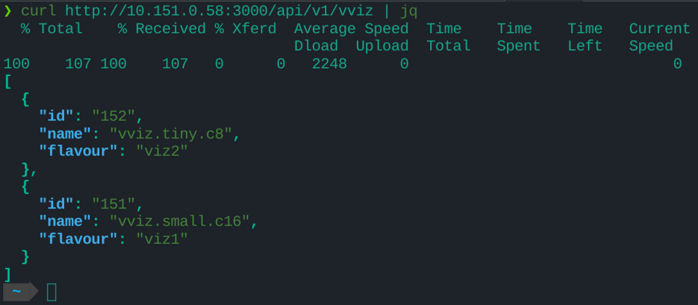

After that, we made a delete endpoint that would run the scancel process on that id.
To do that, we found that scancel and squeue will return stderr if you give it a job id that didn’t exist, so we had to make a method that would ensure that the job existed, and was a viz job before cancelling it.

We were able to use the fact that the genders are just sbatch scripts to create an endpoint that lists the available flavours.
Also by reading the content of those scripts, we was able to get information about them such as their core count and memory.

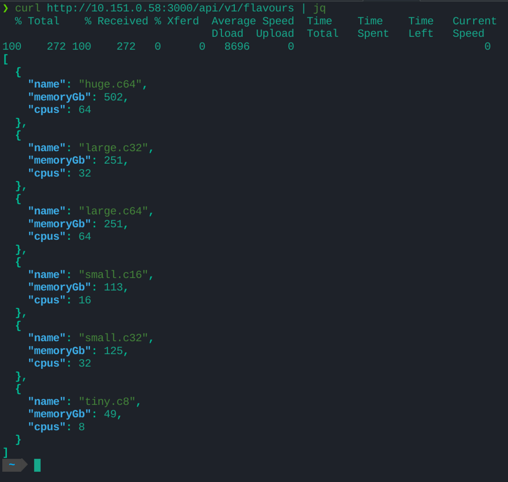

Finally, using the flavour names, we could make an endpoint that created a vviz.

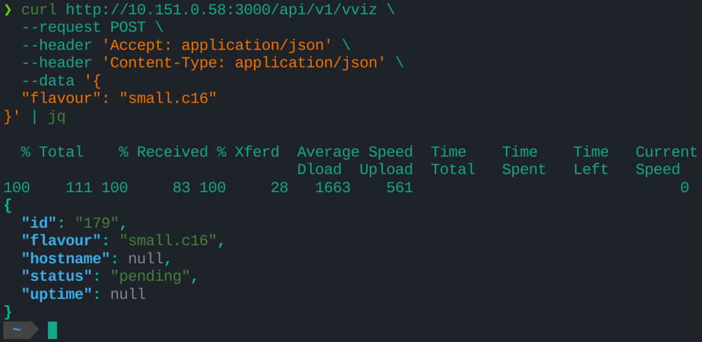

Using slurm commands as the data layer proved to be a bit challenging, as the outputs are optimised for human readability and not for computers.

We found that there is a package to give slurm a REST api, and that would be a much better way of interacting with slurm as it can include the safeguards and doesn’t involve running bash commands directly.
The issue with it is that it isn’t installed by default on slurm, so there may be clusters without the api.
We believe that the best way to implement this would be to have a layer of abstraction between the data layer, which could be either direct slurm commands or the slurm REST api, and the rest of the api.
This way, the api can run on any slurm installation, and can be configured to use whichever is more convenient.

While working with the slurm REST api though we realised that it would be better to interact with slurm through the commands to help reduce the need for additional software to be installed when setting up the API.
It would also help further down the line with development as when we implement logging into the user accounts we will need to be able to mimic the user and run commands which gets complicated through the slurm REST api so it is better to focus on developing the commands variant.

### Continuing

#### Oscar

I am going to do some experimentation on an idea I had to book out slots so that users can be sure of when their vviz session is starting.
The idea for this can be seen here:

When the user creates a VVIZ, they can specify times that they would not like to be booked out, e.g. night, lectures/labs, other commitments, etc, along with their flavour.
The system would then use the start time and time limits of existing and queued jobs in order to find the next available slot that would fit the specifications of the user, and then the job could be queued, with the job id returned to the user so they could keep track of its status.
Jobs would be run internally with slurm with the --begin flag so that they won’t run too early.

If a vviz session was cancelled early, other vviz sessions would not be reorganised to account for this gap, the slot would be made available for booking by other people.
This is because if a user has been told that they have the machine from a certain time, they will schedule things around it and it wouldn’t make sense for it to start early.

This information could be visualised like this in order to show how much resources are available:

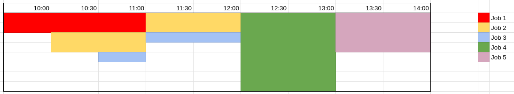

Pros:

- Users would know exactly when their vviz sessions would be
- Users would be able to specify when they don’t want their sessions
- Users would be able to easily see when their job could run through visualisations
  Cons:

- This seems like trying to turn slurm into a more traditional booking scheduler rather than what it was designed to do: get as many jobs running as soon as possible.
- It wouldn’t integrate well with the regular usage of slurm, as slurm will make earlier jobs take priority, and not respect the begin time of existing jobs. The system would have to be configured to use slurm’s reservation system. This would make it difficult to run jobs where you don’t know how long they will run for, so clusters may have to be partitioned to allow for these sorts of jobs.

#### Alex

I am going onto authentication using PAM to interact with the linux user system and combining it with JWT token to lock the API behind needing to be logged into a linux account which is on the slurm cluster and so that jobs can be started as the logged in user so only they can control and access their jobs.

## Frontend

This week our task was to explore creating virtual machines for users that would double as their own personal login node where they can run jobs.
I wanted to explore a web UI that would help guide users to create their own personal virtual computer on a cluster.
The frontend used Alex and Oscar’s API to view flavours, create instances and track the status of those instances.
After experimenting with the frontend for AWS, a clear pain point was a lack of user flow and a very noisy UI.
I therefore decided to create a UI that was clean, minimal and straightforward for a user that would hopefully minimise any future pain points they would have when interacting with the site.

I named the site AlcesNova, or New Moose, as I wanted a modern, technical sounding name without down selling the project.
The landing page features a supernova-inspired design with the project name and clear guidance of what it does.
It also features an infinite marquee with the software packages that would come preinstalled with launching the computer.
(This needs some revising as unsure whether the VM inherits all the software from the compute node it is hosted on, or whether a user would have to install all desired software packages themselves.)
This was added to increase transparency for the user, answering questions regarding whether the virtual machines would have the software they needed.

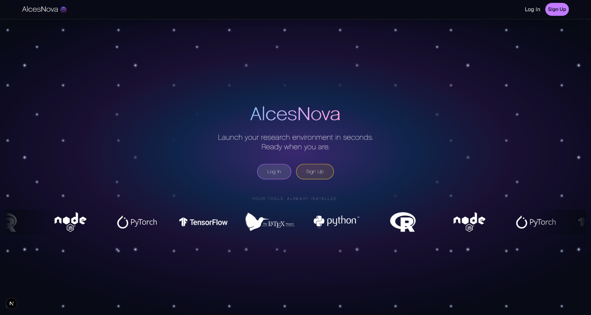

The flow is log in → select a flavour → create instance → track status → if running, provide instructions for connection to their machine.
The connection options included a web terminal which was achieved through running a separate backend and opening up a websocket where the client could SSH in and see the terminal in real time.
This was more a demonstration of possible features of a production build and more research has to be done to ensure if this can be done securely when in production.

Next week I am going to work on displaying more information for the user when selecting a flavour, specifically I aim to tell them how long they can expect to wait for their virtual computer to launch depending on what flavour they select.
I will also look at improving the web terminal experience and ensuring it is safe and secure.

## Monitoring

In the first week of R&D I made a vviz monitoring system for individual instances of a vm.
This gathered cpu utilisation, memory utilisation, network activity, ssh sessions and vscode activity.
This could also detect how many people sshed into the vm using vscode and tell the difference between that and a normal terminal ssh in.

The idea was if someone wasn’t using the vm the vm could go into a hibernation state and potentially lend the resources back to the rest of the cluster.

I built this agent originally in typescript and it found the information mentioned in the first paragraph and printed the results in json every ten seconds initially.

I realised a few days into development I was solving a problem that was never a problem.
We don’t necessarily need to see how much individual vviz vms are doing through an agent on each vm, it would be better if we had something on the cluster which monitors it all rather than having something on each vm which collects a lot of information parts of which are unnecessary.

As I already built the monitoring agent I thought I would get AI to rebuild the agent in go and see how it compares as in the future in a different/another project I may need to make something that runs as a monitoring agent and I was not sure if typescript would be the best one to use in that scenario
Below is a table of my findings of comparing the Go agent to the TypeScript agent.

| Metric       | TypeScript/Node.js | Go                         |
| ------------ | ------------------ | -------------------------- |
| RSS memory   | ~60.4 MiB          | ~10.9 MiB                  |
| PSS memory   | ~26.6 MiB          | ~9.5 MiB                   |
| CPU overhead | Higher             | ~6.5–6.7× lower CPU time   |
| Deployment   | Requires Node.js   | Single compiled executable |

### Conclusion

It is possible to somewhat monitor an individual on a vviz vm, however its pretty much redundant when all the information is accessible from libvirt, getting rid of the need for a monitoring agent on every vm.
However, I do think if I am to make a monitoring agent of some kind that is on a lot of vms or nodes or something, it may be worth looking into a go solution rather than typescript due to it being so much smaller than a typescript solution
Also without doing this research I wouldn’t be able to confidently say that its not worth having a monitoring agent on each vm but I can say that now
The information you can gather on a vm is more but not much more and it's relatively redundant information
Below are URL’s to the monitoring agents I made. I also have more detailed notes I have saved locally under my VVIZ folder in my notes on Obsidian locally.

[go agent](https://gitlab.dmz.alces.network/a04b04/go_vviz_agent)

[typescript agent](https://gitlab.dmz.alces.network/a04b04/ts_vviz_agent)

Below is example of data of what both agents would give out:

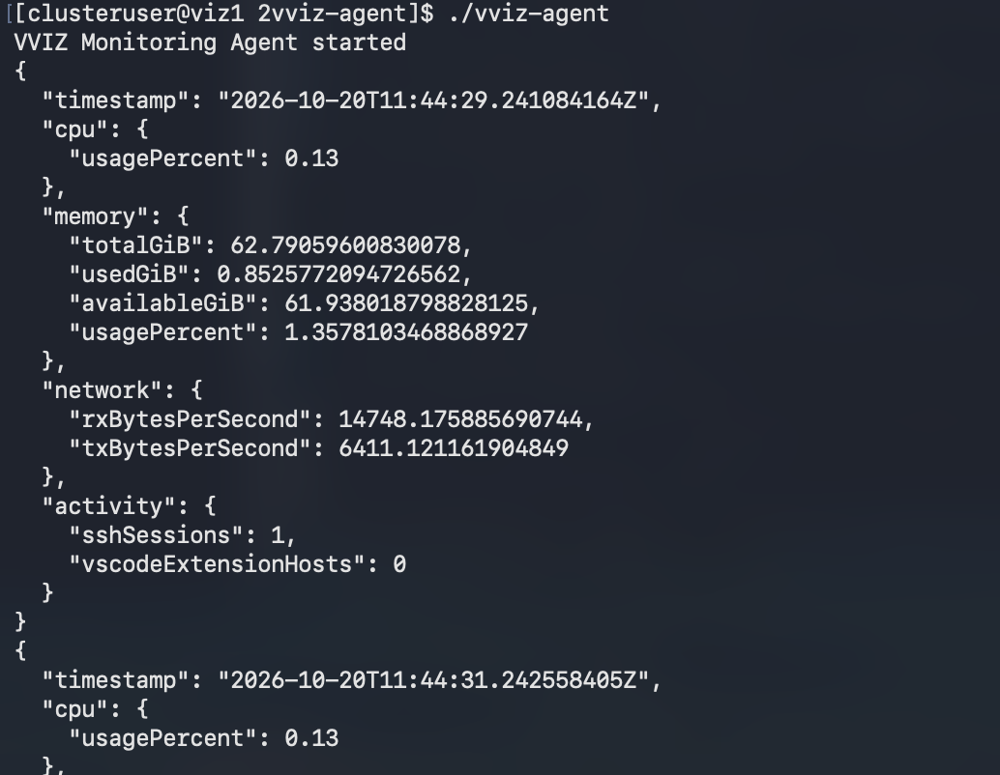

# Week 2

## VVIZ Scripts

In week 2 I continued to focus further on the core scripts.
I fixed the scripts to properly kill and bring back up the vviz's, this means that all files kept in the vviz’s root directory are lost when the vviz stops.

My main focus this week was to expand the options available on the vviz's, my main way of doing this was through seasonings, these are software packages that the user can specify they want the vm to be installed with.
For example you can specify that you want the vviz to have the blender seasoning and on the state changing to ready the vviz will be fully functional with blender installed.
Alongside seasonings I also implemented multiple operating systems on the vviz’s this week this means that the users have a high amount of flexibility in terms of what options they can have on their vviz.
A major problem I ran into when implementing seasonings alongside the multiple operating systems options was the fact that different operating systems use different syntax for installation of software.

These options combined lead to difficulties making the seasonings work, something I have learnt this week is that the installation process can vary largely depending on the distribution of linux the vviz is running.
In particular openfoam was a seasoning that was difficult to make work as a lot of distributions weren’t able to install it easily, alma10 in particular simply had no packages for it available.
This led to the usage of apptainer to install openfoam and after a lot of trial and error all operating systems tested to date have been able to support openfoam running on them.

Furthermore I have implemented vnc connections to vviz nodes this week and gui options allowing for multiple ways to access a vviz node, the gui is optional making the vviz nodes more flexible and better able to meet different user requirements.
Due to the vviz nodes being only on the internal network currently and using the login node as a router in order to make vnc connections work an ssh tunnel has to be established which prevents vnc connections in their current state from being implemented into web frontends.

After requests by Oscar the attributes of a vviz are now stored in the comments of the job in json format making it easier for an API to parse making development of web APIs easier.

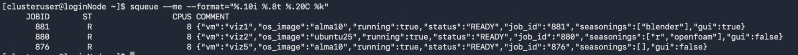

This week I have also started to merge files into the prolog.sh file cutting down on the amount of files the vviz core scripts have, it should also make it easier to work with as it will centralise all of the generate and setup vm logic into one central file rather than being spread out across multiple.
Next week on merging files into the prolog.sh will continue into the following week as well as expanding the amount of seasonings available, research into passing gpus into vviz nodes and general changes to make the system more user friendly for example by placing the vnc connection information into the home directory of the user that creating the vviz rather than just outputting it into a slurm.out as is done currently.

Below is screenshots of the current list of seasonings implemented, OS’s supported and a vviz running a gui:

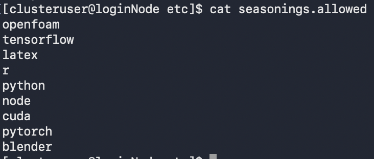
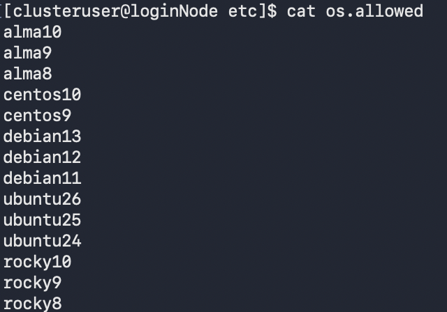
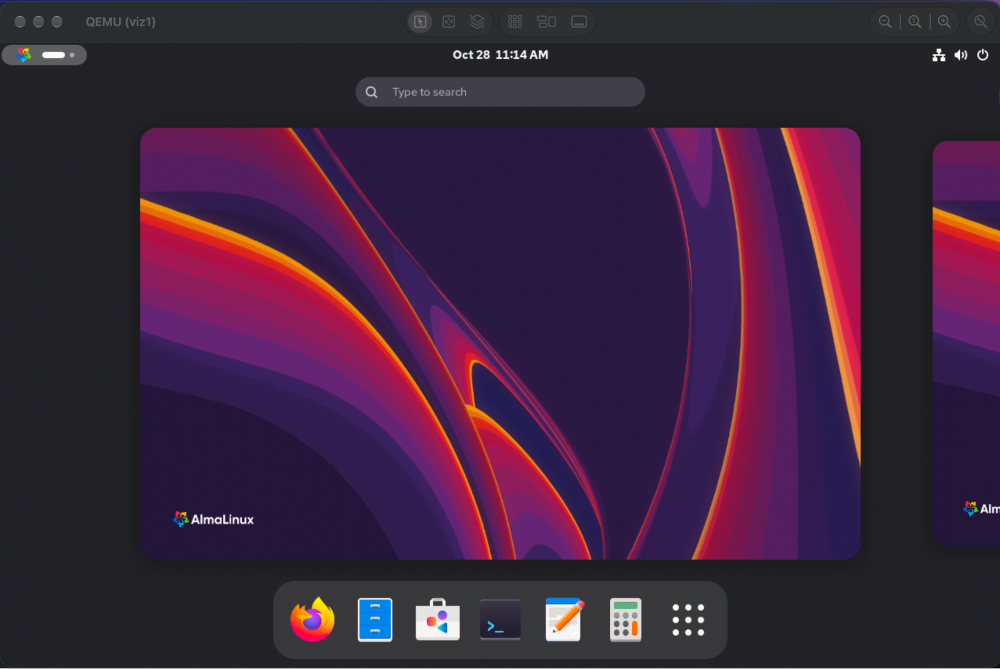

## API

In Week 2 I focused on adding user authentication into the API using PAM to validate the users login credentials against the linux system then once the user has been authenticated providing the user with a JWT token stored in HTTP only cookies which is then used to authenticate the rest of the users API request without the frontend handling the JWT token.

I went for this approach as it offers the best protection for users accounts helping to prevent cookies from being manipulated on the frontend, I also made it so the secret for the JWT tokens is generated on boot of the API and stored in memory to help prevent the secret from being stolen and used to read and sign new JWT tokens, this also allows for the secret to be rotated by just restarting the API.

The validation for the JWT tokens was added as middleware so it automatically gets implemented onto new API endpoints unless they are specifically specified as endpoints that do not need authentications, with this I also implemented a CSRF middleware to help protect the API more.

I also implemented rate limiting and timeout on the login endpoint to help prevent people from spamming the endpoint and overwhelming the PAM authentication system.

With the authentication implemented I also implemented user mimicking so once a user is logged in all jobs are then submitted by their linux user account and then can only be cancelled by their account.
I also implemented the web terminal into my API with authentication so when SSH through the API the user is logged into the terminal as their linux account.

In week 3 I want to focus on improving the API alongside the frontend to make sure it's able to do everything the frontend needs as well as look into build a CLI tool that can interact with the API as well as look into the web terminal and investigate a better way to handle the keys instead of generating new ones every connection.

### Continuing

#### Oscar

Building off of the api I made last week, I decided to go more in depth into the idea of resource management on the clusters, and the idea of booking a slot.

##### Portions

One of the things I was experimenting with was the idea of breaking up the nodes into “portions” that were an abstraction of computing resources.
The idea behind it being that you would be able to see how much “space” was available on a node now and in the near future at a glance, to make it easier to determine if a vviz flavour could fit in a node at a certain time.
The idea of scheduling would also have fit into this with “portions” being the units of compute power that determine if a vviz could be scheduled.

Visually it would have looked like this:

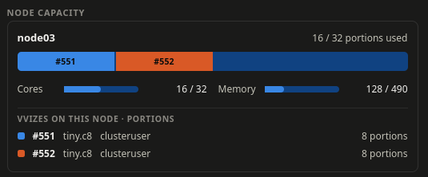

Where you can easily see how much space is being taken up.
This could also be given a time axis to show how much space is being taken up for a given time, showing users where they might be able to schedule their vvizes.

The main problem with this approach is that there is no real correlation between how many cores a user might want for their vviz with how much memory they need.
One flavour of vviz might only require one core and lots of memory, whereas a more processing heavy flavour might need more cores.
This means that two vvizes, each taking up 8 “portions” could combine to only take up 10 “portions” of cluster space.
The solution to this would either be to standardise the ratio of cores to memory in all flavours, which takes away from the idea that different users need different things, or to accept that a lot of cluster resources would be unusable.
Abstracting computing power into a single scalar was always going to waste some resources like this, but I think that this is too much.

I removed all the references to portions, and instead replaced them with a less abstracted, but more intuitive method for getting this information, by just having the vvizes and nodes return the actual values for their resource amount.

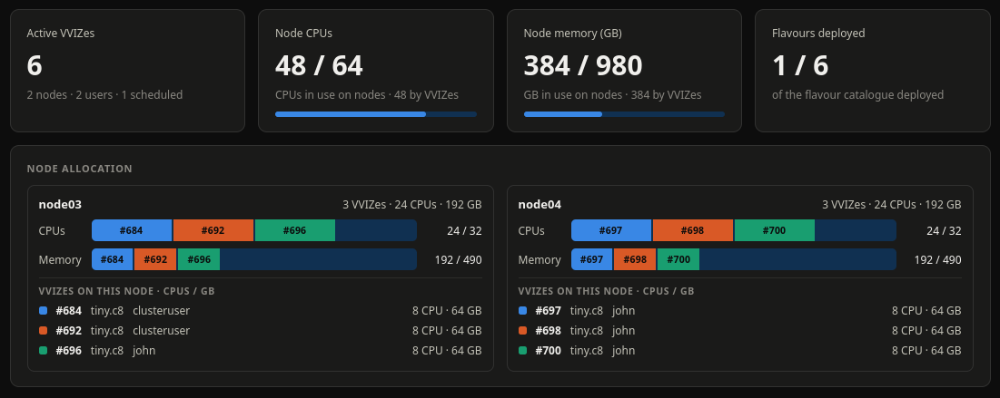

##### Scheduling

The next thing I decided to try was using the api as a way to add scheduling information into the slurm commands that ran the vvizes.
This would involve stripping away some of the scheduling responsibility from slurm, and instead managing at the API level instead.
Slurm supports an option for “--begin” which tells slurm when to start trying to run the job, as well as a “--time” flag that tells slurm how long the job can run for, so I was able to submit vviz jobs that would run within a set window.
The “--begin” option only determines when slurm will start trying to run that job, not actually when it will start.
This means that the API will have to ensure that jobs end when they are supposed to, and that a job scheduled earlier can’t push an already scheduled job later.

###### Slurm’s Reservation System

Slurm does actually include a reservation system that allows users to reserve a certain number of cores, or even a full node, and then submit that job to the reservation.
There are a few issues with this, however.
Firstly, while you can reserve cores, you can’t reserve memory, so resource reservation might fall apart with few high-memory vvizes running.
Also, while reservations can manage start times, if a vviz is running and the reservation ends, the vviz won’t stop.
Reservations are also more complex to work with, as getting information about a vviz won’t necessarily get information about the reservation it’s in, requiring an additional information request to get the info about the reservation.
Reservations can also have multiple jobs assigned to them, which is just more complexity.
As both memory and end times would have to be managed by the api, adding in the extra layer of dealing with slurm reservations just seems like additional, unneeded complexity.
Managing core allocations also isn’t that complex, and can be handled in the same way as memory.

###### Manual Scheduling

Slurm itself stores the information about the start and run times of jobs, even if they aren’t running yet, and the resource information could be retrieved from the flavours.
Because of this, I was able to return resource usage over time from the GET /vviz endpoint, and format it like this.

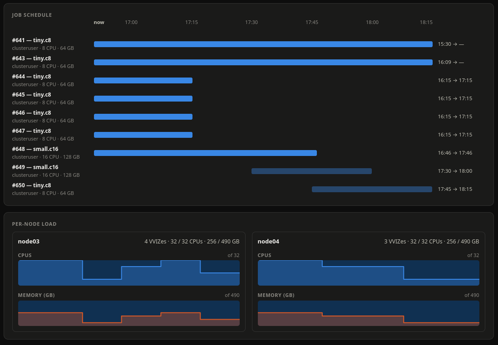

After this, I made the api calculate if a job would be able to run when submitted based on how many resources are available at that time.
If it couldn’t, rather than let slurm schedule it after, I decided to make it return a conflict error.
I decided to make the api be the arbiter of when things run, as it makes predicting when jobs can run that much easier.
I also made an endpoint that will tell the user if a vviz will be able to run, and which nodes can take it.

I was able to represent this information like this:

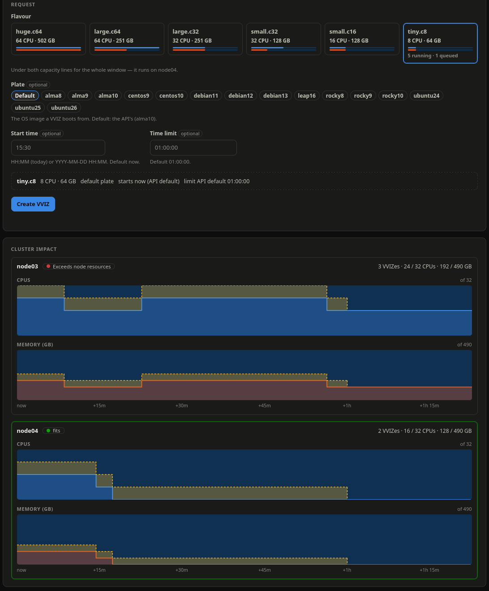

Overall, manual scheduling works well.
The main issue with it is that all the jobs need to be submitted through the api, as otherwise, jobs could skip the validation process, and push other jobs later in the queue.
The viability of this approach will depend on if the api is the only access point to creating the vvizes, or if there will be other ways that do not adhere to the scheduling.

##### Next Steps

There is some more scheduling logic I’d like to try and create.
At the moment, the user has to look at the graphs of resource usage and decide for themselves when they would like to book the vviz for.
One thing that could be useful is a way of asking the api to schedule the vviz itself.
Users could provide restrictions about when they want it, and maybe even provide a range of flavours to use with different priorities so the api could return which flavours could fit at the requested times.
Getting flavours could also show when the flavour can next be requested, on which node, and for how long.

I also want to experiment with taking the scheduling logic out of the api.
The idea here is that if other methods of interacting with the vviz scripts is required, then users wouldn’t have to go through the api in order to use the scheduling functionality.
Other systems, such as a cli tool or a TUI, could then interact with it, and keep the same scheduling logic.

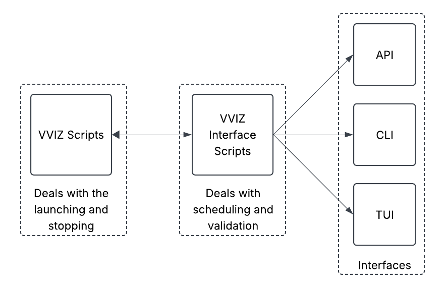

## Frontend

This week I worked on improving the web terminal experience.
I was particularly interested in how AWS and other cloud providers allow access to web terminals for their users through the browser.
After some research and discussions with Alex, a solution came to us of having an API, which ran on the cluster, generate an SSH key pair, append the public key to the authorized_keys file in the .ssh folder, and then used the private key to create a connection from the server to the user via a websocket.
The private key would not be sent to the browser or saved to disk but would just exist temporarily in memory and then be discarded.
I created an API with a get /terminal request that opened up a websocket and this approach worked.
After this, Alex incorporated this into his own API and improved it by making it work for different users and jumping into the hostname.

I also worked on adding more information to the users about what they would like in their virtual computer.
This included choices on operating systems, software packages and time duration.
Using Oscar’s API I was also able to let the user know when their job was expected to run and made more UI/UX improvements to the web portal.

I also added authentication gates on the frontend to allow the website to be compatible with Alex’s API.

Aside from this, I improved the look of the website by creating a starry galaxy sky with a moose-antlers constellation to reinforce the Alces brand.
In week 3 I am focusing on getting the portal ready for a comprehensive demo and improving the UI as and where necessary.
I am also adding in additional features to fully demonstrate the APIs that have been created for this project.

## Monitoring

After the first week of R&D I realised that making a monitoring agent on each vviz would be relatively redundant due to being able to find all the information I needed using libvirt commands on the login node.
So I decided to make a monitoring script which runs every 20 seconds and stores the information in a database.
This database stores information such as the jobId cpu percentage used memory percentage and memory used in GB.
Also stores the slurm job id vm name node and the vcpus.

The process is to first get the vviz jobs running to work out which nodes they are on.
Then depending on what nodes they are on it will ssh into those nodes and get info about the vviz jobs on that node and so on.
Then once it has all finished it will wait 20 seconds then start again below is an example of the information it collects.

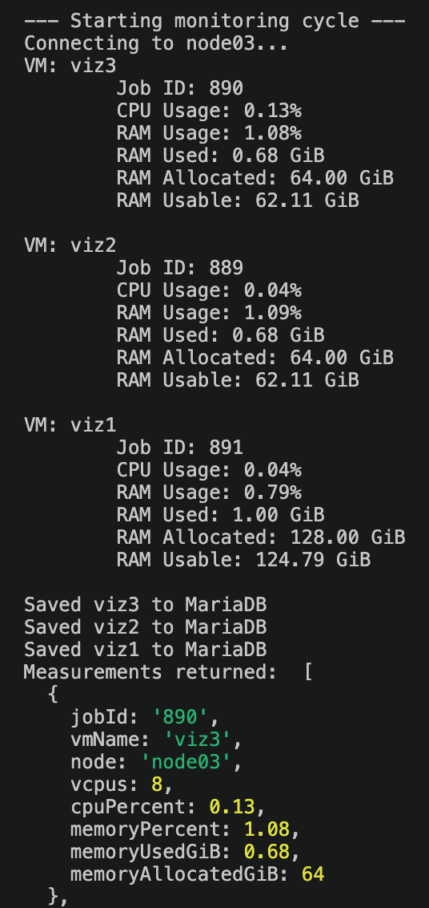

I put the database onto a vm and am currently storing the data from the monitoring script.
I then decided to start working on an api which can interact with the database which is what I started building the end of week 2 and am still finishing it up now in week 3.

# Week 3

## VVIZ Scripts

In week 3 further improvements were made to the core scripts, files relating to bringing the vviz’s up have been successfully merged into the prolog.sh file making overall maintenance and alterations to the start up process significantly easier.
Furthermore significant changes were made to the system to make it more easily parseable by the API, namely changing the os.allowed and seasonings.allowed files to JSON files.
This has allowed categorisation to be implemented into seasonings and families to be implemented into os’s allowing for easier expandability in the future on both the seasonings and JSON side.

Further improvements in week 3 included an output of a JSON file with all the information about a vviz when the vviz has finished it’s cloud init process, the JSON file contains: the job id, when it ends, the cancel command, the name of the vm, the hostname, the ip, the flavour, the os image, the hypervisor, the user, the user’s home directory, ssh information and VNC connection information.
All of this is provided to make it as easy as possible for API’s to get information about the vviz’s, the sbatch command also now takes in the users password as an argument as we also create the user who ran the sbatch command on the vviz so passing their password through makes this as seamless as possible to the user.

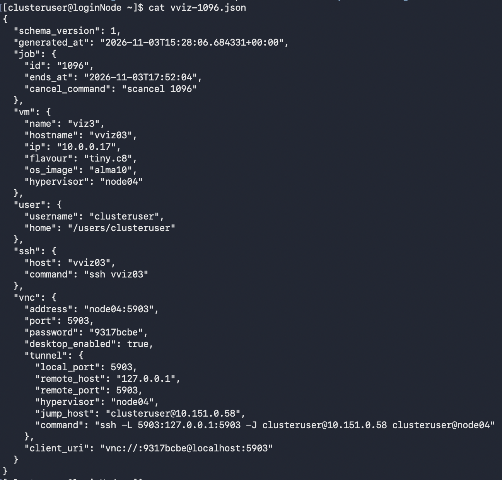

Significantly more seasonings were added to the system this week across several categories, several text editors were added, podman and docker were added, basic utilities like firefox, a pdf viewer and the libreoffice suite were included as well as developer tools like Jupyter and general build tools and scientific tools like Avogadro and IGV.

Research into how to pass GPUs into vviz nodes has revealed several results, given our current system it seems possible to pass GPUs in several different ways.
We can pass GPUs directly with a whole GPU going to one viz node via our vm creation scripts, we can also use Nvidia MIG and Nvidia vGPU Manager to split one gpu into multiple and then pass one of these slices into a vviz however this has disadvantages namely that Nvidia MIG only works on some Nvidia GPUs, furthermore Nvidia vGPU manager is required to properly split the GPUs and is licensed software.
Another approach to splitting one GPU into multiple is by making use of SR-IOV (Single Root I/O Virtualisation) this allows one PCIE device to appear as multiple giving multiple virtual machines access to the same hardware however a lot of GPUs do not support SR-IOV and SR-IOV with virt-install is incredibly prone to configuration errors.
Therefore the best way to share GPUs between multiple vviz nodes that I have found is to use slurm scheduling to share the resource and make use of gres sharding which would allow for multiple vviz jobs to share one gpu and would allow us to ask for however many shards of the gpu the vviz needs while the other approaches would mean assigning what the vviz vm would see as multiple GPUs if we needed more than one MIG/SR-IOV slice, furthermore it seems that gres sharding can be done with any GPU while MIG and SR-IOV are limited in the GPUs they can run on so in my opinion the best way to tackle splitting a GPU across multiple vviz nodes would be to make use of slurm and gres sharding.

Going into week 4 I plan to continue to develop the scripts into a fully fledged product, a main goal for the coming week is to make the scripts easier to setup and install as currently it is not documented very well and could be automated via a setup script, furthermore a basic management interface could be created as currently adding or removing vviz slots is performed through a script as well as continuing to add features and format changes request by people working on API’s to make it as easy to get information from the core scripts about the state of the vviz’s as possible.

## API

In Week 3 I worked on switching the web terminal from creating and storing SSH keys in the users authorised keys file to using a temporary certificate system instead which would then expire after 30 seconds to prevent the certificate from being used again.
This method also adds the benefit of not needing to be added to the users authorised keys as the certificate is created against a key that's already registered against the whole system this is good as it means there doesn't have to be lots of read and writes to a file preventing the issue of it becoming corrupted or overfilled with temporary keys.

I also worked on updating the API to implement filtering to some of the get endpoints, making it so it can read the new JSON files instead of the old txt files and making it so it can retrieve the new information about VNC connections into the VVIZ.

I also then worked on building a CLI tool for the cluster which allowed the users to login to the API and interact with the API to create, view and manage their VVIZes I built this using a system to store the users cookies into a session file which is stored in their home directory this allows them to stay logged in over multiple days.

Going into week 4 I will be working on adding more features to the CLI and improving its implementation, as well as keeping the API up to date with new changes and features being added to the VVIZ handler.

### Continuing

#### Oscar

##### Removing the Scheduling Logic out of the API

I didn’t get very far into removing the scheduling logic before realising that it wouldn’t be as helpful as I thought it would be.
What this would be, is a service that runs somewhere on the same network as the cluster, that could run slurm commands and find things out about the state of the vviz nodes.
This describes the api that I’ve made.
The only benefits I could find for making it a separate service is that it could be written in a more efficient language, like rust or go, and run as a daemon, meaning that any service could easily interact with it, without having to worry about the speed of network requests.
That is a minor issue in the grand scheme of things, however, so I felt my time would be better suited to other experiments.

##### Scheduling Improvements

The next thing I wanted to try was making some improvements to how scheduling was done.
One thing that I said at the start of making the scheduling api, was that the user could set a blacklist or whitelist for times that they would be ok with, and then they could be assigned the next available vviz that fit those conditions.
I originally thought that this would be something that would be done in a separate service, like a frontend, but I thought that it would make sense to move this logic to the backend, so that any service could use it.
I created two endpoints to this end.

Firstly, I created an endpoint to see if a vviz would fit in a given time.
This just used the already existing logic I had that would throw an error if a posted vviz wouldn’t fit in order to return what nodes the vviz could run on.

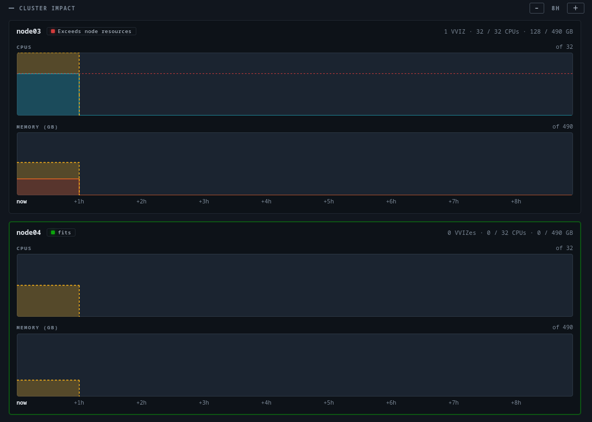

Secondly I created an endpoint that would get the next time that a vvizes with a specified config would be able to run.
The way I made it was inefficient, as it had to check each spot where a vviz could be slotted in and see if it would actually fit.
This involved getting all the scheduled vvizes, and seeing if a new vviz could be put in after it.
This proved that the concept worked, but even with small amounts of vvizes, the response times were exceeding 100ms, and I am sure that there is a more efficient way of doing this.
This could do with some further experimentation.

##### Updating a VVIZ

One other idea I had while testing the visualiser was that as slurm could update the time limit of existing jobs, users could patch vvizes to increase or decrease the length of their vviz.
This could also be useful to administrators if there is a priority vviz that needs to run, or another issue that requires resizing jobs.
One thing that I found while doing this, is that in slurm 26, users don’t have permission to edit the length of jobs, even their own one.
In a live system, this would have to be linked up with Alex’s account system so that the commands could be run as root after the proper authentication was done.
Apart from that, it was simple to add in a patch endpoint to the existing vvizes to allow users to change their size.

##### Other API Improvements

To keep up with the changes that Adam was making to the vviz scripts, and as I had some other ideas, I made some other changes and improvements to the api.
This included:

- The ability to sort by each of the fields when an user gets all vvizes
- Duplication checking on posting seasonings, as multiple of the same seasonings could be added to one vviz
- Custom output paths for the slurm messages so that they could be in a consistent place and not clogging up the home directory.
- Vnc connection info that was retrieved from a new file created by the vviz scripts

##### Slurmy Vvizy Stuff

One of the issues with this method of scheduling vvizes is that it relies on everyone creating the vvizes through the api, as someone could make a vviz with slurm and it would be put to the front of the queue, pushing all the queued vvizes back.
Users need to be able to submit jobs normally, but they also need to be able to submit vviz jobs only through the api.

I had the idea to make two login nodes, one normal one where users could submit jobs to the regular partition, and one restricted one, that didn’t have ssh access, and could only be connected to over http via the api.
This would mean that only the slurm jobs requested by the api could be run, and these would have to run through all the validation and queueing stuff.

To test this, I made a test cluster with the following specs:

|                   | login-01             | login-02             | node-01              | node-02              |
| ----------------- | -------------------- | -------------------- | -------------------- | -------------------- |
| User              | dev                  | dev                  | dev                  | dev                  |
| OS                | alma10               | alma10               | alma10               | alma10               |
| Internal IP       | 10.0.0.200           | 10.0.0.201           | 10.0.0.202           | 10.0.0.203           |
| External IP       | 10.151.0.42          | 10.151.0.44          | 10.151.0.165         | 10.151.0.125         |
| Local Hostname    | login-01.testcluster | login-02.testcluster | node-01.testcluster  | node-02.testcluster  |
| Internal Hostname | login-01.testcluster | login-01.testcluster | login-01.testcluster | login-01.testcluster |
| Password          | m00seh3ad!           | m00seh3ad!           | m00seh3ad!           | m00seh3ad!           |
| Role              | login + mgmnt        | login                | compute              | compute              |
| Partition         | n/a                  | n/a                  | nodes                | vviz                 |

The openflight shared key is on the login node so it should be open to access.

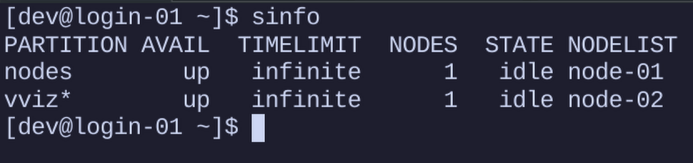

I was able to set the slurm partitions so that vviz would only accept jobs from login-02 and nodes would only accept jobs from login-01.

##### Next Steps

I want to do more configuration with the extra node to see if I can fully disconnect it from the other nodes to prevent ssh access to it except from an admin account.
I’d also like to see if I could put another login node on the test cluster that we’re using and run the api on that.

## Frontend

This week I was focusing on incorporating several new features of the api such as introducing software packages and separating both software and operating systems into categories.
The virtual nodes also support desktop sessions so that became an additional step in the setup wizard and also included an additional connection method.
Currently the virtual desktop connection simply opens a vnc connection with the username and password supplied by the api.
It connects to the virtual node through a proxy jump at the moment but this will change when each node has their own distinct IP address.

I am also happy with the current setup wizard for creating a virtual node after having added more software packages, breaking OS and software packages into categories and introducing configuring virtual desktop sessions.

The wizard steps:

1. Flavour

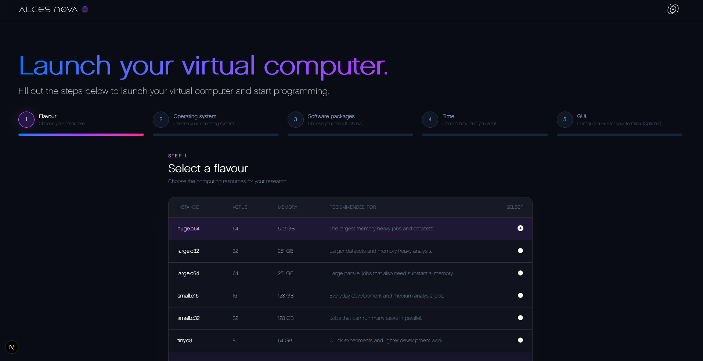

2. Operating system

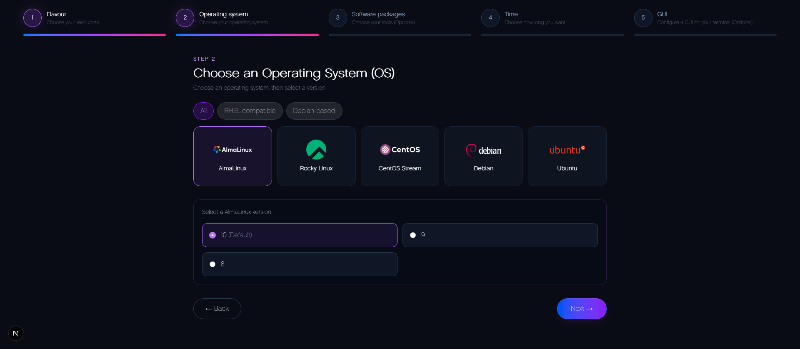

3. Software packages

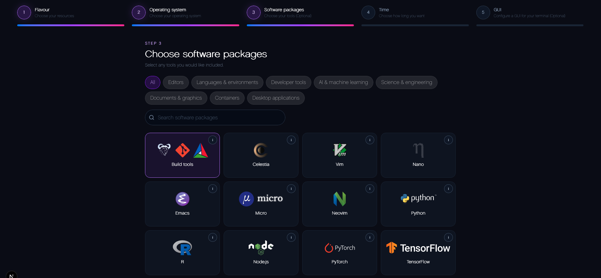

4. Time limit

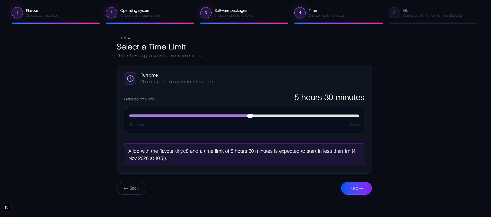

5. Graphical User Interface

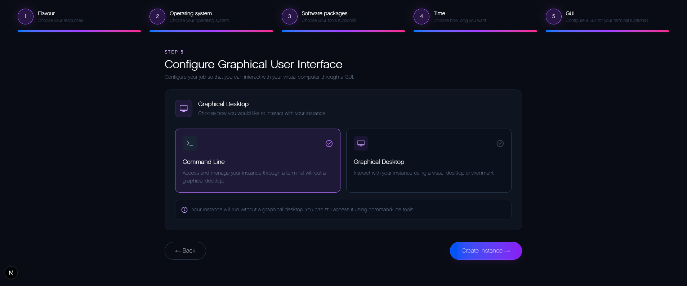

I have also been further experimenting with the design of the site, creating the landing page to be a night scene in the desert with the Alces constellation in the night sky.

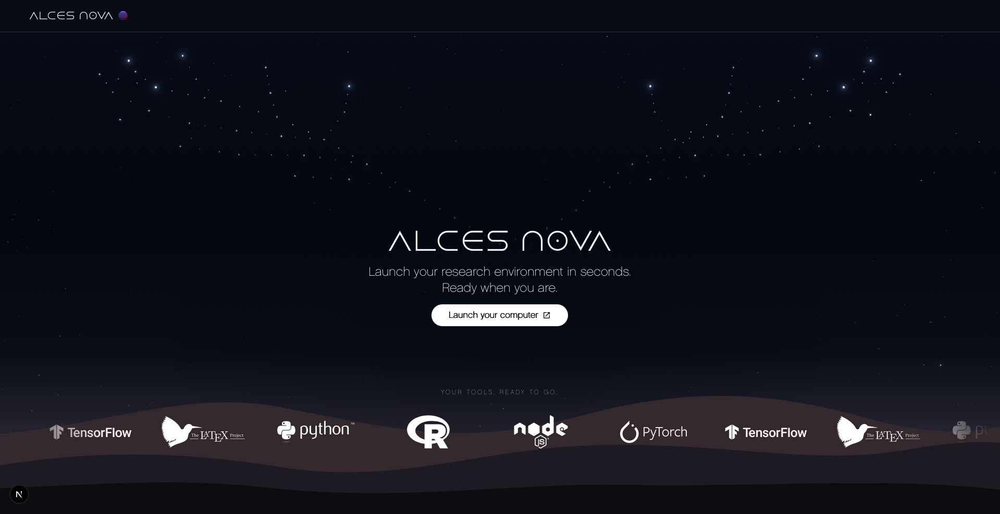

This week I’m planning to finalise the frontend flow, ensuring consistent styling across the whole site.
I will also look at incorporating Oscar’s timetable into my own frontend.

## Monitoring

This week I decided to make an API using hono.
This api was going to be something that could interface the database that was put on a VM last week.
As the database is updated dependent on what vvizes are doing and how many there are, the api cannot alter what's in the database it is just used to get information out of the database.

It only has endpoints and an image for them is below.

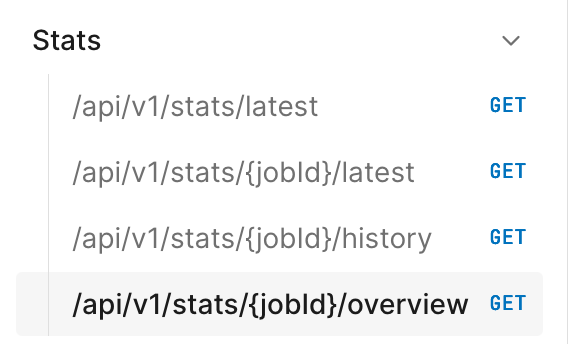

Initially I made the API how I would make it in university which isn’t the best practice.
So after I made the API I looked at Alex’s api skeleton then tried to reformat my api to match something similar to that.
This meant the code became much cleaner and in the future I will definitely just use that repo as a base then build off that.

The history endpoints show the full history of a specified viz by the slurmid, also the overview endpoint shows the average cpu percent memory percent and memory used within a specified time frame.

I’d say the majority of the time I spent this week was looking at how Oscar and Alex built their API’s and understanding why they did it that way.
I definitely feel more comfortable doing backend work from me making this basic api using hono.
The API is currently on a vm and if you would like to have a look at the docs here is the link. http://10.151.0.109:8081/api/v1/docs#description/introduction

Also I spent the Friday messing around with a frontend solution while fixing up little bugs with the frontend.
The frontend was heavily AI as I wanted to focus more on the monitoring systems and other ideas.
I just wanted to spend a bit of time on a frontend so I could showcase the API a bit better.
Below are some screenshots.

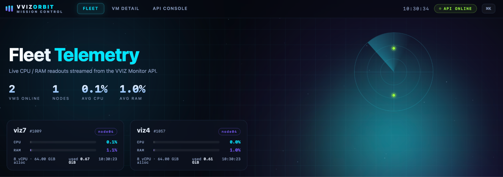
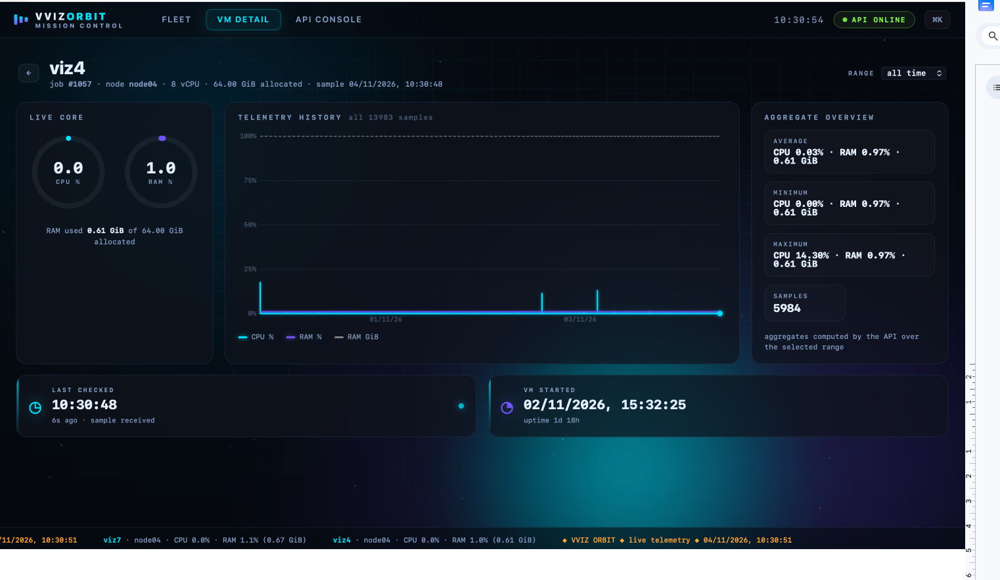

For the following week I was going to focus on fixing the site as it was heavily vibecoded there was a few bugs and then I'm going to mess around with a viz cli tool which may be able to find more information about the vizes need to do some research as well, seeing if its worth me spending time doing.

# Week 4

## API

In week 4 I worked on implementing the new features brought into the VVIZ into the API so that they can be brought into the frontend, this also came with more improvements to filtering on get endpoints allowing for more ways to filter returned data.
I also worked on improving the CLI to handle the new features I added to the API as well as improving its handling of logging in users.

As well as this I also worked on taking parts of my most recent API and implementing them into an API skeleton i’ve made to help with creating APIs in the future, some of the things i’ve taken is a new error handler for the API as well as streamlining other parts of the skeleton to make it easier to work with and more lightweight making it easy to work with and build on top of.

Github links:

[api skeleton](https://github.com/acegoal07/Hono-API-Skeleton)
[vem2 cli](https://gitlab.dmz.alces.network/dev/vem2-cli)
[vem2 api](https://gitlab.dmz.alces.network/dev/vem2-api)

### Continuing

#### Oscar

##### Slurmy Vvizy Stuff

I was able to use the slurm config and munge key on the existing cluster, as well as the built slurm rpms, to add another login node in with the same configuration as the first login node, just without being a slurm controller.
It shouldn’t really be called a login node, as I disabled ssh access to it except for a dev account.
It’s really just an http access point to the vviz scripts.
I was also able to get my api running on this node, and Alex was able to get his api running as a service so that it didn’t need to be run as a user.
It was very simple to add the APIs onto the node, as they could be configured to use any path for the vviz scripts and outputs.
This means that the gateway node could sit completely separate from the rest of the cluster, including the vviz scripts, but still run the jobs.
The entire api could be packaged into a vm or container that sits entirely separate from the rest of the cluster.

I also had a look at other slurm config options that could be relevant.

‘SchedulerType’ determines how slurm schedules jobs.
By default, it comes with builtin and backfill, which both deal with priority slightly differently.
In theory, it would be possible to write a custom scheduler in c that would deal with ensuring that there are sufficient resources before scheduling a job at a certain time, but this would conflict with the normal usage of slurm on the other partitions.
A custom scheduler could run different logic for the normal partitions as well as the vviz partitions, however.
This does raise the question of if the vviz nodes and normal compute nodes even have to be within the same logical cluster, as the scheduling requires that the nodes hosting the vviz sessions are only used for that and nothing else.

‘PreemptMode’

##### Partition Config

For this type of setup, where the api is acting as the only route to run the vviz jobs, I think the partitions should be configured as follows.

Nodes that run vviz jobs should be in their own partition with a distinct name.
This will make it both easier to get specifically vviz jobs from slurm, as well as making it possible to configure the partition specifically for those jobs.

If specific nodes need to be configured to only allow certain users to run jobs on them, this should be done at the node level, and not with another partition.
This is to ensure that all vviz jobs are run on the same partition.
Restrictions like this can be applied to ranges of nodes, same as assigning partitions to them.

The vviz partition should be configured to only allow submissions from the gateway node using the ‘AllocNodes=’ config option on the partition.

One of the main parts of config that is needed is a controller user that has root access that a typical user can’t connect to.
This is so this user can run the slurm jobs as any user while still managing the permissions of all the files.

Another bit of config that is needed is that the flavours need to be accessible by a standard user.
I solved this by putting the flavour scripts in /etc, but it would probably make more sense to put them in /usr/share/vviz or something similar, as they can be edited, and new ones can be added.

##### FiFo Slurm Configuration

Doing some research into different slurm configurations has shown me that there might be a way to configure slurm to use a First in / First out configuration for queuing, which, combined with preemption, would mean that jobs that were scheduled earlier would always have priority over those scheduled later, meaning that they could be queued without worry of an earlier job pushing it back.

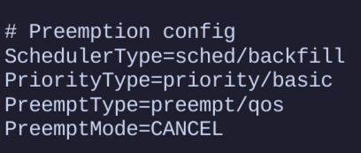

One key part of this is that this is a cluster-wide configuration, meaning that a custom priority plugin would have to be made that handles priority one way for most partitions, but does it a different way for the vviz partition.

## Monitoring

This week I spent fixing my API and altering my website so it works a bit better.
I also started making like a doctor cli which could try to diagnose issues with vvizes if there was one.
So you would run the command ./bin/dev.js doc vviz1 and it would check the viz is in the squeue and that you can ssh into the node.
Then it would make sure you can get an ip address of that vm and some other stuff that you should be able to get with the vm.

In terms of the fixes for the site I made it more usable and less laggy with the radar.
Also, I noticed that the site wasn’t showing the full history just some so I fixed that issue it was just a frontend issue.

## CLI

For this week I was focusing on the CLI integration tools for the VVIZ to make setting up new vviz units easier, as well as providing for a linking tool for all of the other projects.
This has been constructed in Ruby and is designed to work on the login node.
It is able to read the current cluster state, and run slurm commands from a simple cluster based system as seen by the command list here allowing for creation, deletion and monitoring of VVIZ nodes as required.
Every single command here contains an output reporting in json format as needed to allow for API integration.

### How it reads cluster state

- squeue --me and the %k comment JSON that bin/launch.sh writes per job — this is the primary data source: flavour, OS, seasonings, gui, status all come from the comment, with ownership guarded by --me (plus a job-name prefix fallback that catches PENDING jobs, which have no comment yet).
- The flavour catalogue: the sbatch flavour scripts in /opt/vviz/flavours (parsed for cpus/memory/partition exactly as the API does), etc/os.allowed and etc/seasonings.json.
- The per-job connection-info JSON launch.sh writes to /opt/vviz/run/output/ — connect relays the ssh/vnc commands it already contains rather than re-deriving them, so launch-script changes need no CLI change.

In action (creating a new vviz, checking status, connecting, and killing).
VVIZ create requires the flavour, then status can be used to track where the current role is.

Connect gives you the command action, not actually running the connect.

Killing ends the process

# Week 5

## API

### Continuing

#### Oscar

##### FiFo Slurm Configuration

Having done some further research into this type of configuration, I have learned that it doesn’t do what I expect it to do, and would need the external controller to be attached anyway in order for this to work.
Because of this, I think it makes sense to let the api handle everything to do with timetabling and reservations, and just let slurm manage the resource allocation.
This means that the standard configurations for slurm can be used, without having to make any custom slurm plugins.
Slurm isn’t designed for this type of timetabling, so it doesn’t make sense to try and force it to.
The best course of action is just to restrict what applications can submit vviz jobs, and let those applications handle the scheduling.

# What we learnt

The slurm REST api vs running slurm commands directly was one of the first decisions, and the commands won out as the REST api isn't installed by default on slurm so there may be clusters without it, and mimicking the logged in user through it gets complicated.
That does mean a fair amount of parsing though as slurm's output is written for humans rather than computers, and it also means being very restrictive with what commands the api can run, as an RCE exploit would be very dangerous on anything web facing attached to a HPC.
The timetabling went the same way, with slurm not being designed for that type of scheduling, so the api owns the timetabling and reservations and slurm is left to plain resource allocation on its standard configuration, rather than forcing it with custom scheduler plugins.

Putting everything somewhere machine readable made the rest a lot easier.
With the job attributes in the slurm job comments, the os and seasoning lists as json instead of txt and the connection information written out at cloud init, nothing had to scrape slurm output to work out what a vviz is, and the api, the frontend and the cli all read from the same places.
That's also why every cli command outputs json, so the other projects can consume it.

On auth, PAM against the linux accounts with a JWT in a http only cookie worked well, and generating the signing secret on boot and keeping it in memory means it can't be stolen out of a file, and rotating it is just a restart.
The web terminal went through a couple of approaches, first generating a key pair per connection and appending the public key to authorized_keys, then swapping that for a certificate expiring after 30 seconds signed against a key already registered on the system, so there's no risk of the keys file filling up with temporary keys or getting corrupted from all the reads and writes.

The vviz scripts showed how much linux distributions differ as they all use different syntax for installing software, so a seasoning has to be made to work across every os, and openfoam ended up going through apptainer since a lot of distributions simply had no packages for it.
Merging everything into the one prolog.sh file also showed how much easier a single central file is to work with than the same logic spread across multiple.

For gpus, splitting them through slurm gres sharding made more sense than MIG, vGPU Manager or SR-IOV, as gres sharding can be done with any gpu and a vviz can ask for however many shards it needs, where those are limited to particular gpus or need licensed software.

The monitoring agent turned out to be solving a problem that was never a problem, as everything we needed was already available from libvirt on the login node, so one script sshing into the nodes every 20 seconds and storing it in a database, with a read only api on top, covers it.
Though if we ever do need an agent, go would be the better choice over typescript, given how much smaller it ran and that it deploys as a single executable.

On the frontend, experimenting with AWS showed that a busy UI with no clear user flow is a real pain point, so keeping things clean and minimal is worth the effort.
Starting from a backend skeleton to begin with also beats tidying up a first attempt afterwards, which is what the api skeleton is there for.
