# Vem2

Vem2 is a collection of scripts and tools designed to manage VVIZes.
The bulk of it is the core vviz scripts that create and run the vms, with an api sat on top of those, and a few tools around the edges like the cli, the monitoring and the frontends.

## What is a VVIZ?

A VVIZ, or Virtual VI(Z)ulisation node, is a process managed by SLURM, that provides a virtual login node that users can access directly.
These nodes have some computing power behind them, and can be used as fully independant computers, without having to interact with the scheduler or other nodes.
The advantage of this is that users with less familiarity with HPCs and their workflows can still access the power of a compute node, and can run jobs and processes like they would on any other computer.
They can be scheduled at any future time, and safeguards are in place to ensure that the VVIZ only runs if there is sufficient resources at that time to satisfy it.

## How are they created?

The VVIZes are created and managed through slurm, using the scheduler to allocate resources and manage uptime.
Slurm runs a flavour file on one of the hypervisor nodes, and then that node creates a vm using virsh with all the specifics set in the flavour file, and any other flags or environment variables used.
Examples of configuration include:

- The OS of the vm
- If the vm will have a GUI
- If the vm can have additional users
- The flavour of the vm
- Any packages that come preinstalled on the vm

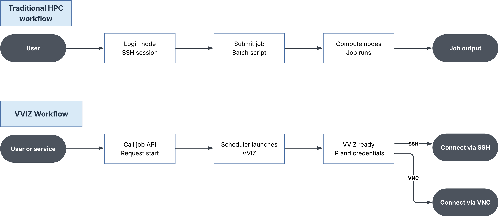

## The vviz scripts

The vviz scripts are the part of vem2 that slurm actually runs on the hypervisor to generate and set up a vm.
Everything involved in bringing a vviz up is centralised into the one prolog.sh file, so the generate and setup logic all lives in one place, which makes changes to the startup process much easier to make.

### slots/licences

Viz node slots are configured on the hypervisors ahead of time rather than being created per job.
newNode.sh is the script for adding a new slot: it edits the existing files programmatically, configures the new node with slurm and sorts out its connection to the nfs mount, and it can delete slots again as well.
The number of licences in slurm.conf gets edited by the same script, as that needs to go up and down as slots are added and removed.

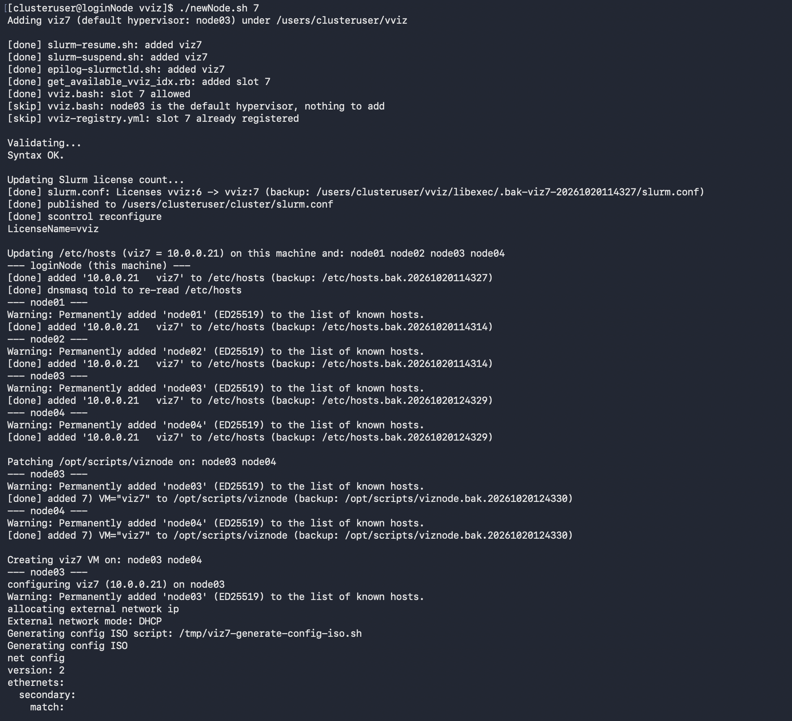

### vm management

When a vviz stops, the vm is killed outright rather than being shut down nicely, so all the files in its root directory are lost and nothing is left hanging around between sessions, which is how a vviz is meant to behave.
Nearly everything about a vviz is written down somewhere machine readable: the attributes of the job are kept in the slurm job's comments as json, and once the vm has finished its cloud init a json file is written out with the job id, when it ends, the cancel command, the vm name, hostname, ip, flavour, os image, hypervisor, user, home directory and the ssh and vnc connection information.
All of this is there so anything that wants to talk to the vizes (mostly the api) doesn't have to scrape slurm output to work out what a given vviz is.
The user who submitted the job is also created on the vviz, with their password passed through at submit time, so they can log into it straight away.
Since the vvizes only live on the internal network with the login node acting as a router, vnc connections have to go through an ssh tunnel to reach them.

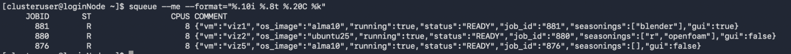
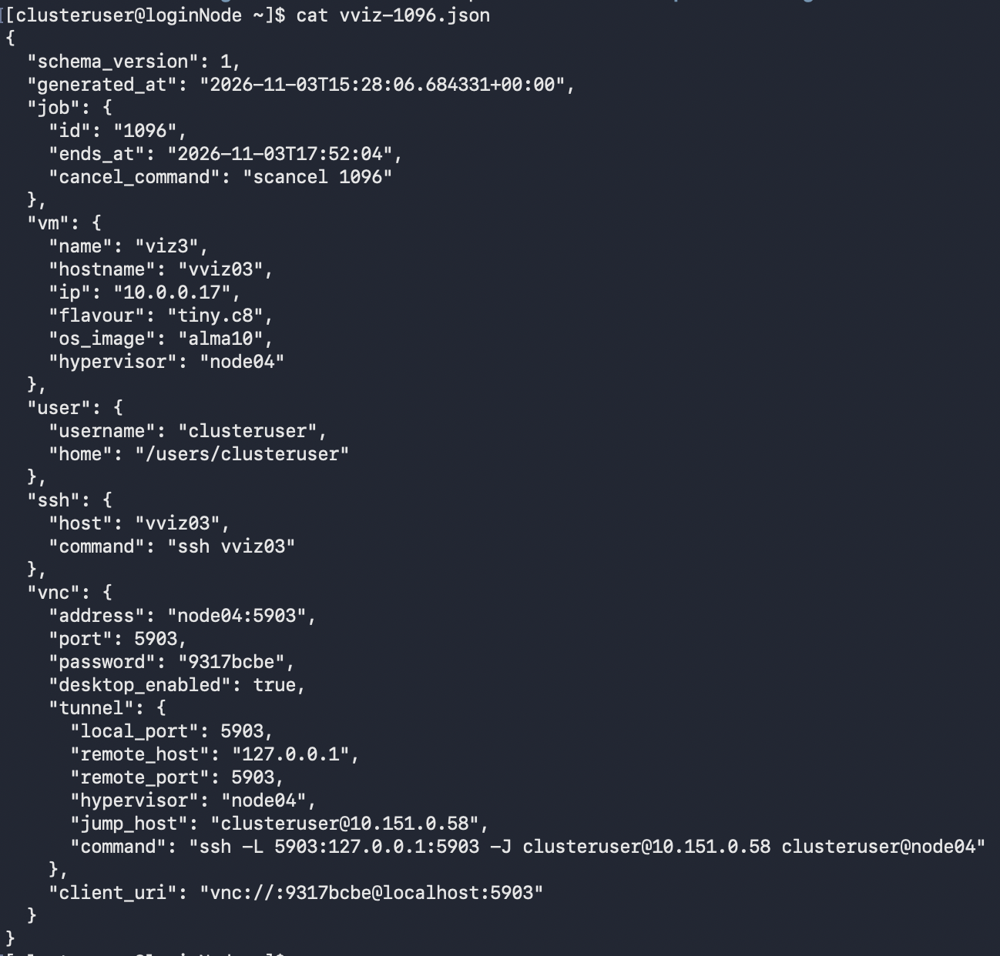

### flavours

A flavour is just an sbatch script describing what the vm gets, so the list of flavours and their core counts and memory can be read straight out of those scripts rather than being kept in a separate list that would drift out of date.

### packages

Extra software on a vviz is handled through seasonings, which the user asks for as part of the vm and which get installed while the vm is booting, so by the time the job is ready the software is already there.
Because vvizes support multiple operating systems and every distro installs software its own way, a seasoning has to work across every operating system it supports.
openfoam goes through apptainer for that reason, since some distros have no packages for it at all, and once it runs through apptainer it works on all of the operating systems tested so far.
The rest covers a spread of things: several text editors, podman and docker, firefox and the libreoffice suite, jupyter, general build tools and scientific tools like avogadro and IGV.
Which seasonings and operating systems are available is kept in JSON files (seasonings.allowed and os.allowed), with the seasonings grouped into categories and the operating systems into families, which makes both easier to expand and much easier for the api to present.

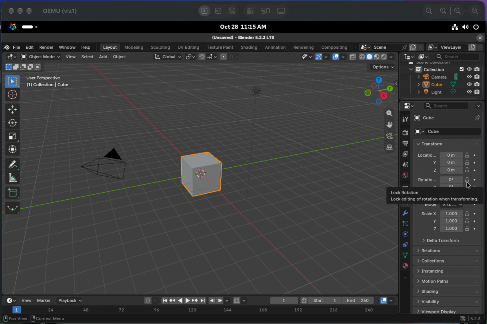
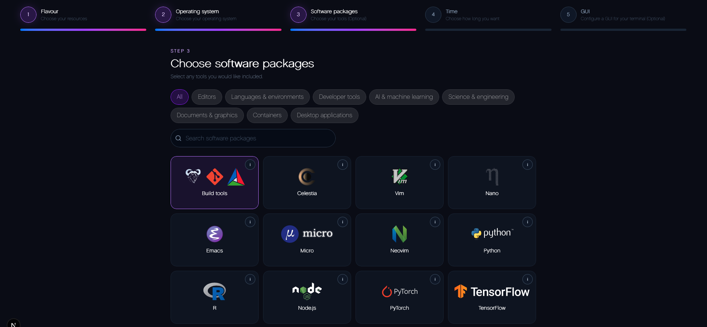
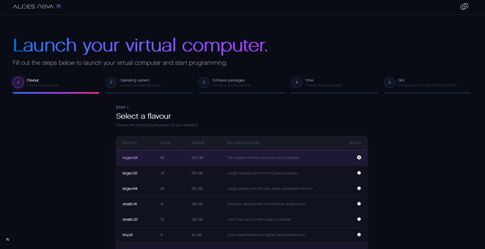
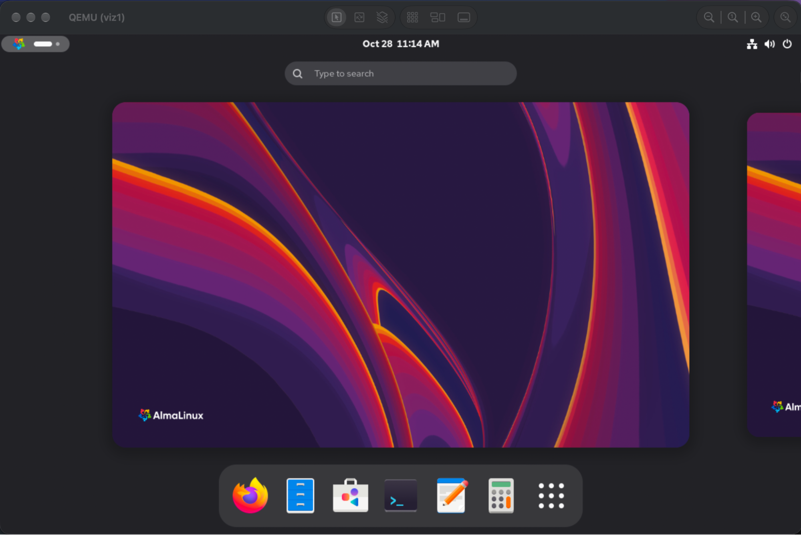

### gpus

GPUs can be handed to vvizes, with a whole GPU going straight through to a single vviz when the vm is created.
Sharing one GPU between several vvizes is done with slurm's gres sharding rather than the hardware, since it works with any GPU and lets each vviz ask for however many shards it needs, where the hardware level routes (Nvidia MIG, vGPU Manager, SR-IOV) are all tied to particular cards or a licence.

## The api

The api is written in hono and sits on the login node, managing vizes by running slurm commands directly and turning what comes back into json for the endpoints.
It only runs a deliberate, restricted set of commands, since a web interface that can run commands on a cluster is exactly what an RCE would be after, and nothing arbitrary is allowed through.
A fair share of its job is parsing, as slurm's output is written for humans rather than computers.
Slurm also has a REST api that hands over json directly, but it isn't installed everywhere, and running everything as the logged in user (which the auth depends on) gets complicated through it, so it goes through the commands instead.
The endpoints cover the obvious things, listing the available flavours, spinning up a vviz and cancelling one, with a check in front of scancel that the job exists and is actually a viz job, since scancel only complains about a bad id through stderr.

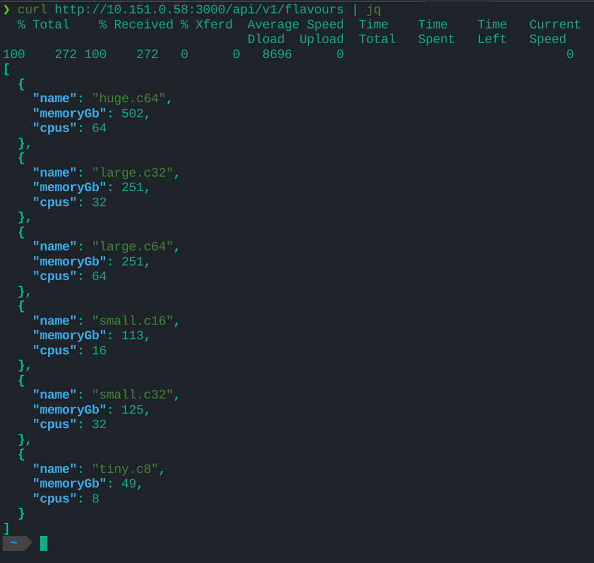
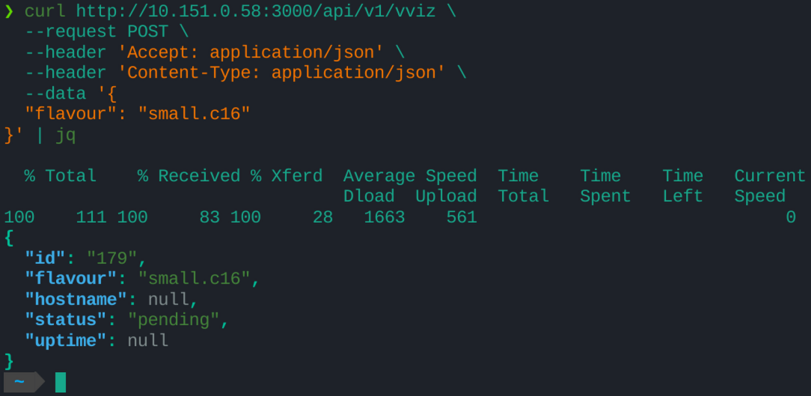
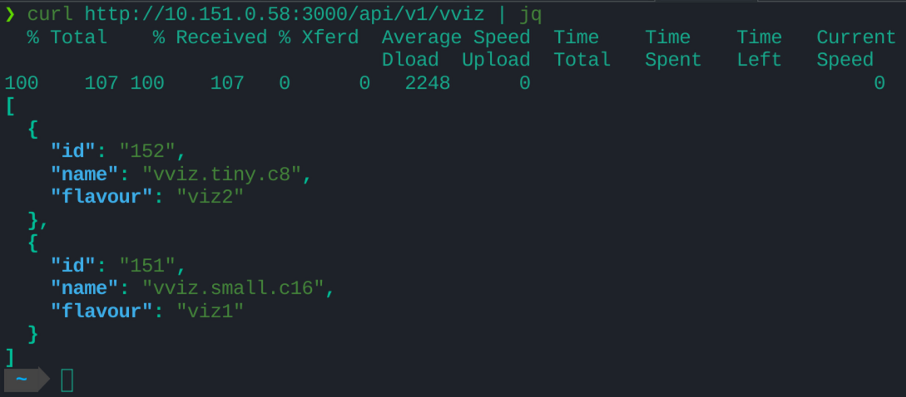

### scheduling

vvizes are scheduled by slurm like any other job, and the api can report when a job is expected to start, which lets a frontend actually tell the user.
Slot booking is also in the works so a user can be sure of when their session is going to start, along with describing a job by when it should end rather than how long it should run.

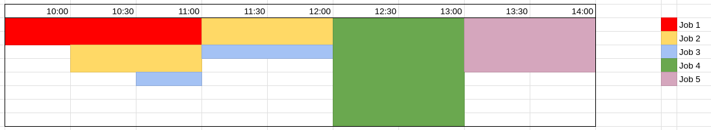

### auth

Users log in with their normal linux credentials, which are checked through PAM, and are then given a JWT stored in an http only cookie, so the token never has to be handled by the frontend.
The secret used to sign the JWTs is generated when the api boots and only lives in memory, so it can't be pinched out of a file anywhere, and rotating it is just a restart.
Auth and CSRF are applied as middleware, so every new endpoint gets them automatically unless it specifically says it doesn't need them.
Once logged in, all of a user's jobs are submitted under their own linux account, and can only be cancelled by that account.
The login endpoint is rate limited and timed out as well, so it can't be spammed and the PAM authentication overwhelmed.

### integrating with the vviz scripts

The api reads from the same places the scripts write to: the JSON config files rather than the old txt ones, the attributes in the job comments, the json written out at cloud init and the vnc connection information, and its get endpoints can be filtered so a frontend only pulls back what it needs.
The web terminal lives here too, where the user ssh's through the api and lands in the vviz as their own account.
The connection is opened with a short lived ssh certificate which expires after 30 seconds and is signed against a key already registered on the system, so nothing is written into authorised_keys per connection and the file can't fill up with temporary keys.

## Other tools

### monitoring tools

Monitoring is a script that runs on the login node every 20 seconds: it works out which nodes the vviz jobs are running on, ssh's into those, and writes the cpu percent, memory percent, memory used, job id, vm name, node and vcpus of each vviz into a database kept on a vm of its own.
A small read only api sits on top of that database, which can't alter what's in it by design since the script owns the writes, and serves the full history of a given viz along with averages of cpu, memory and memory used over a given time frame.
Nothing has to be installed on the vvizes themselves for any of it, as all of the information is already available from libvirt on the hypervisor.

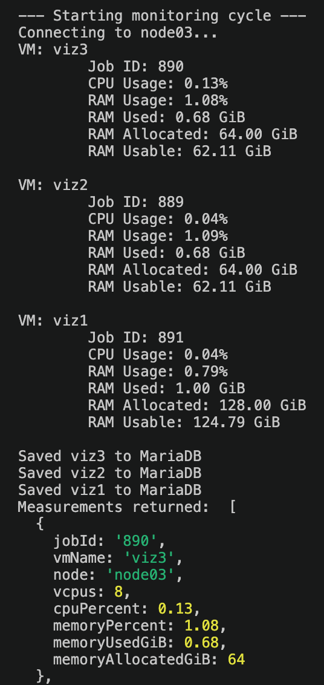
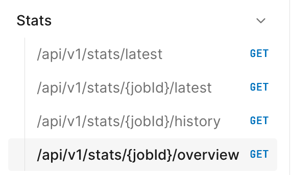

### cli

The cli gives users a terminal way of doing what the site does, and acts as the linking tool for the other projects, since every command reports its output as json for the api or anything else to consume.
Users log into the api through it, with their session kept in a file in their home directory so they stay logged in across days rather than logging back in every time.
It is written in Ruby and designed to live on the login node, where it can read the cluster state for itself: squeue --me and the comment json that bin/launch.sh writes per job are the main source, giving the flavour, os, seasonings, gui and status of each viz, with a fallback on the job name catching pending jobs which don't have a comment yet.
The flavour scripts in /opt/vviz/flavours are parsed for their cpus, memory and partition exactly the way the api does it, and os.allowed and seasonings.json fill in the catalogue.
Connection information isn't re-derived either; launch.sh writes a per job json out to /opt/vviz/run/output/, so connect just relays the ssh and vnc commands it finds in there, which means launch script changes don't need a matching cli change.
The command list is short, create (which needs a flavour), status to track where a vviz is up to, connect, and kill to end the process, with connect deliberately handing you the command to run rather than making the connection itself.
There is also a doctor command for when a vviz isn't behaving, which goes through the things that should be true of a working one, that the job is in squeue, that its node can be ssh'd into, that the vm has an ip address and so on, and reports which of them aren't.

### frontend

There are two frontends. The main one is AlcesNova, a proper portal which takes the user through a wizard of flavour, operating system, seasonings, time limit and whether they want a desktop session, then tracks the job and shows how to connect once it is running, with the expected start time pulled from the api so users know when their vviz will actually come up.

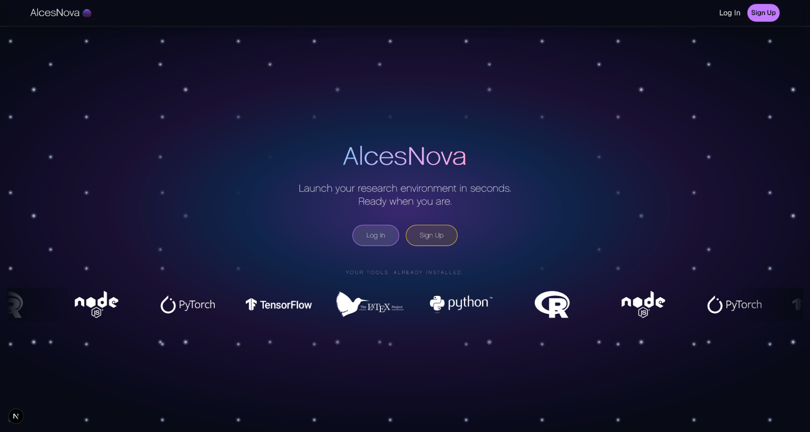

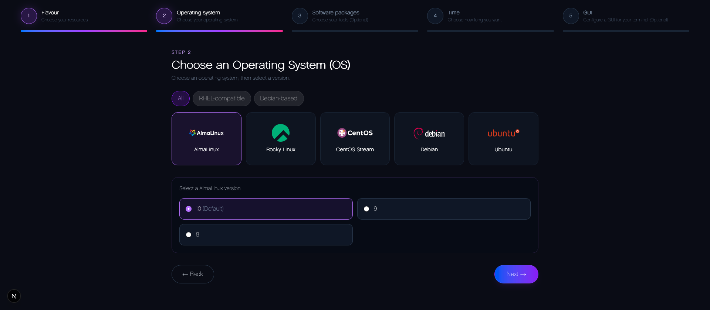

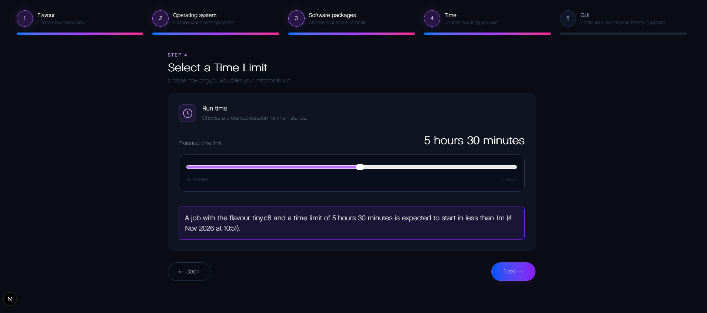
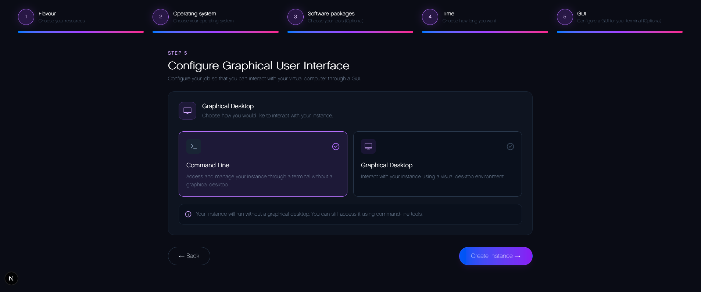

Connections are either a web terminal in the browser or vnc for the desktops, which for now hops through the login node as a proxy jump, with the connection details (login included) coming from the api.
Auth gates tie it into the api's login system.

There is also a demo frontend for the monitoring api, which shows the cpu and memory of the whole fleet at a glance along with the history of an individual viz, radar and all.

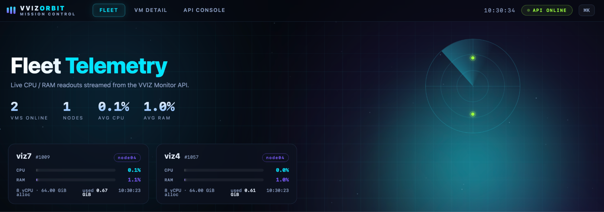
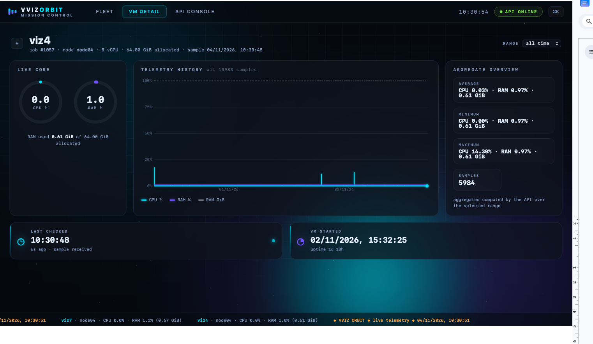
